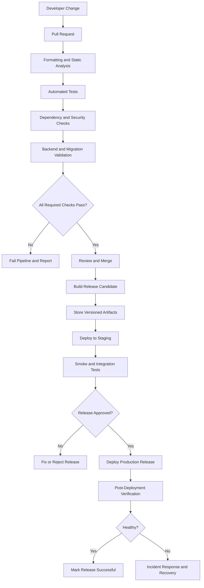

# Schedular App: CI/CD Standards and Deployment Pipeline

**File:** `CI_CD.md`  
**Project:** Schedular  
**Document Version:** 1.0  
**Status:** Proposed implementation standard  
**Primary Client:** Flutter  
**Target Platforms:** Android and iOS  
**Backend:** Defined by the approved TRD  
**Database:** Defined by `database-schema.md`  
**CI/CD Provider:** To be selected  
**Release Strategy:** Automated validation with controlled production releases

---

# 1. Purpose

This document defines the Continuous Integration and Continuous Delivery or Deployment standards for Schedular.

It establishes how code changes are validated, tested, built, packaged, and released across development, testing, staging, and production environments.

The objectives are to:

- Detect defects before they reach production.
- Maintain consistent build environments.
- Enforce code quality and security checks.
- Validate Flutter application changes automatically.
- Test backend and database changes before deployment.
- Protect production credentials and user data.
- Prevent unverified changes from reaching production.
- Make releases traceable and reproducible.
- Provide a controlled rollback and recovery process.
- Reduce manual deployment errors.

This document describes the required pipeline behavior. The final workflow files must be adapted to the actual repository, selected CI/CD provider, signing setup, and backend architecture.

# 2. Core Principles

All CI/CD implementations must follow these principles.

1. **Automated validation:** Every proposed code change must pass required checks before merging.
2. **Reproducibility:** Builds should use documented and controlled tool versions.
3. **Environment separation:** Development, staging, and production must not share unrestricted credentials or mutable resources.
4. **Least privilege:** CI jobs receive only the permissions they require.
5. **Secret protection:** Credentials must never be committed to source control or printed in logs.
6. **Traceability:** Releases must be linked to a specific source revision.
7. **Fail-fast behavior:** Required checks must stop the pipeline when they fail.
8. **Controlled production deployment:** Production releases must require the configured approval policy.
9. **Migration safety:** Database changes must be reviewed and deployed using versioned migrations.
10. **Honest reporting:** A successful build must not be treated as proof that every feature works correctly.
11. **Recovery readiness:** Deployment procedures must define how to respond to failures.
12. **Documentation consistency:** Pipeline changes must be documented and reviewed like application code.

# 3. Scope

This document covers:

- Source control and branch validation.
- Pull request checks.
- Dart formatting and static analysis.
- Flutter unit, widget, and integration tests.
- Backend tests.
- Database migration validation.
- Dependency and security scanning.
- Android builds.
- iOS builds.
- Build artifact management.
- Internal testing and beta releases.
- Staging deployments.
- Production releases.
- Database migration deployment.
- Environment configuration.
- Secret management.
- Release approvals.
- Rollback and recovery.
- Monitoring and pipeline maintenance.

# 4. CI/CD Terminology

| Term | Meaning |
|---|---|
| Continuous Integration (CI) | Automatically validating code changes |
| Continuous Delivery | Keeping changes in a releasable state |
| Continuous Deployment | Automatically releasing approved changes to production |
| Workflow | A sequence of automated CI/CD jobs |
| Job | A group of related pipeline steps |
| Runner | The machine or environment executing a job |
| Artifact | A build output or test report |
| Environment | A configured deployment target |
| Migration | A versioned database structure or data change |
| Release candidate | A build prepared for final verification |
| Rollback | Reverting to a known-good application or deployment state |
| Hotfix | A focused change addressing a production issue |

For Schedular, production deployment should remain controlled. Do not enable fully automatic production deployment unless the project owner explicitly approves that policy and the release safeguards are in place.

# 5. CI/CD Architecture

The pipeline must separate code validation, artifact creation, and deployment.



## 5.1 Separation of responsibilities

CI validates source code and produces trustworthy artifacts.

CD promotes approved artifacts to the relevant environment.

A production deployment must not bypass required tests merely because a developer can build the application locally.

# 6. Tooling Policy

The specific provider and version matrix must be confirmed before the pipeline is finalized.

| Area | Requirement |
|---|---|
| Mobile framework | Flutter |
| Language | Dart |
| Package management | Flutter and Dart package tooling |
| Static analysis | Dart analyzer and project lints |
| Formatting | `dart format` |
| Mobile tests | Flutter test tooling |
| Source control | Existing project Git repository |
| CI/CD runner | Selected CI provider |
| Android build | Gradle through Flutter tooling |
| iOS build | Xcode through Flutter tooling on macOS |
| Database migration | Approved backend-specific migration tooling |
| Artifact storage | Private CI artifact storage or approved distribution service |
| Secrets | CI secret store or approved secret manager |

Do not add another CI service or deployment platform without a documented reason.

# 7. Environment Strategy

Schedular must separate environments according to the actual deployment architecture.

## 7.1 Development

Purpose:

- Local development.
- Fast feedback.
- Debug builds.
- Developer-controlled test data.
- Feature implementation.

Rules:

- Never use production data as a default development dataset.
- Keep local configuration out of committed secret files.
- Use development-only credentials.
- Make debug logging safe for the data being processed.

## 7.2 Testing

Purpose:

- Automated backend tests.
- Integration tests.
- Database migration tests.
- Regression testing.
- Isolated test fixtures.

Rules:

- Use disposable or isolated test data where possible.
- Ensure tests do not affect production systems.
- Use deterministic test setup and cleanup.
- Do not depend on real user accounts or production push tokens.

## 7.3 Staging

Purpose:

- Validate release candidates.
- Test backend integration.
- Validate application configuration.
- Verify database migrations.
- Run smoke tests.
- Perform internal acceptance testing.

Rules:

- Keep staging credentials separate from production credentials.
- Use a staging backend and database when the architecture supports them.
- Do not send real customer notifications from test workflows.
- Restrict access to private staging artifacts and test data.
- Ensure staging behaves sufficiently like production to make test results useful.

## 7.4 Production

Purpose:

- Serve real users.
- Store authoritative user data.
- Deliver actual reminders and notifications.
- Execute approved production jobs.

Rules:

- Restrict deployment permissions.
- Require the configured production approval.
- Protect production secrets.
- Run release verification.
- Use backward-compatible database migrations wherever practical.
- Maintain a documented incident response and recovery procedure.

# 8. Git Branching Strategy

Use the repository's existing branching strategy if one is already established. Otherwise, the following is the proposed default.

## 8.1 Branches

| Branch | Purpose |
|---|---|
| `main` | Stable, reviewed code suitable for release |
| `feature/*` | New features |
| `fix/*` | Non-emergency bug fixes |
| `hotfix/*` | Urgent production corrections |
| `chore/*` | Maintenance and tooling changes |
| `release/*` | Optional release preparation |

Avoid creating long-lived branches without a specific maintenance requirement.

## 8.2 Branch protection

Protect `main` with the following requirements where supported:

- Pull request required.
- Required CI checks must pass.
- At least one qualified review for significant changes.
- No direct pushes by default.
- No force-pushes by default.
- No merging with unresolved required checks.
- Appropriate restrictions on branch protection changes.

Emergency exceptions must be documented and followed by the normal review and verification process.

## 8.3 Pull request requirements

Every pull request must include:

- A clear summary.
- The reason for the change.
- A description of the implementation.
- Relevant screenshots or recordings for UI changes when useful.
- Database migration details when applicable.
- Configuration changes when applicable.
- Tests added or updated.
- Known limitations.
- Any required documentation updates.

Do not merge a pull request that introduces unapproved product scope or violates `master_rules.md`.

# 9. Continuous Integration Pipeline

## 9.1 Trigger events

The CI workflow should run on:

- Pull requests targeting protected branches.
- Pushes to protected branches.
- Explicit manual runs where appropriate.
- Release tags or approved release branches.

Avoid triggering expensive deployment jobs for every unrelated branch update.

## 9.2 Required CI stages

The standard pipeline should include these stages when applicable:

1. Repository and toolchain setup.
2. Dependency resolution.
3. Formatting validation.
4. Static analysis.
5. Unit tests.
6. Widget tests.
7. Backend tests.
8. Database migration validation.
9. Dependency vulnerability scanning.
10. Secret scanning.
11. Build validation.
12. Test and build artifact publication.

The pipeline may split stages into parallel jobs, provided that required checks cannot be bypassed.

# 10. Flutter Validation

## 10.1 Dependency resolution

Run dependency resolution using the project's committed dependency lockfile.

Example:

```bash
flutter pub get
```

Rules:

- Commit `pubspec.lock` for the application.
- Do not silently regenerate dependency versions in CI.
- Review changes to `pubspec.yaml` and `pubspec.lock`.
- Verify package compatibility with the selected Flutter SDK.
- Avoid unapproved dependency upgrades.

If the lockfile is inconsistent with the package manifest, the pipeline must fail and require the issue to be corrected.

## 10.2 Formatting

Validate Dart formatting:

```bash
dart format --output=none --set-exit-if-changed .
```

The exact directory scope must exclude generated or external files where appropriate.

Formatting failures must be fixed before merge.

Do not use CI to silently rewrite developer changes without reporting the resulting modifications.

## 10.3 Static analysis

Run:

```bash
flutter analyze
```

The analyzer must use the committed analysis configuration.

Rules:

- Fix newly introduced errors.
- Review warnings.
- Avoid unnecessary suppressions.
- Require explicit justification for suppressions that hide important issues.
- Keep the analysis configuration versioned.
- Do not weaken analyzer rules merely to make a pipeline pass.

## 10.4 Unit and widget tests

Run:

```bash
flutter test
```

Tests must cover the applicable business logic and UI behavior.

Required areas include:

- Form validation.
- Schedule time calculations.
- Item state transitions.
- Error handling.
- Loading and empty states.
- Repository behavior.
- Recurrence logic, if supported.
- Reminder calculations, if supported.
- Authentication-related state transitions.

## 10.5 Integration tests

Run the project's approved integration test suite.

Example:

```bash
flutter test integration_test
```

This command is only appropriate if the project has a compatible integration test setup and the required device or simulator is available.

Integration tests should verify critical user journeys and interactions with the backend.

## 10.6 Coverage

Collect coverage when the test environment supports it:

```bash
flutter test --coverage
```

Coverage thresholds must be established based on actual project requirements.

Do not invent a universal coverage percentage and treat it as evidence of quality. Critical business logic and security behavior require meaningful tests even when aggregate coverage is high.

# 11. Backend and Database Validation

Backend checks depend on the selected platform.

## 11.1 Backend tests

Where applicable, run:

- Unit tests.
- API integration tests.
- Authentication and authorization tests.
- Input validation tests.
- Error response tests.
- Rate-limit tests.
- Background worker tests.
- Notification scheduling tests.
- Concurrency and idempotency tests.

Tests must use isolated credentials and data.

## 11.2 Database migration validation

Every database change must be represented by a reviewed, versioned migration.

The pipeline must validate, where supported:

1. Migration syntax.
2. Migration ordering.
3. Migration application to a clean test database.
4. Upgrade from a representative previous schema.
5. Relevant constraints and indexes.
6. Row-level security policies.
7. Rollback or forward-recovery expectations.
8. Compatibility with the deployed application.

If Supabase is selected, use the repository's approved Supabase migration workflow and CLI version.

Do not assume that a migration is safe merely because it applies successfully to an empty database.

## 11.3 Destructive migrations

Destructive changes require special review.

Examples:

- Dropping a column.
- Removing a table.
- Changing the meaning of an existing field.
- Converting data types.
- Renaming a column used by a deployed client.
- Changing ownership or authorization semantics.
- Deleting production records.

Prefer an expand-and-contract migration strategy:

1. Add the new schema in a backward-compatible way.
2. Deploy code that supports the transition.
3. Migrate or backfill data.
4. Verify the migrated data.
5. Remove the old schema only after dependent code is no longer using it.

Never run destructive production migrations automatically without the required review and approval.

# 12. Security Checks

Security checks should run automatically where appropriate.

## 12.1 Secret scanning

Detect accidental commits containing:

- API secrets.
- Service-role keys.
- Private signing keys.
- Keystores.
- Passwords.
- Access tokens.
- Refresh tokens.
- Database credentials.
- Production environment files.

If a secret is discovered:

1. Stop the release process.
2. Determine whether the secret is real and exposed.
3. Revoke or rotate the credential when necessary.
4. Remove the secret from the current source and affected artifacts.
5. Assess whether Git history or build logs require remediation.
6. Record the incident and prevention measures.

Deleting a secret from the latest commit does not invalidate a previously exposed credential.

## 12.2 Dependency scanning

- Scan dependencies for known vulnerabilities.
- Review high-risk transitive dependencies.
- Evaluate the severity and actual exposure.
- Update vulnerable dependencies through reviewed changes.
- Avoid unreviewed automated major-version upgrades.
- Document accepted risks with an owner and review date.

## 12.3 Mobile security

Review:

- Android manifest permissions.
- iOS usage descriptions and entitlements.
- Network security settings.
- Deep-link handling.
- Token storage.
- Debug-only code.
- Logging behavior.
- Release build configuration.
- Signing credentials.
- Embedded configuration.

Do not ship debug endpoints, test credentials, or development-only behavior in production builds.

## 12.4 Authorization verification

Where relevant, test that a user cannot access another user's:

- Schedule items.
- Categories.
- Reminders.
- Device registrations.
- Preferences.
- Profile data.
- Other protected records.

Security checks must validate the backend enforcement, not just the Flutter interface.

# 13. Build Reproducibility

The project should produce builds from a known source revision and controlled toolchain.

## 13.1 Version control

- Pin or document the Flutter SDK version.
- Pin the Java and Android toolchain versions where required.
- Pin the Xcode version used for iOS releases.
- Commit dependency lockfiles.
- Version the build scripts.
- Version the database migrations.
- Document required build variables.

Use the same approved toolchain versions across CI and release preparation where practical.

## 13.2 Build metadata

Every release artifact should be traceable to:

- Git commit SHA.
- Release version.
- Build number.
- Build environment.
- Flutter SDK version.
- Relevant build configuration.
- Pipeline run identifier.

Do not embed secrets in build metadata.

## 13.3 Artifact integrity

- Store release artifacts in approved private or distribution storage.
- Restrict access to signing-sensitive artifacts.
- Keep artifacts associated with the corresponding source revision.
- Use checksums or artifact verification where appropriate.
- Do not overwrite a released artifact with a different binary under the same release identifier.

# 14. Android Build Pipeline

## 14.1 Validation build

Use a debug or profile build for relevant validation jobs.

Example:

```bash
flutter build apk --debug
```

Use only where an Android build is needed for the relevant tests or validation.

## 14.2 Release build

Example:

```bash
flutter build appbundle --release
```

An Android App Bundle is the proposed Google Play distribution artifact.

The actual release configuration must use the project's approved signing setup and application ID.

## 14.3 Android signing

- Keep keystore files out of source control.
- Store signing passwords and key aliases in an approved secret store.
- Restrict access to release signing credentials.
- Inject credentials only into the required release job.
- Do not print credentials in logs.
- Ensure pull request workflows from untrusted forks cannot access signing secrets.
- Document key backup and rotation procedures.
- Verify the signing identity before publishing.

Do not generate a new production signing identity for every release.

## 14.4 Android release checks

Before distribution:

- Confirm the application ID.
- Confirm the version and build number.
- Confirm the release signing configuration.
- Confirm permissions.
- Confirm the backend environment.
- Confirm that debug behavior is disabled.
- Install and launch the artifact in an appropriate test environment.
- Run critical smoke tests where supported.

# 15. iOS Build Pipeline

iOS release builds require a compatible macOS runner and the approved Xcode environment.

## 15.1 Validation

Run Flutter analysis and tests on the supported CI runner.

Where practical, build the iOS application for a simulator.

Example:

```bash
flutter build ios --simulator
```

This command requires a compatible macOS and Xcode environment.

## 15.2 Release build

Example:

```bash
flutter build ipa --release
```

The final command may require signing assets, provisioning profiles, and environment-specific configuration.

## 15.3 iOS signing

- Protect distribution certificates and provisioning profiles.
- Store credentials in an approved secret store.
- Restrict release signing jobs.
- Do not commit private signing keys.
- Verify bundle identifiers and entitlements.
- Keep App Store Connect credentials out of source control.
- Rotate compromised credentials.
- Ensure the release configuration uses the intended environment.

## 15.4 iOS release checks

Before distribution:

- Verify the bundle identifier.
- Verify version and build number.
- Verify signing and provisioning.
- Verify permission descriptions.
- Verify deep links and URL schemes.
- Verify push notification configuration when applicable.
- Verify backend environment selection.
- Test installation and launch.
- Run critical application smoke tests.

Do not claim that an iOS release pipeline is functional until it has been tested on the configured macOS runner.

# 16. Versioning and Release Numbers

Use a consistent versioning policy.

The proposed application version format is:

`MAJOR.MINOR.PATCH`

Examples:

- `1.0.0`: Initial stable release.
- `1.1.0`: Backward-compatible feature release.
- `1.1.1`: Backward-compatible bug-fix release.
- `2.0.0`: Release with significant compatibility or product changes.

This is a proposal, not a requirement to use a particular versioning model if the repository already has an approved one.

## 16.1 Build numbers

- Android requires an appropriate version code.
- iOS requires an appropriate build number.
- Build numbers must follow the selected distribution service's constraints.
- Build numbers must increase as required for successive uploads.
- CI must not accidentally reuse a conflicting distribution build number.

The source of version and build metadata must be documented. Do not rely on inconsistent manual edits across unrelated files.

# 17. Artifact Management

Artifacts may include:

- Test reports.
- Coverage reports.
- Android APKs for testing.
- Android App Bundles for release.
- iOS simulator builds.
- iOS IPAs for distribution.
- Backend deployment packages where applicable.
- Migration validation reports.
- Release metadata.

## 17.1 Artifact rules

- Retain artifacts according to the project's policy.
- Restrict access to private or signed release builds.
- Never include secrets in artifacts.
- Do not distribute internal test builds as production releases without approval.
- Associate release artifacts with a commit and version.
- Keep production artifacts immutable after approval.
- Verify that the intended artifact is being promoted.

Build once and promote the same artifact through environments when the architecture supports it. If environment-specific compilation is required, document the difference and ensure the final production artifact is tested.

# 18. Continuous Delivery Pipeline

## 18.1 Pull request pipeline

Required behavior:

1. Checkout the intended source revision.
2. Install the approved toolchain.
3. Resolve dependencies.
4. Validate formatting.
5. Run static analysis.
6. Run unit and widget tests.
7. Run relevant backend tests.
8. Validate migrations.
9. Run applicable security checks.
10. Publish useful test reports.
11. Mark required checks as passed or failed.

No production deployment should occur from an untrusted pull request.

## 18.2 Main branch pipeline

After a change is merged:

1. Run the required validation pipeline.
2. Build the approved validation artifacts.
3. Publish internal artifacts if configured.
4. Deploy to development or staging only according to the approved policy.
5. Run smoke tests.
6. Notify the appropriate team of failures.

A merge does not automatically authorize a production release.

## 18.3 Release pipeline

A release pipeline should:

1. Verify the source revision.
2. Verify required CI checks.
3. Validate release metadata.
4. Build or select the intended release artifact.
5. Verify signing and environment configuration.
6. Publish to the internal testing channel.
7. Run release-candidate smoke tests.
8. Obtain the configured approval.
9. Publish to the selected distribution channel.
10. Verify the release status.
11. Record the release metadata.
12. Monitor post-release health where telemetry is available.

# 19. Deployment Approval Policy

## 19.1 Development deployment

May be automated after successful validation if the environment is isolated and the deployment cannot affect production.

## 19.2 Staging deployment

May be automated after the required checks pass.

The deployment must use staging credentials and staging resources.

## 19.3 Production deployment

Production deployment must require the approved release policy.

At minimum:

- Required CI checks must pass.
- The release candidate must be identified.
- The intended environment must be verified.
- Production secrets must be available only to authorized jobs.
- Database migration changes must be reviewed.
- A designated approver must authorize the release where required.
- A recovery plan must exist for risky changes.

Do not permit an untrusted pull request to deploy to production.

# 20. Backend Deployment

The backend deployment process depends on the selected platform.

## 20.1 General rules

- Deploy reviewed backend code.
- Validate configuration before deployment.
- Use separate credentials for each environment.
- Run relevant backend tests.
- Preserve API compatibility with supported mobile versions.
- Monitor deployment health.
- Avoid deploying unreviewed destructive changes.
- Record the deployed source revision.

## 20.2 API compatibility

Mobile clients may remain installed for extended periods.

Therefore:

- Prefer backward-compatible API changes.
- Do not remove response fields immediately when deployed clients may still depend on them.
- Version incompatible APIs where appropriate.
- Support a documented compatibility window.
- Introduce deprecation before removing important fields or endpoints.
- Test supported application versions against backend changes where practical.

Do not assume every mobile user updates immediately after a backend deployment.

# 21. Database Deployment

Database migrations require a separate, controlled process.

## 21.1 Migration pipeline

1. Identify the migration associated with the release.
2. Review the migration.
3. Validate it against a clean database.
4. Validate it against a representative previous schema.
5. Run relevant data integrity tests.
6. Confirm security policies.
7. Obtain approval for production-impacting changes.
8. Apply the migration using the approved deployment process.
9. Verify the migration result.
10. Deploy dependent backend or mobile code according to the compatibility plan.
11. Monitor errors and database health.

The exact order of schema and application deployment depends on the migration strategy.

## 21.2 Backward-compatible migrations

Where practical, use an expand-and-contract approach.

For example:

1. Add a new nullable field.
2. Deploy backend code that understands both old and new data.
3. Backfill existing records.
4. Verify completeness and correctness.
5. Deploy clients or services that use the new field.
6. Remove the old field only after all dependencies are retired.

## 21.3 Rollback limitations

A database rollback is not always safe or possible.

If a migration has deleted or transformed data, reverting the schema may not restore the original data.

Before production migration, define whether recovery requires:

- A forward-fix migration.
- A compatible previous application release.
- A backup restore.
- A data repair operation.

Never automatically roll back a database migration without understanding its data effects.

# 22. Mobile App Distribution

Use the distribution channels approved by the project owner.

Potential channels include:

- Private CI artifacts.
- Internal Android testing.
- Google Play testing tracks.
- TestFlight.
- Production app stores.

These channels are options, not a declaration that any specific account or integration is already configured.

## 22.1 Internal distribution

Before distributing a test build:

- Confirm that it targets the correct environment.
- Confirm that the build is signed appropriately.
- Confirm that test data is isolated.
- Confirm that no production credentials are exposed.
- Include release notes and build metadata.
- Restrict distribution where the build contains internal functionality.

## 22.2 Store submission

Before submitting a release:

- Verify the application version.
- Verify store metadata.
- Verify privacy declarations.
- Verify permission descriptions.
- Verify required signing.
- Verify the target environment.
- Run the final release checklist.
- Obtain the required approval.

A successful upload does not mean that a store has approved or published the release.

# 23. Environment Configuration

The application must use explicit environment configuration.

Typical configuration categories include:

- API base URL.
- Public backend project URL.
- Public client configuration where supported.
- Feature flags approved for the environment.
- Logging level.
- Distribution configuration.
- Service integration identifiers.

## 23.1 Configuration rules

- Never embed production-only behavior implicitly in debug defaults.
- Never commit actual secret values.
- Validate required configuration at startup or build time.
- Keep development and production configuration distinct.
- Document how configuration is supplied.
- Restrict who can change production configuration.
- Avoid silently falling back to a different environment after a configuration failure.

## 23.2 Flutter build configuration

Flutter supports build-time configuration, for example:

```bash
flutter build apk --release \
  --dart-define=APP_ENV=staging
```

This is an illustrative example only.

Values passed through `--dart-define` are compiled into the application and must be treated as public. Do not use this mechanism to embed service-role keys, passwords, private signing credentials, or other privileged secrets.

The final application must validate that its configured environment is the intended one before release.

# 24. Secrets Management

## 24.1 Storage

Store secrets in the CI provider's protected secret store or an approved secret manager.

Examples include:

- Android signing passwords.
- Keystore access information.
- iOS signing credentials.
- App Store Connect credentials.
- Deployment tokens.
- Database migration credentials.
- Backend service credentials.

Use only the secrets required for the relevant job.

## 24.2 Access restrictions

- Limit production secrets to protected release workflows.
- Do not expose secrets to untrusted forks.
- Avoid granting all secrets to every CI job.
- Rotate credentials when compromised.
- Review access when team membership changes.
- Prevent secrets from appearing in command output.
- Avoid passing sensitive values through insecure temporary files.
- Remove temporary credential files after use where appropriate.

## 24.3 Secret incident handling

If a credential is exposed:

1. Stop the affected release.
2. Revoke or rotate the credential.
3. Determine which systems and environments are affected.
4. Review logs and artifacts for further exposure.
5. Remove the exposed value from active configuration.
6. Restore service using the replacement credential.
7. Document the incident and corrective action.

Do not assume deleting a leaked value from Git fixes the exposure.

# 25. Pipeline Failure Handling

A failed required job must cause the workflow to fail.

## 25.1 Failure categories

| Failure | Required response |
|---|---|
| Dependency resolution | Check toolchain and lockfile consistency |
| Formatting | Apply the formatter and review the diff |
| Static analysis | Resolve errors and review warnings |
| Unit tests | Fix the defect or correct an invalid test |
| Integration tests | Investigate the failing dependency or workflow |
| Migration validation | Review the schema change and migration order |
| Security scan | Assess severity and remediate or formally accept the risk |
| Build failure | Inspect build logs and environment configuration |
| Deployment failure | Stop progression and preserve diagnostic information |
| Smoke test failure | Block promotion and investigate |
| Signing failure | Verify credentials, certificates, and configuration |

## 25.2 Retry policy

Retries are appropriate for transient infrastructure failures.

Do not automatically retry deterministic code failures until the pipeline eventually passes.

Retries must not cause duplicate deployments, repeated destructive migrations, or duplicate notifications.

# 26. Rollback and Recovery

Rollback procedures must be defined for the application, backend, and database separately.

## 26.1 Mobile application

If a release causes a production problem:

1. Stop further staged rollout where supported.
2. Identify the affected version and source revision.
3. Determine whether the issue is in the client, backend, or database.
4. Use the distribution channel's supported recovery options.
5. Prepare and verify a corrective release if needed.
6. Monitor the affected behavior.
7. Document the incident.

Mobile application rollback is constrained by store policies and devices that have already installed the release. Do not assume all users can be forced to downgrade.

## 26.2 Backend

Where safe:

- Redeploy a known-good compatible revision.
- Restore compatible configuration.
- Verify that the backend can operate with the current database schema.
- Run smoke tests.
- Monitor critical endpoints.

Do not redeploy an older backend if it cannot safely operate against a newer schema.

## 26.3 Database

Database recovery must follow the migration-specific plan.

Prefer a reviewed forward fix when reversing the migration could lose data or violate constraints.

Restore from backups only through the approved recovery process, with attention to data loss, service downtime, and consistency with related systems.

## 26.4 Incident record

For significant deployment failures, record:

- Incident date and time.
- Affected release.
- User impact.
- Root cause, when known.
- Immediate mitigation.
- Recovery steps.
- Data integrity assessment.
- Preventive actions.
- Follow-up owner.

# 27. Post-Deployment Verification

Every production release must have an appropriate verification process.

Potential checks include:

- Application installation and launch.
- Authentication.
- Profile retrieval.
- Schedule loading.
- Schedule item creation.
- Schedule item updates.
- Task completion.
- Reminder configuration.
- Backend health.
- Database connectivity.
- Background worker status.
- Notification provider responses.

Run only checks that are safe and appropriate for the environment.

Production smoke tests must not create uncontrolled user data, send unwanted notifications, or mutate customer records. Use dedicated test accounts and cleanup procedures where appropriate.

# 28. Monitoring and Alerts

If monitoring is configured, monitor the components that affect user-facing reliability.

Potential signals include:

- Backend error rate.
- API latency.
- Authentication failure patterns.
- Database connection errors.
- Migration failures.
- Background worker failures.
- Notification delivery failures.
- Application crash reports.
- Release-related regressions.

## 28.1 Alerting rules

- Route high-severity alerts to an accountable owner.
- Avoid exposing secrets or sensitive user data in alerts.
- Document how to acknowledge and investigate alerts.
- Review recurring failures.
- Tune noisy alerts rather than ignoring them.
- Establish actual thresholds based on service requirements and observed behavior.

Do not claim monitoring is active until the provider, configuration, and alert destinations have been verified.

# 29. Release Checklist

Before a production release, verify all applicable items.

## Source and validation

- [ ] Source revision is identified.
- [ ] Required pull request reviews are complete.
- [ ] Formatting validation passed.
- [ ] Static analysis passed.
- [ ] Required tests passed.
- [ ] Security checks were reviewed.
- [ ] No known release-blocking defect remains.

## Flutter application

- [ ] Version and build number are correct.
- [ ] Intended environment is configured.
- [ ] Android artifact was verified where applicable.
- [ ] iOS artifact was verified where applicable.
- [ ] Signing configuration is correct.
- [ ] Debug-only behavior is excluded.
- [ ] Permissions are justified.
- [ ] Critical smoke tests passed.

## Backend and database

- [ ] Backend revision is identified.
- [ ] Database migrations are reviewed.
- [ ] Migration compatibility is verified.
- [ ] Security policies are validated.
- [ ] Data backup and recovery requirements are addressed.
- [ ] Background jobs and notification behavior are checked where applicable.

## Release operations

- [ ] Required approval is recorded.
- [ ] Release notes are prepared.
- [ ] Artifacts are traceable to the source revision.
- [ ] Rollback or recovery steps are documented.
- [ ] Post-deployment verification is ready.
- [ ] Release outcome will be recorded.

# 30. Example GitHub Actions CI Workflow

The following is a **starter template**, not a verified, production-ready workflow. It assumes the repository uses GitHub Actions and that Flutter is the primary application.

Before adopting it, confirm the repository structure, Flutter version, test setup, and required backend jobs.

Create `.github/workflows/flutter-ci.yml`:

```yaml
name: Flutter CI

on:
  pull_request:
    branches:
      - main

  push:
    branches:
      - main

  workflow_dispatch:

permissions:
  contents: read

concurrency:
  group: flutter-ci-${{ github.workflow }}-${{ github.ref }}
  cancel-in-progress: true

jobs:
  validate:
    name: Validate Flutter
    runs-on: ubuntu-latest
    timeout-minutes: 20

    steps:
      - name: Checkout
        uses: actions/checkout@v4

      - name: Set up Flutter
        uses: subosito/flutter-action@v2
        with:
          flutter-version: "<PINNED_FLUTTER_VERSION>"
          channel: stable
          cache: true

      - name: Verify Flutter installation
        run: flutter --version

      - name: Install dependencies
        run: flutter pub get

      - name: Verify lockfile consistency
        run: git diff --exit-code -- pubspec.lock

      - name: Check Dart formatting
        run: dart format --output=none --set-exit-if-changed .

      - name: Run static analysis
        run: flutter analyze

      - name: Run tests
        run: flutter test

      - name: Build Android validation artifact
        run: flutter build apk --debug
```

### Template adoption requirements

Before enabling this workflow:

1. Replace the Flutter version placeholder with the project's actual pinned version.
2. Verify that the Flutter action version is approved and maintained.
3. Review third-party actions and pin them to reviewed immutable commit SHAs according to the repository's supply-chain policy.
4. Confirm that the repository root contains the Flutter application or update the working directory.
5. Add backend and migration checks if those components live in the repository.
6. Add integration tests where the required environment is available.
7. Confirm that generated files do not cause false formatting failures.
8. Add appropriate artifact retention if build artifacts need to be retained.
9. Configure protected branches to require the intended checks.
10. Test the workflow in the actual repository before relying on it.

Do not add production secrets to this CI workflow.

# 31. Example Android Release Build

An Android release workflow must be a separate protected workflow or a clearly isolated protected job.

It must not run with signing secrets on untrusted pull requests.

A complete release implementation must define:

- Trigger policy.
- Protected environment.
- Release approval.
- Signing credential retrieval.
- Temporary signing file handling.
- Version and build number management.
- Artifact verification.
- Artifact retention.
- Distribution destination.
- Post-upload validation.

The following is a release command example, not a complete deployment workflow:

```bash
flutter pub get
flutter analyze
flutter test
flutter build appbundle --release
```

The release build must use the approved signing configuration and intended backend environment. Signing and distribution should be added only after the secure credential workflow has been configured and tested.

# 32. Example iOS Release Build

iOS release workflows must run on an approved macOS runner with the required Xcode toolchain.

A release implementation must define:

- Xcode version.
- Flutter version.
- Bundle identifier.
- Signing certificate.
- Provisioning profile.
- App Store Connect authentication.
- Build number policy.
- Protected release approval.
- Artifact retention.
- Distribution destination.
- Post-upload validation.

Example build command:

```bash
flutter pub get
flutter analyze
flutter test
flutter build ipa --release
```

This command does not by itself configure signing, upload the IPA, or publish an App Store release.

# 33. CI/CD Documentation Maintenance

Update this document whenever the project changes its:

- CI/CD provider.
- Flutter or Dart toolchain.
- Branching strategy.
- Required validation jobs.
- Backend deployment process.
- Database migration process.
- Signing configuration.
- Distribution channel.
- Production approval policy.
- Secret management approach.
- Rollback or recovery procedure.

Workflow files and deployment scripts must be reviewed alongside changes to this document.

# 34. Definition of Done for CI/CD

The CI/CD implementation is considered ready when:

- [ ] The CI provider is selected and configured.
- [ ] Toolchain versions are pinned or documented.
- [ ] Pull request checks run automatically.
- [ ] Formatting and static analysis are enforced.
- [ ] Required tests run automatically.
- [ ] Failed required checks block merging.
- [ ] Backend checks are included where applicable.
- [ ] Database migrations are validated.
- [ ] Secret scanning is configured.
- [ ] Dependencies are scanned according to project policy.
- [ ] Production secrets are restricted.
- [ ] Release artifacts are traceable to a source revision.
- [ ] Android builds are verified if Android is supported.
- [ ] iOS builds are verified if iOS is supported.
- [ ] Staging deployment is tested where applicable.
- [ ] Production deployment requires the configured approval.
- [ ] Database recovery limitations are documented.
- [ ] Post-deployment verification is implemented.
- [ ] The workflow has been tested in the actual repository.
- [ ] Documentation matches the deployed pipeline.

A workflow file existing in the repository does not prove that CI/CD is operational. Operational readiness requires a successful run in the target repository and environment.

---

# 35. Final Policy

Schedular CI/CD must prioritize correctness, security, reproducibility, and controlled releases over deployment speed.

No production release may bypass required security checks, required tests, migration review, or configured approvals.

Every release must be traceable to its source revision, and every consequential deployment must have a documented verification and recovery strategy.

**End of `CI_CD.md`.**