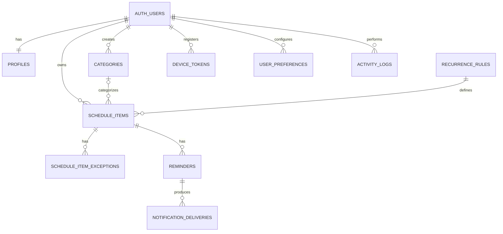

# Database Schema — Schedular App

**File:** `database-schema.md`  
**Project:** Schedular  
**Client:** Flutter (Dart)  
**Database:** PostgreSQL  
**Recommended backend:** Supabase  
**Schema version:** 1.0  
**Status:** Proposed baseline, pending validation against the final TRD

---

## 1. Purpose

This document defines the database architecture, relational model, table definitions, constraints, indexes, data ownership rules, and migration requirements for the Schedular application.

The database must support:

- User accounts and profiles.
- Personal schedules and calendar items.
- Tasks, events, deadlines, and completion status.
- Categories and organization.
- Recurring schedules.
- Reminders and notification delivery tracking.
- User preferences and time zones.
- Mobile device registration for push notifications.
- Audit history for important schedule changes.
- Secure, user-scoped data access.
- Future integration with additional clients and backend services.

The schema is designed to support a Flutter mobile application without coupling the database to Flutter-specific implementation details.

## 2. Architectural principles

1. PostgreSQL is the authoritative source of persistent application data.
2. Supabase Auth manages authentication when Supabase is selected as the identity provider.
3. Every user-owned record must have an explicit ownership relationship.
4. Database constraints must enforce data integrity wherever practical.
5. All timestamps representing real-world instants must use `TIMESTAMPTZ`.
6. Recurring schedules must preserve their time-zone and recurrence semantics.
7. Notifications must be generated and delivered by trusted backend workers, not by relying exclusively on the Flutter client.
8. Database migrations must be version-controlled.
9. Sensitive service credentials must never be embedded in the mobile application.
10. Schema changes must remain compatible with existing production data or include an explicit migration plan.

## 3. Technology assumptions

| Component | Proposed choice |
|---|---|
| Mobile application | Flutter |
| Language | Dart |
| Database | PostgreSQL |
| Backend and database access | Supabase or a trusted API layer |
| Authentication | Supabase Auth |
| Primary keys | UUID |
| Timestamp storage | `TIMESTAMPTZ` |
| Structured recurrence configuration | JSONB |
| Schema management | SQL migrations |
| Database authorization | PostgreSQL Row-Level Security |
| Push notification delivery | Trusted backend worker and push provider |

**Important:** Supabase is a proposed implementation choice. If the approved TRD specifies a different backend, retain the relational design where appropriate and adapt authentication, authorization, and deployment accordingly.

## 4. Entity relationship overview

The core relationships are:



`AUTH_USERS` represents the external identity table `auth.users` provided by Supabase Auth. It is not created by this application schema.

## 5. Naming conventions

- Table names: lowercase `snake_case`, plural.
- Column names: lowercase `snake_case`.
- Primary keys: `id`.
- Foreign keys: `{referenced_table_singular}_id`.
- Timestamps: `created_at`, `updated_at`, `deleted_at` where appropriate.
- Boolean fields: use clear `is_` or `has_` prefixes.
- Indexes: `idx_{table}_{columns}`.
- Check constraints: `chk_{table}_{purpose}`.
- Foreign-key constraints: `fk_{table}_{relationship}`.
- Database migrations: sequentially numbered SQL files.

## 6. Database tables

### 6.1 `profiles`

Stores application-specific profile information associated with an authenticated user.

| Column | Type | Constraints | Description |
|---|---|---|---|
| `id` | UUID | Primary key, FK to `auth.users.id` | User identity |
| `display_name` | TEXT | Nullable | Display name |
| `avatar_url` | TEXT | Nullable | Profile image URL |
| `created_at` | TIMESTAMPTZ | Not null | Creation time |
| `updated_at` | TIMESTAMPTZ | Not null | Last update time |

Rules:

- Create the profile when an account is created, using a trusted database trigger or backend operation.
- A user can only access or modify their own profile.
- Authentication credentials must not be stored in this table.
- Profile deletion and account deletion must follow the account lifecycle policy.

### 6.2 `user_preferences`

Stores user-specific application and scheduling preferences.

| Column | Type | Constraints | Description |
|---|---|---|---|
| `id` | UUID | Primary key | Preference record ID |
| `user_id` | UUID | FK, unique, not null | Owner |
| `timezone` | TEXT | Not null | IANA time-zone identifier |
| `locale` | TEXT | Not null | Language and locale |
| `week_starts_on` | SMALLINT | 0–6 | First weekday, Sunday = 0 |
| `time_format` | TEXT | `12h` or `24h` | Display preference |
| `default_reminder_minutes` | INTEGER | Nullable, nonnegative | Default reminder offset |
| `notifications_enabled` | BOOLEAN | Not null | Global notification preference |
| `created_at` | TIMESTAMPTZ | Not null | Creation time |
| `updated_at` | TIMESTAMPTZ | Not null | Last update time |

Rules:

- `timezone` must contain a valid IANA identifier, validated by the backend.
- A missing preference record must have a documented default configuration.
- Changing the display time zone must not silently shift existing absolute timestamps.
- The default reminder must not override an explicitly configured item reminder.

### 6.3 `categories`

Organizes schedule items into user-defined categories.

| Column | Type | Constraints | Description |
|---|---|---|---|
| `id` | UUID | Primary key | Category ID |
| `user_id` | UUID | FK, not null | Owner |
| `name` | TEXT | Not null | Category name |
| `description` | TEXT | Nullable | Category details |
| `color` | TEXT | Nullable | Optional design-system color token |
| `icon_key` | TEXT | Nullable | Optional supported icon identifier |
| `created_at` | TIMESTAMPTZ | Not null | Creation time |
| `updated_at` | TIMESTAMPTZ | Not null | Last update time |
| `deleted_at` | TIMESTAMPTZ | Nullable | Soft deletion time |

Rules:

- Category names must not be empty or consist only of whitespace.
- Category names should be unique per user among non-deleted categories.
- The client must render only supported color tokens and icon identifiers.
- Category deletion must not delete the user's schedule items.
- Deleted categories must not be available for new assignments.

### 6.4 `recurrence_rules`

Stores recurrence definitions separately from schedule items.

| Column | Type | Constraints | Description |
|---|---|---|---|
| `id` | UUID | Primary key | Recurrence rule ID |
| `user_id` | UUID | FK, not null | Owner |
| `frequency` | TEXT | `daily`, `weekly`, `monthly`, `yearly` | Recurrence frequency |
| `interval_value` | INTEGER | Positive, not null | Repeat every N frequency units |
| `days_of_week` | SMALLINT[] | Nullable | Selected weekdays, Sunday = 0 |
| `day_of_month` | SMALLINT | Nullable, 1–31 | Monthly day |
| `month_of_year` | SMALLINT | Nullable, 1–12 | Annual month |
| `starts_at` | TIMESTAMPTZ | Not null | Series start instant |
| `ends_at` | TIMESTAMPTZ | Nullable | Series end instant |
| `timezone` | TEXT | Not null | IANA time-zone identifier |
| `max_occurrences` | INTEGER | Nullable, positive | Maximum generated occurrences |
| `rule_config` | JSONB | Not null, default `{}` | Additional recurrence configuration |
| `created_at` | TIMESTAMPTZ | Not null | Creation time |
| `updated_at` | TIMESTAMPTZ | Not null | Last update time |

Rules:

- `interval_value` must be greater than zero.
- `ends_at`, if present, must not precede `starts_at`.
- `max_occurrences`, if present, must be greater than zero.
- `days_of_week` must contain only values from 0 through 6.
- The backend must validate frequency-specific fields.
- `rule_config` must follow a documented, versioned JSON structure.
- The recurrence algorithm must define month-end handling, daylight-saving transitions, and end-of-series behavior.
- Recurrence calculations must use the stored time zone, not the device's current time zone.

### 6.5 `schedule_items`

The central table for tasks, appointments, and calendar events.

| Column | Type | Constraints | Description |
|---|---|---|---|
| `id` | UUID | Primary key | Schedule item ID |
| `user_id` | UUID | FK, not null | Owner |
| `category_id` | UUID | Nullable, composite FK | Assigned category |
| `recurrence_rule_id` | UUID | Nullable, composite FK | Recurrence definition |
| `item_type` | TEXT | `task` or `event` | Item classification |
| `title` | TEXT | Not null | Item title |
| `description` | TEXT | Nullable | Additional details |
| `start_at` | TIMESTAMPTZ | Nullable | Scheduled start instant |
| `end_at` | TIMESTAMPTZ | Nullable | Scheduled end instant |
| `due_at` | TIMESTAMPTZ | Nullable | Task deadline |
| `all_day` | BOOLEAN | Not null, default false | All-day item flag |
| `timezone` | TEXT | Not null | Time-zone context |
| `status` | TEXT | Not null | Lifecycle state |
| `priority` | SMALLINT | 1–4 | Priority level |
| `location` | TEXT | Nullable | Physical or virtual location |
| `completion_note` | TEXT | Nullable | Optional completion notes |
| `completed_at` | TIMESTAMPTZ | Nullable | Completion instant |
| `parent_item_id` | UUID | Nullable, self-reference | Parent series or template |
| `series_key` | UUID | Nullable | Logical recurring-series identifier |
| `created_at` | TIMESTAMPTZ | Not null | Creation time |
| `updated_at` | TIMESTAMPTZ | Not null | Last update time |
| `deleted_at` | TIMESTAMPTZ | Nullable | Soft deletion time |

Recommended status values:

- `scheduled`
- `in_progress`
- `completed`
- `cancelled`

Recommended priority values:

- `1`: Low
- `2`: Normal
- `3`: High
- `4`: Urgent

Rules:

1. `title` must not be empty or consist only of whitespace.
2. `end_at` must not precede `start_at` when both are provided.
3. `completed_at` must be populated when an item is completed and cleared when it returns to an incomplete state, unless completion history is intentionally retained elsewhere.
4. An event should have valid scheduling boundaries.
5. A task may have a deadline without a start time.
6. A recurring series must reference a valid recurrence rule.
7. An item must not reference a category owned by another user.
8. A user must not reference another user's recurrence rule.
9. Soft-deleted items must not appear in ordinary active-item queries.
10. Hard deletion must be reserved for explicit data-retention or account-deletion procedures.

**Recurring item implementation:** choose one of the following approaches before production:

- **Series plus generated occurrences:** store a series definition and materialize individual occurrences.
- **Series plus on-demand expansion:** calculate occurrences when querying a date range and persist exceptions separately.

Do not implement both models without a clear distinction between a series definition and an occurrence. The proposed schema supports a hybrid approach, but the final occurrence-generation strategy must be documented in the TRD.

### 6.6 `schedule_item_exceptions`

Stores exceptions to recurring items, such as skipped, moved, or modified occurrences.

| Column | Type | Constraints | Description |
|---|---|---|---|
| `id` | UUID | Primary key | Exception ID |
| `user_id` | UUID | FK, not null | Owner |
| `schedule_item_id` | UUID | FK, not null | Series or template |
| `original_start_at` | TIMESTAMPTZ | Not null | Original occurrence start |
| `exception_type` | TEXT | `skipped`, `moved`, `modified` | Exception type |
| `new_start_at` | TIMESTAMPTZ | Nullable | Replacement start |
| `new_end_at` | TIMESTAMPTZ | Nullable | Replacement end |
| `override_data` | JSONB | Not null, default `{}` | Allowed occurrence overrides |
| `created_at` | TIMESTAMPTZ | Not null | Creation time |
| `updated_at` | TIMESTAMPTZ | Not null | Last update time |

Rules:

- The combination of `schedule_item_id` and `original_start_at` must be unique.
- The schedule item must belong to the same user.
- A skipped occurrence must not be generated or notified.
- A moved occurrence must preserve its original occurrence identity.
- Modified fields must be explicitly whitelisted.
- Overrides must not be allowed to change ownership or unrelated records.
- Exception updates must trigger appropriate reminder rescheduling.

### 6.7 `reminders`

Stores reminder configurations associated with schedule items.

| Column | Type | Constraints | Description |
|---|---|---|---|
| `id` | UUID | Primary key | Reminder ID |
| `user_id` | UUID | FK, not null | Owner |
| `schedule_item_id` | UUID | FK, not null | Associated item |
| `offset_minutes` | INTEGER | Nonnegative, not null | Minutes before the trigger time |
| `trigger_type` | TEXT | `before_start`, `at_start`, `before_due` | Trigger basis |
| `channel` | TEXT | `push`, `local` | Delivery channel |
| `is_enabled` | BOOLEAN | Not null, default true | Reminder enabled state |
| `created_at` | TIMESTAMPTZ | Not null | Creation time |
| `updated_at` | TIMESTAMPTZ | Not null | Last update time |

Rules:

- Reminder and schedule-item ownership must match.
- A reminder must not reference a deleted item.
- Unsupported trigger types must be rejected.
- An item may have multiple reminders if the product requirements allow it.
- Reminder delivery must respect the user's notification preferences and permissions.
- A local reminder configuration does not guarantee delivery by the operating system.
- Recurring occurrences need a documented reminder scheduling strategy.

### 6.8 `notification_deliveries`

Tracks notification jobs and delivery outcomes for retries, diagnostics, and duplicate prevention.

| Column | Type | Constraints | Description |
|---|---|---|---|
| `id` | UUID | Primary key | Delivery ID |
| `user_id` | UUID | FK, not null | Owner |
| `reminder_id` | UUID | Nullable, FK | Source reminder |
| `schedule_item_id` | UUID | Nullable, FK | Related item |
| `occurrence_start_at` | TIMESTAMPTZ | Nullable | Relevant occurrence |
| `channel` | TEXT | Not null | Delivery channel |
| `scheduled_for` | TIMESTAMPTZ | Not null | Intended delivery time |
| `status` | TEXT | Not null | Job state |
| `attempt_count` | INTEGER | Not null, default 0 | Attempts made |
| `last_attempt_at` | TIMESTAMPTZ | Nullable | Most recent attempt |
| `delivered_at` | TIMESTAMPTZ | Nullable | Successful delivery time |
| `provider_message_id` | TEXT | Nullable | External provider ID |
| `error_code` | TEXT | Nullable | Normalized failure code |
| `created_at` | TIMESTAMPTZ | Not null | Creation time |
| `updated_at` | TIMESTAMPTZ | Not null | Last update time |

Recommended status values:

- `pending`
- `processing`
- `sent`
- `failed`
- `cancelled`

Rules:

- Delivery workers must use idempotency keys or equivalent deduplication.
- Retries must be bounded and use a defined backoff strategy.
- A database status of `sent` means the provider accepted the request, not necessarily that the device displayed it.
- Never store push-provider secrets in this table.
- Apply a retention policy to old delivery records.
- Do not store unnecessary notification payloads containing sensitive information.

### 6.9 `device_tokens`

Stores registered device tokens for push notifications.

| Column | Type | Constraints | Description |
|---|---|---|---|
| `id` | UUID | Primary key | Device record ID |
| `user_id` | UUID | FK, not null | Owner |
| `platform` | TEXT | `ios` or `android` | Device platform |
| `token` | TEXT | Not null | Push token |
| `device_identifier` | TEXT | Nullable | App-scoped device identifier |
| `is_active` | BOOLEAN | Not null, default true | Token active state |
| `last_seen_at` | TIMESTAMPTZ | Nullable | Last activity |
| `created_at` | TIMESTAMPTZ | Not null | Registration time |
| `updated_at` | TIMESTAMPTZ | Not null | Last update time |

Rules:

- A user can register multiple devices.
- Token rotation must update or deactivate stale records.
- Device identifiers must not be used as authentication credentials.
- Tokens must not be publicly readable.
- Invalid tokens should be deactivated following provider feedback.
- Never expose other users' device tokens to the client.

### 6.10 `activity_logs`

Records important schedule changes for auditing and troubleshooting.

| Column | Type | Constraints | Description |
|---|---|---|---|
| `id` | UUID | Primary key | Log ID |
| `user_id` | UUID | FK, not null | Actor or owner |
| `schedule_item_id` | UUID | Nullable | Related item |
| `action` | TEXT | Not null | Action identifier |
| `metadata` | JSONB | Not null, default `{}` | Non-sensitive audit details |
| `created_at` | TIMESTAMPTZ | Not null | Event time |

Example actions:

- `schedule_item_created`
- `schedule_item_updated`
- `schedule_item_completed`
- `schedule_item_cancelled`
- `schedule_item_deleted`
- `reminder_created`
- `reminder_updated`
- `recurrence_changed`

Rules:

- Audit records should be append-only for ordinary application roles.
- Audit metadata must not contain authentication tokens, passwords, or other secrets.
- Do not depend on activity logs as the primary source of current schedule state.
- Establish a retention policy appropriate to the product.
- Use backend-generated audit entries for operations that require trustworthy history.

## 7. PostgreSQL migration SQL

The following migration implements the core schema described above. It assumes that the Supabase `auth.users` table already exists.

Create a versioned migration such as `0001_initial_schema.sql`.

```sql
BEGIN;

CREATE EXTENSION IF NOT EXISTS pgcrypto;

-- Automatically maintain updated_at.
CREATE OR REPLACE FUNCTION public.set_updated_at()
RETURNS TRIGGER
LANGUAGE plpgsql
AS $$
BEGIN
    NEW.updated_at = now();
    RETURN NEW;
END;
$$;

-- Profiles
CREATE TABLE public.profiles (
    id UUID PRIMARY KEY
        REFERENCES auth.users(id) ON DELETE CASCADE,
    display_name TEXT,
    avatar_url TEXT,
    created_at TIMESTAMPTZ NOT NULL DEFAULT now(),
    updated_at TIMESTAMPTZ NOT NULL DEFAULT now()
);

-- Preferences
CREATE TABLE public.user_preferences (
    id UUID PRIMARY KEY DEFAULT gen_random_uuid(),
    user_id UUID NOT NULL UNIQUE
        REFERENCES auth.users(id) ON DELETE CASCADE,
    timezone TEXT NOT NULL DEFAULT 'UTC',
    locale TEXT NOT NULL DEFAULT 'en',
    week_starts_on SMALLINT NOT NULL DEFAULT 0
        CHECK (week_starts_on BETWEEN 0 AND 6),
    time_format TEXT NOT NULL DEFAULT '24h'
        CHECK (time_format IN ('12h', '24h')),
    default_reminder_minutes INTEGER
        CHECK (default_reminder_minutes IS NULL
               OR default_reminder_minutes >= 0),
    notifications_enabled BOOLEAN NOT NULL DEFAULT true,
    created_at TIMESTAMPTZ NOT NULL DEFAULT now(),
    updated_at TIMESTAMPTZ NOT NULL DEFAULT now()
);

-- Categories
CREATE TABLE public.categories (
    id UUID PRIMARY KEY DEFAULT gen_random_uuid(),
    user_id UUID NOT NULL
        REFERENCES auth.users(id) ON DELETE CASCADE,
    name TEXT NOT NULL
        CHECK (length(trim(name)) > 0),
    description TEXT,
    color TEXT,
    icon_key TEXT,
    created_at TIMESTAMPTZ NOT NULL DEFAULT now(),
    updated_at TIMESTAMPTZ NOT NULL DEFAULT now(),
    deleted_at TIMESTAMPTZ,
    CONSTRAINT uq_categories_owner_id UNIQUE (user_id, id)
);

CREATE UNIQUE INDEX idx_categories_unique_active_name
    ON public.categories (user_id, lower(trim(name)))
    WHERE deleted_at IS NULL;

-- Recurrence definitions
CREATE TABLE public.recurrence_rules (
    id UUID PRIMARY KEY DEFAULT gen_random_uuid(),
    user_id UUID NOT NULL
        REFERENCES auth.users(id) ON DELETE CASCADE,
    frequency TEXT NOT NULL
        CHECK (frequency IN ('daily', 'weekly', 'monthly', 'yearly')),
    interval_value INTEGER NOT NULL DEFAULT 1
        CHECK (interval_value > 0),
    days_of_week SMALLINT[],
    day_of_month SMALLINT
        CHECK (day_of_month BETWEEN 1 AND 31),
    month_of_year SMALLINT
        CHECK (month_of_year BETWEEN 1 AND 12),
    starts_at TIMESTAMPTZ NOT NULL,
    ends_at TIMESTAMPTZ,
    timezone TEXT NOT NULL DEFAULT 'UTC',
    max_occurrences INTEGER
        CHECK (max_occurrences IS NULL OR max_occurrences > 0),
    rule_config JSONB NOT NULL DEFAULT '{}'::jsonb,
    created_at TIMESTAMPTZ NOT NULL DEFAULT now(),
    updated_at TIMESTAMPTZ NOT NULL DEFAULT now(),
    CONSTRAINT chk_recurrence_end
        CHECK (ends_at IS NULL OR ends_at >= starts_at),
    CONSTRAINT chk_recurrence_weekdays
        CHECK (
            days_of_week IS NULL OR
            (
                array_position(days_of_week, NULL) IS NULL
                AND days_of_week <@ ARRAY[0,1,2,3,4,5,6]::SMALLINT[]
            )
        ),
    CONSTRAINT uq_recurrence_owner_id UNIQUE (user_id, id)
);

-- Schedule items
CREATE TABLE public.schedule_items (
    id UUID PRIMARY KEY DEFAULT gen_random_uuid(),
    user_id UUID NOT NULL
        REFERENCES auth.users(id) ON DELETE CASCADE,
    category_id UUID,
    recurrence_rule_id UUID,
    item_type TEXT NOT NULL
        CHECK (item_type IN ('task', 'event')),
    title TEXT NOT NULL
        CHECK (length(trim(title)) > 0),
    description TEXT,
    start_at TIMESTAMPTZ,
    end_at TIMESTAMPTZ,
    due_at TIMESTAMPTZ,
    all_day BOOLEAN NOT NULL DEFAULT false,
    timezone TEXT NOT NULL DEFAULT 'UTC',
    status TEXT NOT NULL DEFAULT 'scheduled'
        CHECK (
            status IN (
                'scheduled',
                'in_progress',
                'completed',
                'cancelled'
            )
        ),
    priority SMALLINT NOT NULL DEFAULT 2
        CHECK (priority BETWEEN 1 AND 4),
    location TEXT,
    completion_note TEXT,
    completed_at TIMESTAMPTZ,
    parent_item_id UUID,
    series_key UUID,
    created_at TIMESTAMPTZ NOT NULL DEFAULT now(),
    updated_at TIMESTAMPTZ NOT NULL DEFAULT now(),
    deleted_at TIMESTAMPTZ,

    CONSTRAINT chk_schedule_time_range
        CHECK (end_at IS NULL OR start_at IS NULL
               OR end_at >= start_at),

    CONSTRAINT chk_schedule_completion
        CHECK (
            (status = 'completed' AND completed_at IS NOT NULL)
            OR
            (status <> 'completed' AND completed_at IS NULL)
        ),

    CONSTRAINT chk_event_start
        CHECK (item_type <> 'event' OR start_at IS NOT NULL),

    CONSTRAINT fk_schedule_category
        FOREIGN KEY (user_id, category_id)
        REFERENCES public.categories(user_id, id)
        ON DELETE RESTRICT,

    CONSTRAINT fk_schedule_recurrence
        FOREIGN KEY (user_id, recurrence_rule_id)
        REFERENCES public.recurrence_rules(user_id, id)
        ON DELETE RESTRICT,

    CONSTRAINT fk_schedule_parent
        FOREIGN KEY (parent_item_id)
        REFERENCES public.schedule_items(id)
        ON DELETE SET NULL,

    CONSTRAINT uq_schedule_owner_id UNIQUE (user_id, id)
);

-- Recurrence exceptions
CREATE TABLE public.schedule_item_exceptions (
    id UUID PRIMARY KEY DEFAULT gen_random_uuid(),
    user_id UUID NOT NULL
        REFERENCES auth.users(id) ON DELETE CASCADE,
    schedule_item_id UUID NOT NULL,
    original_start_at TIMESTAMPTZ NOT NULL,
    exception_type TEXT NOT NULL
        CHECK (exception_type IN ('skipped', 'moved', 'modified')),
    new_start_at TIMESTAMPTZ,
    new_end_at TIMESTAMPTZ,
    override_data JSONB NOT NULL DEFAULT '{}'::jsonb,
    created_at TIMESTAMPTZ NOT NULL DEFAULT now(),
    updated_at TIMESTAMPTZ NOT NULL DEFAULT now(),

    CONSTRAINT fk_exception_item
        FOREIGN KEY (user_id, schedule_item_id)
        REFERENCES public.schedule_items(user_id, id)
        ON DELETE CASCADE,

    CONSTRAINT uq_schedule_exception
        UNIQUE (schedule_item_id, original_start_at),

    CONSTRAINT chk_exception_range
        CHECK (
            new_end_at IS NULL OR new_start_at IS NULL
            OR new_end_at >= new_start_at
        )
);

-- Reminder configurations
CREATE TABLE public.reminders (
    id UUID PRIMARY KEY DEFAULT gen_random_uuid(),
    user_id UUID NOT NULL
        REFERENCES auth.users(id) ON DELETE CASCADE,
    schedule_item_id UUID NOT NULL,
    offset_minutes INTEGER NOT NULL DEFAULT 0
        CHECK (offset_minutes >= 0),
    trigger_type TEXT NOT NULL
        CHECK (
            trigger_type IN (
                'before_start',
                'at_start',
                'before_due'
            )
        ),
    channel TEXT NOT NULL DEFAULT 'push'
        CHECK (channel IN ('push', 'local')),
    is_enabled BOOLEAN NOT NULL DEFAULT true,
    created_at TIMESTAMPTZ NOT NULL DEFAULT now(),
    updated_at TIMESTAMPTZ NOT NULL DEFAULT now(),

    CONSTRAINT fk_reminder_item
        FOREIGN KEY (user_id, schedule_item_id)
        REFERENCES public.schedule_items(user_id, id)
        ON DELETE CASCADE
);

-- Notification delivery records
CREATE TABLE public.notification_deliveries (
    id UUID PRIMARY KEY DEFAULT gen_random_uuid(),
    user_id UUID NOT NULL
        REFERENCES auth.users(id) ON DELETE CASCADE,
    reminder_id UUID
        REFERENCES public.reminders(id) ON DELETE SET NULL,
    schedule_item_id UUID,
    occurrence_start_at TIMESTAMPTZ,
    channel TEXT NOT NULL
        CHECK (channel IN ('push', 'local')),
    scheduled_for TIMESTAMPTZ NOT NULL,
    status TEXT NOT NULL DEFAULT 'pending'
        CHECK (
            status IN (
                'pending',
                'processing',
                'sent',
                'failed',
                'cancelled'
            )
        ),
    attempt_count INTEGER NOT NULL DEFAULT 0
        CHECK (attempt_count >= 0),
    last_attempt_at TIMESTAMPTZ,
    delivered_at TIMESTAMPTZ,
    provider_message_id TEXT,
    error_code TEXT,
    created_at TIMESTAMPTZ NOT NULL DEFAULT now(),
    updated_at TIMESTAMPTZ NOT NULL DEFAULT now(),

    CONSTRAINT fk_delivery_item
        FOREIGN KEY (user_id, schedule_item_id)
        REFERENCES public.schedule_items(user_id, id)
        ON DELETE SET NULL
);

-- Registered push devices
CREATE TABLE public.device_tokens (
    id UUID PRIMARY KEY DEFAULT gen_random_uuid(),
    user_id UUID NOT NULL
        REFERENCES auth.users(id) ON DELETE CASCADE,
    platform TEXT NOT NULL
        CHECK (platform IN ('ios', 'android')),
    token TEXT NOT NULL UNIQUE,
    device_identifier TEXT,
    is_active BOOLEAN NOT NULL DEFAULT true,
    last_seen_at TIMESTAMPTZ,
    created_at TIMESTAMPTZ NOT NULL DEFAULT now(),
    updated_at TIMESTAMPTZ NOT NULL DEFAULT now()
);

-- Audit history
CREATE TABLE public.activity_logs (
    id UUID PRIMARY KEY DEFAULT gen_random_uuid(),
    user_id UUID NOT NULL
        REFERENCES auth.users(id) ON DELETE CASCADE,
    schedule_item_id UUID,
    action TEXT NOT NULL,
    metadata JSONB NOT NULL DEFAULT '{}'::jsonb,
    created_at TIMESTAMPTZ NOT NULL DEFAULT now(),

    CONSTRAINT fk_activity_item
        FOREIGN KEY (user_id, schedule_item_id)
        REFERENCES public.schedule_items(user_id, id)
        ON DELETE SET NULL
);

-- Query indexes
CREATE INDEX idx_schedule_items_user_start
    ON public.schedule_items(user_id, start_at)
    WHERE deleted_at IS NULL;

CREATE INDEX idx_schedule_items_user_due
    ON public.schedule_items(user_id, due_at)
    WHERE deleted_at IS NULL;

CREATE INDEX idx_schedule_items_user_status
    ON public.schedule_items(user_id, status)
    WHERE deleted_at IS NULL;

CREATE INDEX idx_schedule_items_category
    ON public.schedule_items(user_id, category_id)
    WHERE deleted_at IS NULL;

CREATE INDEX idx_schedule_items_recurrence
    ON public.schedule_items(recurrence_rule_id)
    WHERE recurrence_rule_id IS NOT NULL;

CREATE INDEX idx_recurrence_rules_user
    ON public.recurrence_rules(user_id);

CREATE INDEX idx_schedule_exceptions_item_date
    ON public.schedule_item_exceptions(
        schedule_item_id, original_start_at
    );

CREATE INDEX idx_reminders_item
    ON public.reminders(user_id, schedule_item_id);

CREATE INDEX idx_deliveries_due
    ON public.notification_deliveries(scheduled_for)
    WHERE status = 'pending';

CREATE INDEX idx_deliveries_user
    ON public.notification_deliveries(user_id, created_at DESC);

CREATE INDEX idx_device_tokens_active
    ON public.device_tokens(user_id)
    WHERE is_active = true;

CREATE INDEX idx_activity_logs_user_time
    ON public.activity_logs(user_id, created_at DESC);

-- Maintain updated_at on mutable tables.
DO $$
DECLARE
    table_name TEXT;
BEGIN
    FOREACH table_name IN ARRAY ARRAY[
        'profiles',
        'user_preferences',
        'categories',
        'recurrence_rules',
        'schedule_items',
        'schedule_item_exceptions',
        'reminders',
        'notification_deliveries',
        'device_tokens'
    ]
    LOOP
        EXECUTE format(
            'CREATE TRIGGER set_updated_at
             BEFORE UPDATE ON public.%I
             FOR EACH ROW EXECUTE FUNCTION public.set_updated_at()',
            table_name
        );
    END LOOP;
END;
$$;

COMMIT;
```

### Migration review notes

The SQL above is a starting migration, not a complete production security configuration. Before deploying it:

- Add profile and preference initialization logic.
- Add and verify Row-Level Security policies.
- Validate time-zone identifiers in the trusted backend.
- Implement recurrence-specific validation and occurrence generation.
- Review the composite foreign keys involving `ON DELETE SET NULL`. PostgreSQL may attempt to null the non-nullable `user_id` column when using a composite foreign key. Replace those deletion actions with an explicit policy, a suitable single-column relationship, or a trigger that preserves ownership.
- Review the self-referencing `parent_item_id` relationship and ensure that a parent cannot belong to another user.
- Decide how recurring occurrence identity is represented before implementing notification deduplication.
- Add database tests for all constraints and deletion behavior.

Do not deploy this SQL unchanged to a production environment without those checks.

## 8. Row-Level Security (RLS)

RLS must be enabled for every user-owned table accessible through Supabase's client APIs.

Example policy pattern:

```sql
ALTER TABLE public.profiles ENABLE ROW LEVEL SECURITY;
ALTER TABLE public.user_preferences ENABLE ROW LEVEL SECURITY;
ALTER TABLE public.categories ENABLE ROW LEVEL SECURITY;
ALTER TABLE public.recurrence_rules ENABLE ROW LEVEL SECURITY;
ALTER TABLE public.schedule_items ENABLE ROW LEVEL SECURITY;
ALTER TABLE public.schedule_item_exceptions ENABLE ROW LEVEL SECURITY;
ALTER TABLE public.reminders ENABLE ROW LEVEL SECURITY;
ALTER TABLE public.notification_deliveries ENABLE ROW LEVEL SECURITY;
ALTER TABLE public.device_tokens ENABLE ROW LEVEL SECURITY;
ALTER TABLE public.activity_logs ENABLE ROW LEVEL SECURITY;

CREATE POLICY profiles_select_own
ON public.profiles
FOR SELECT TO authenticated
USING ((SELECT auth.uid()) = id);

CREATE POLICY profiles_update_own
ON public.profiles
FOR UPDATE TO authenticated
USING ((SELECT auth.uid()) = id)
WITH CHECK ((SELECT auth.uid()) = id);

CREATE POLICY schedule_items_select_own
ON public.schedule_items
FOR SELECT TO authenticated
USING ((SELECT auth.uid()) = user_id);

CREATE POLICY schedule_items_insert_own
ON public.schedule_items
FOR INSERT TO authenticated
WITH CHECK ((SELECT auth.uid()) = user_id);

CREATE POLICY schedule_items_update_own
ON public.schedule_items
FOR UPDATE TO authenticated
USING ((SELECT auth.uid()) = user_id)
WITH CHECK ((SELECT auth.uid()) = user_id);

CREATE POLICY schedule_items_delete_own
ON public.schedule_items
FOR DELETE TO authenticated
USING ((SELECT auth.uid()) = user_id);
```

These policies illustrate the pattern. They are not sufficient by themselves to secure the entire schema.

Implement appropriate `SELECT`, `INSERT`, `UPDATE`, and `DELETE` policies for every exposed table, including ownership checks on related records. For audit logs, consider allowing clients to read their own records but not modify or delete them. Notification delivery records should generally be managed by trusted backend workers.

Do not grant unrestricted access to tables merely because RLS is enabled.

### Security requirements

- Never expose a Supabase service-role key in Flutter code.
- Do not trust a client-supplied `user_id` without validating it against the authenticated identity.
- Restrict database grants as well as applying RLS.
- Use a trusted backend for notification delivery and other privileged operations.
- Keep authentication secrets and push-provider credentials in server-side secret storage.
- Test cross-user access attempts for every table and relationship.
- Review views, RPC functions, triggers, and `SECURITY DEFINER` functions for authorization bypasses.

## 9. Data types and integrity requirements

### UUID primary keys

UUIDs are suitable for mobile applications because IDs can be generated without coordinating a central sequence. They also simplify offline creation and synchronization, although UUIDs do not replace authorization.

### Timestamps

- Use `TIMESTAMPTZ` for actual instants.
- Store the IANA time zone needed to interpret recurring local times.
- Use a documented convention for date-only values.
- Do not assume that all days contain exactly 24 hours because of daylight-saving transitions.
- Use server-generated timestamps for authoritative audit and delivery events.

### JSONB

Use JSONB only for genuinely flexible structures, such as recurrence extensions and occurrence overrides. Do not place core relational fields such as ownership, status, or foreign keys exclusively inside JSON.

Validate JSON structures in the backend and version the structure when it changes.

### Soft deletion

Use `deleted_at` where restoration or temporary hiding is useful. Ordinary queries must exclude soft-deleted rows. Define whether deleted records retain reminders, recurrence rules, and audit history.

Hard deletion should be limited to explicit retention and account-erasure operations.

## 10. Recurrence and scheduling rules

Recurring schedules are a high-risk area for data consistency. Implement these rules explicitly:

1. Preserve the series' local time and time zone.
2. Define behavior when a recurrence lands on an invalid calendar date, such as the 31st in a shorter month.
3. Define whether recurrence end dates are inclusive.
4. Define whether editing a series affects future occurrences only or the whole series.
5. Preserve exceptions when the series is edited, unless the user explicitly resets them.
6. Recalculate pending reminder jobs when an occurrence changes.
7. Cancel obsolete reminder jobs when an item is deleted or a recurrence is terminated.
8. Prevent duplicate occurrences when multiple workers run concurrently.
9. Make recurrence generation idempotent.
10. Treat daylight-saving gaps and repeated local times according to a documented policy.
11. Store enough information to identify an occurrence independently of its potentially changed start time.
12. Apply the user's notification preferences and permission state before delivery.

**Implementation decision required:** if the application needs a persistent occurrence table, add a `schedule_occurrences` table with a stable UUID, parent series reference, original occurrence key, resolved start and end instants, status, and uniqueness constraints. Do not use the mutable start timestamp alone as the permanent identity of an occurrence.

## 11. Notification processing

A reliable notification pipeline should operate as follows:

1. A schedule item or recurrence is created or updated.
2. The backend calculates relevant reminder trigger times.
3. Pending notification jobs are inserted or updated transactionally.
4. A worker claims due jobs safely.
5. The worker checks ownership, item state, reminder state, and notification preferences.
6. The worker submits the notification to the appropriate provider.
7. The delivery result is recorded.
8. Temporary failures are retried with bounded exponential backoff.
9. Permanent failures and invalid device tokens are handled explicitly.
10. Rescheduled or cancelled occurrences invalidate obsolete jobs.

Use database transactions and an appropriate job-claiming mechanism, such as `FOR UPDATE SKIP LOCKED`, when multiple workers can process the same queue.

Push notification delivery is not guaranteed. The app must also handle permission denial, token expiration, device offline conditions, and operating-system restrictions.

## 12. Data access patterns

The schema should support these common operations efficiently:

| Operation | Recommended access pattern |
|---|---|
| Today's schedule | Filter by owner and resolved local-day boundaries |
| Calendar range | Filter by owner and time interval |
| Upcoming deadlines | Filter by owner, `due_at`, and active status |
| Completed tasks | Filter by owner and completion status |
| Category view | Filter by owner and category |
| Upcoming reminders | Index pending delivery jobs by scheduled time |
| Recurring expansion | Load the series rule and its exceptions |
| User preferences | Unique lookup by `user_id` |
| Device registration | Lookup by token or owner |
| Activity history | Owner-filtered descending timestamp query |

For calendar queries, define whether overlapping events must appear in the requested range. A basic overlap query generally considers both the start and end boundaries rather than selecting only items whose start occurs inside the range.

Paginate long lists. Avoid loading a user's entire schedule when only one calendar range is required.

## 13. Performance and scalability

- Create indexes based on actual query patterns.
- Avoid indexing every column without a measured need.
- Review query plans for calendar-range and upcoming-reminder queries.
- Use cursor-based pagination for large histories where appropriate.
- Keep notification jobs bounded by a processing window.
- Batch recurrence expansion for reasonable date ranges.
- Avoid storing duplicated derived state unless it improves measured performance.
- Consider partitioning delivery or audit tables only after volume justifies it.
- Monitor slow queries, database connections, storage growth, and failed jobs.
- Use connection pooling when the selected backend architecture requires it.

## 14. Privacy, retention, and account deletion

The application must define a lifecycle for personal scheduling data.

- Deleting an account must trigger a documented cleanup or anonymization process.
- Device tokens must be deactivated when the user signs out or revokes the relevant device registration.
- Notification jobs for deleted or cancelled items must be invalidated.
- Audit records must follow the agreed retention policy.
- Backups and logs must follow the same applicable privacy commitments.
- Data export and erasure behavior must be defined before release.
- Avoid collecting personal information that is not needed for scheduling functionality.

Foreign-key cascade behavior must be reviewed as a whole. A cascade that is convenient for normal deletion can accidentally erase history that the product intends to retain.

## 15. Migration strategy

All schema changes must be tracked through sequential migration files.

Example:

```text
supabase/
└── migrations/
    ├── 0001_initial_schema.sql
    ├── 0002_rls_policies.sql
    ├── 0003_profile_initialization.sql
    ├── 0004_recurrence_occurrences.sql
    └── 0005_notification_queue.sql
```

The names above are an example structure; each file must correspond to an actual, reviewed migration.

Migration rules:

1. Never rely on manually editing the production database without a migration.
2. Review migrations before applying them to shared environments.
3. Test migrations against a clean database.
4. Test upgrades from the previous schema version.
5. Back up production data before risky changes.
6. Use additive changes before destructive changes when possible.
7. Backfill existing records before making new fields mandatory.
8. Document any data transformation and rollback limitations.
9. Keep development, staging, and production configurations separate.
10. Never commit secrets or production credentials to version control.

## 16. Required database tests

Before production release, test:

- Profile creation and lifecycle behavior.
- Category ownership and uniqueness.
- Schedule-item creation and validation.
- Invalid time ranges and completion states.
- Foreign-key integrity.
- Cross-user access denial.
- RLS enforcement for every exposed table.
- Recurrence generation across month boundaries.
- Daylight-saving transitions.
- Skipped, moved, and modified occurrences.
- Reminder recalculation after edits.
- Notification retry and duplicate-prevention behavior.
- Device-token rotation.
- Soft deletion and restoration.
- Account deletion and data retention.
- Migration upgrades and clean database initialization.

Tests must verify both successful operations and expected failures.

## 17. Definition of done

The database schema is ready for implementation when:

- [ ] The final TRD confirms the supported scheduling features.
- [ ] All required entities and relationships are approved.
- [ ] The recurring occurrence model is finalized.
- [ ] All migrations execute successfully on a clean database.
- [ ] Foreign-key deletion actions have been reviewed.
- [ ] RLS and database grants are implemented and tested.
- [ ] Cross-user access is denied.
- [ ] Time-zone and recurrence behavior is documented.
- [ ] Reminder generation and retry semantics are implemented.
- [ ] Required indexes are verified against real query patterns.
- [ ] Data-retention and account-deletion policies are documented.
- [ ] Automated database tests pass.
- [ ] No privileged credentials are embedded in the Flutter application.

## 18. Scope boundaries

The core schema does not automatically include every possible scheduling feature. The following should be added only if required by the approved TRD:

- Shared calendars and collaborative schedules.
- Teams, organizations, and workspace membership.
- Invite links and event attendees.
- Calendar provider synchronization.
- External calendar integrations.
- Attachments and file storage.
- Subtasks and task dependencies.
- Time tracking.
- Subscription and billing records.
- Advanced analytics and reporting.
- Cross-device offline synchronization conflict resolution.

These features may require additional tables, authorization rules, and lifecycle behavior. They should not be introduced merely because they are common in other scheduling applications.

---

## Final implementation note

This document defines a proposed relational foundation for Schedular. It must be reconciled with the final TRD before the schema is treated as authoritative.

The highest-priority decisions are the backend platform, recurring occurrence representation, notification worker architecture, and complete RLS configuration. Those decisions affect the integrity and security of the entire application.