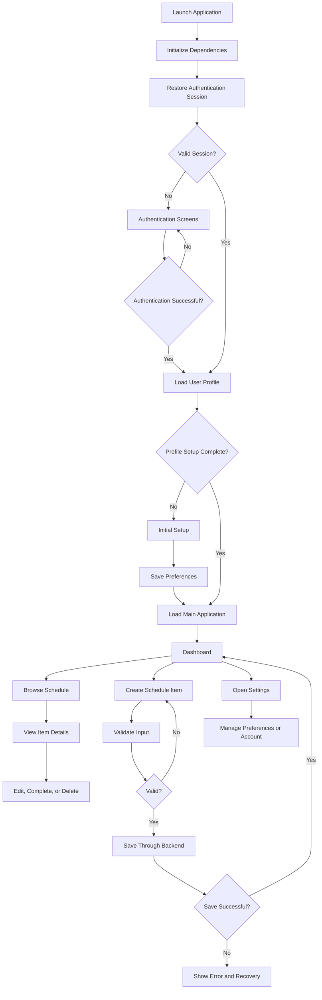
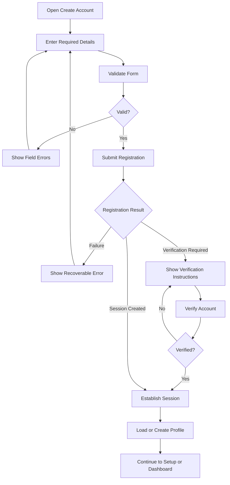
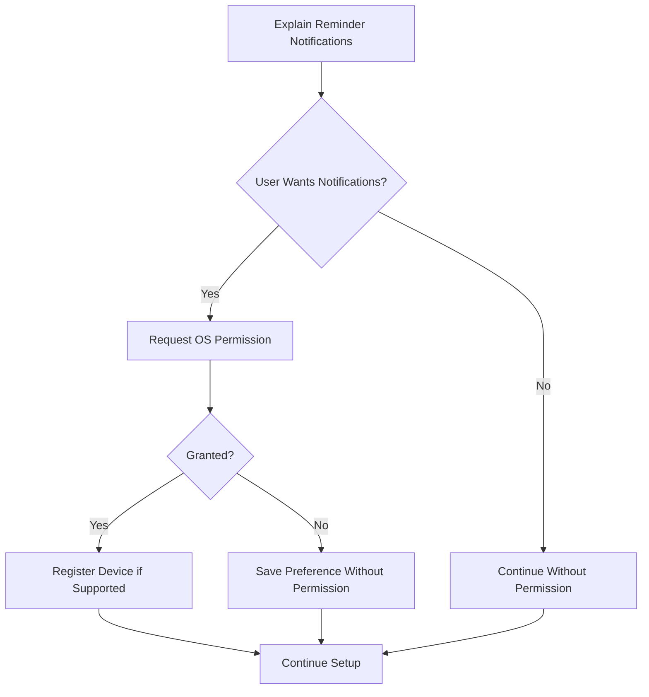
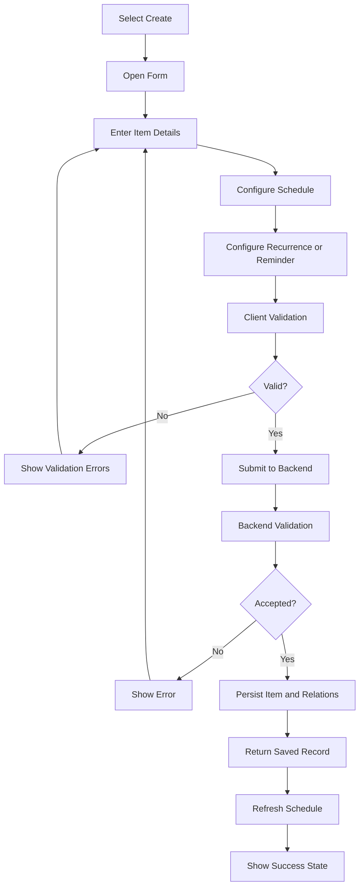
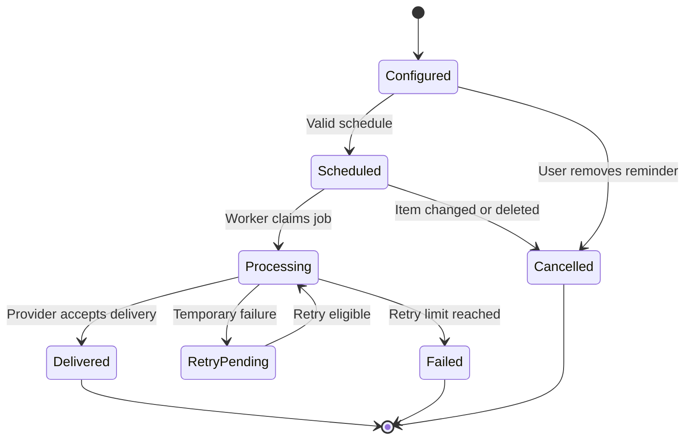
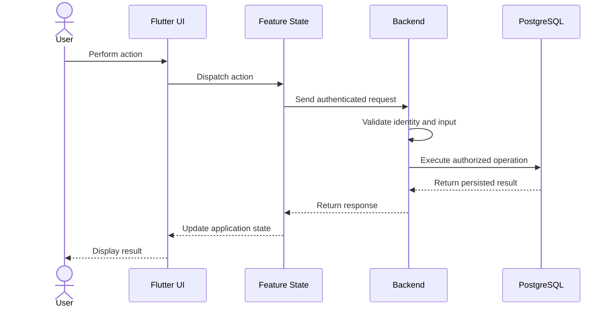
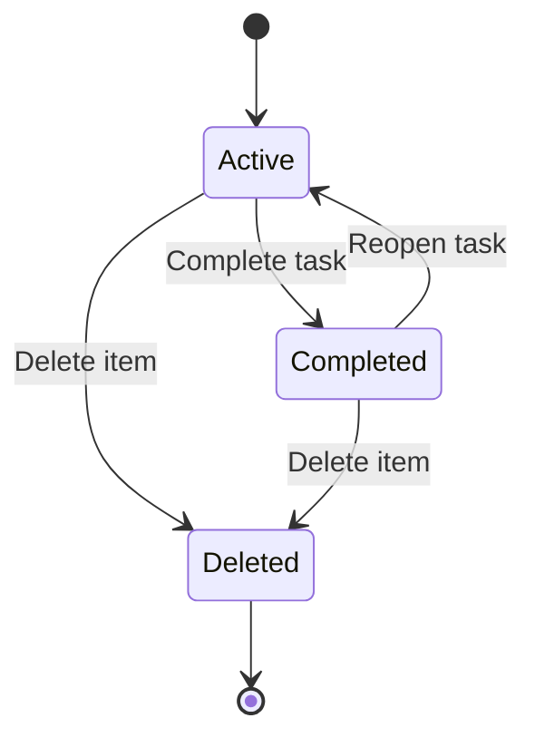
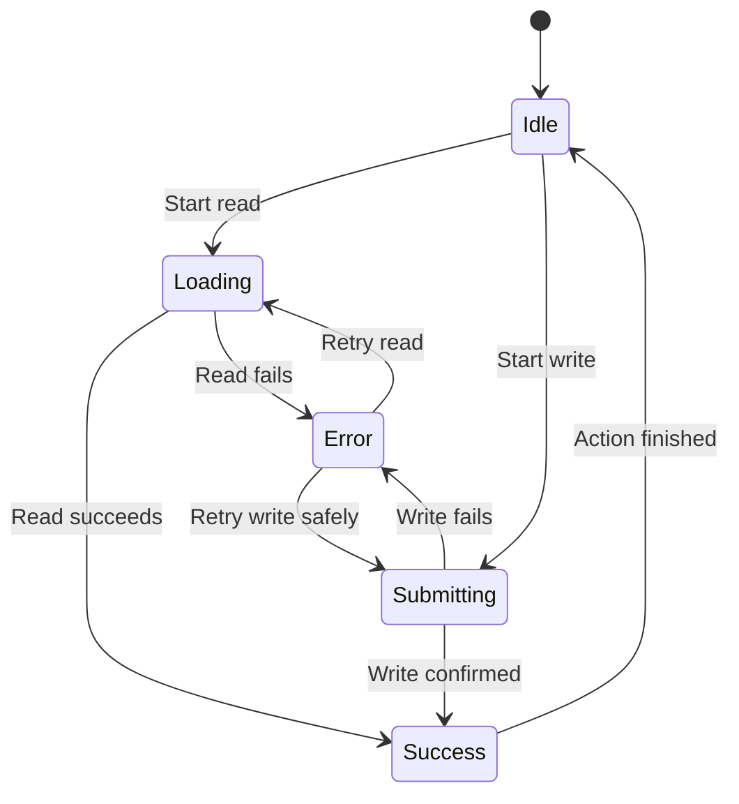

# Schedular App: Application Flow

**File:** `flow.md`  
**Project:** Schedular  
**Document Version:** 1.0  
**Status:** Proposed baseline  
**Primary Client:** Flutter  
**Database:** PostgreSQL  
**Backend:** To be confirmed against the final TRD  
**Document Purpose:** Define the user journeys, navigation, business workflows, application states, error handling, and backend interactions for the Schedular application.

---

## 1. Purpose

This document defines how users move through Schedular, how application features interact, and how data moves between the Flutter client, backend services, database, and notification infrastructure.

It serves as the implementation reference for:

- Mobile app navigation and screen transitions.
- Authentication and account management.
- Onboarding and initial setup.
- Dashboard and schedule views.
- Creating, editing, completing, and deleting schedule items.
- Tasks, events, deadlines, and recurring schedules.
- Reminder configuration and notification delivery.
- User preferences and time zones.
- Loading, empty, error, and offline states.
- Data validation, authorization, and synchronization.
- Testing the complete user journeys.

### 1.1 Core principles

1. Every primary user action must have a clear outcome.
2. Users must understand what will happen before destructive or consequential actions.
3. Data must not be considered saved until the backend confirms persistence, except where an explicitly designed offline queue is used.
4. Client-side validation improves usability; server-side validation enforces correctness.
5. Users may access only data they are authorized to access.
6. Notification delivery must be independent of whether the Flutter application is currently open.
7. Recurring items must have explicit rules for editing and deleting individual occurrences.
8. Every screen must account for loading, empty, success, and failure states.
9. Navigation must remain predictable across Android and iOS.
10. The interface must follow `design.md` and the project's visual constraints.

---

## 2. Product Scope

### 2.1 Core flows

The following flows form the proposed baseline:

- Application launch.
- Authentication and session restoration.
- Account registration, login, and logout.
- Password recovery, if password authentication is supported.
- Initial profile and preference setup.
- Main dashboard.
- Calendar or schedule browsing.
- Schedule item creation and editing.
- Task completion and reopening.
- Schedule item deletion.
- Recurrence creation and modification.
- Reminder setup and notification permission handling.
- Search and filtering, if included in the approved TRD.
- Profile and settings management.
- Account deletion.
- Error recovery and session expiration.

### 2.2 Conditional flows

These flows must be implemented only if they are part of the approved TRD:

- Social authentication.
- Shared schedules and collaboration.
- Calendar provider synchronization.
- Attachments.
- Subtasks.
- Time tracking.
- Subscription and billing.
- Advanced analytics.
- Multi-device offline conflict resolution.

Do not introduce these features solely because the architecture could support them.

---

## 3. Actors and System Components

### 3.1 Actors

| Actor | Responsibility |
|---|---|
| Guest | Uses permitted unauthenticated screens |
| Authenticated user | Manages personal schedule data |
| Flutter application | Presents UI and submits user actions |
| Authentication provider | Verifies identity and issues sessions |
| Backend/API | Validates requests and enforces business rules |
| PostgreSQL database | Stores authoritative application data |
| Notification worker | Processes scheduled reminder jobs |
| Push notification provider | Delivers supported remote notifications |
| Operating system | Manages local notifications and permissions |

### 3.2 System boundaries

The Flutter application is not the security boundary.

The client must not independently decide that a user owns a record, that a reminder has been delivered, or that a recurring occurrence is valid. Those rules must be enforced by trusted backend logic and database constraints where appropriate.

Sensitive service credentials must never be embedded in the mobile application.

---

## 4. High-Level Application Flow



### 4.1 Global application states

At minimum, the application must distinguish these states:

- `initializing`
- `unauthenticated`
- `authenticated`
- `profile_setup_required`
- `loading`
- `ready`
- `submitting`
- `recoverable_error`
- `session_expired`

These are logical states. They do not all need to be implemented as one global state machine. Use feature-specific state management where it produces clearer, more maintainable code.

---

## 5. Navigation Structure

### 5.1 Proposed primary navigation

The final navigation must be validated against the TRD. A reasonable starting structure is:

```text
Application
├── Authentication
│   ├── Welcome / Sign In
│   ├── Create Account
│   ├── Password Recovery
│   └── Reset Password
│
├── Initial Setup
│   ├── Profile Details
│   ├── Time Zone
│   └── Reminder Preferences
│
└── Main Application
    ├── Dashboard
    ├── Schedule
    │   ├── Day View
    │   ├── Week View
    │   ├── Month View
    │   └── Schedule Item Details
    ├── Create Schedule Item
    ├── Search / Filters (if approved)
    └── Settings
        ├── Profile
        ├── Preferences
        ├── Notifications
        ├── Security
        └── Account Management
```

### 5.2 Navigation rules

1. Authentication screens must not expose private schedule data.
2. A successful login must route to setup or the main application based on profile state.
3. Opening an item must preserve enough navigation context to return to the originating view.
4. Opening a creation form from a specific date should prefill that date where appropriate.
5. Successful edits should return to the details screen or previous context with refreshed data.
6. A failed save must preserve user-entered form data whenever safe.
7. Logout must clear authenticated application state and private cached data according to the security policy.
8. Android back navigation and iOS navigation gestures must behave consistently.
9. Repeated taps must not create duplicate routes or duplicate submissions.
10. Deep links must validate authentication and resource access before displaying private content.

---

## 6. Application Launch Flow

### 6.1 Flow

1. The operating system opens the application.
2. Flutter initializes required dependencies.
3. The app loads non-sensitive configuration.
4. The authentication SDK attempts to restore the existing session.
5. If the session is valid, load the authenticated user's profile.
6. If the session requires renewal, attempt supported renewal.
7. If the session cannot be restored, route to authentication.
8. If initial setup is incomplete, route to setup.
9. Otherwise, load the main application.
10. Fetch the initial schedule data and preferences.
11. Display the dashboard when the required data is ready.

### 6.2 Launch states

| State | Expected behavior |
|---|---|
| Initializing | Display a restrained loading or launch state |
| Session restored | Continue to profile loading |
| No session | Display authentication |
| Profile unavailable | Show recoverable error and retry |
| Network unavailable | Show cached content only if supported |
| Setup incomplete | Continue setup |
| Ready | Display the main application |

### 6.3 Failure handling

If profile retrieval fails, do not silently create a new profile or route the user into an unrelated account.

Provide a retry action. If the authentication session is definitively invalid, clear it and route to authentication.

---

## 7. Authentication Flows

### 7.1 Account registration



### 7.2 Registration rules

- Validate required fields before submission.
- Validate email format when email is used.
- Enforce password requirements in both the client and authentication provider.
- Do not log passwords or authentication tokens.
- Avoid revealing whether a particular email address belongs to another account unless the authentication design explicitly permits it.
- Handle verification-required accounts separately from fully authenticated accounts.
- Prevent duplicate profile creation through backend constraints and idempotent operations.

### 7.3 Login

1. The user opens the sign-in screen.
2. The user enters the required credentials or chooses a supported authentication provider.
3. The client performs basic input validation.
4. The authentication provider verifies the credentials.
5. The client handles the authentication result.
6. The application retrieves the user's profile.
7. The app checks whether setup is required.
8. The app routes to setup or the dashboard.

On invalid credentials, display a clear and non-sensitive error. Do not expose internal authentication errors or stack traces.

### 7.4 Password recovery

If password-based authentication is supported:

1. The user selects the password recovery action.
2. The user enters the account email.
3. The client submits a recovery request.
4. The authentication provider initiates its recovery process.
5. The app displays a generic confirmation message.
6. The user follows the supported recovery link or code flow.
7. The user establishes a new password.
8. The app confirms success and follows the configured session policy.

The application must not collect or store the old password.

### 7.5 Session expiration

1. A protected request receives an authentication failure.
2. The client attempts session renewal if supported.
3. If renewal succeeds, the request may be retried safely.
4. If renewal fails, clear authenticated state.
5. Preserve no unauthorized access to private screens.
6. Route the user to sign-in.
7. Display a concise explanation that the session has expired.

Do not automatically retry non-idempotent operations in a way that may create duplicate schedule items.

### 7.6 Logout

1. The user chooses Logout.
2. Display confirmation if required by the product's interaction design.
3. End the authentication session through the configured provider.
4. Clear sensitive in-memory state and private cached information.
5. Cancel or clear user-specific local state as appropriate.
6. Route to the authentication screen.
7. Ensure that back navigation cannot reveal previously open private screens.

Logout must not delete the user's server-side schedule data.

---

## 8. Initial Setup Flow

### 8.1 Purpose

Collect only the information required to make the application useful and correctly configured.

### 8.2 Proposed sequence

1. Confirm the user's profile details where required.
2. Determine or ask for the preferred time zone.
3. Set basic schedule preferences.
4. Configure reminder defaults.
5. Explain notification permission requirements when relevant.
6. Save preferences.
7. Mark setup complete on the backend.
8. Open the dashboard.

### 8.3 Setup rules

- Avoid asking for information that can safely be derived or configured later.
- Do not request notification permission before explaining why it is useful.
- Do not treat permission denial as failed onboarding.
- Store time zone identifiers such as `Asia/Karachi`, not only a fixed UTC offset.
- Save setup progress when partial completion is supported.
- Do not mark setup complete before the required settings have been persisted.

### 8.4 Notification permission branch



The app must distinguish the user's reminder preference from the operating system's permission state. A user may want reminders while the OS currently blocks notification delivery.

---

## 9. Dashboard Flow

### 9.1 Purpose

The dashboard provides a clear overview of the user's upcoming schedule and the most relevant actions.

### 9.2 Loading sequence

1. Open the dashboard.
2. Read the user's saved preferences.
3. Retrieve the schedule data required for the visible date range.
4. Retrieve categories and relevant reminder metadata if needed.
5. Apply sorting and display rules.
6. Render the dashboard.

Avoid loading the entire schedule history if only a short date range is needed.

### 9.3 Dashboard states

| State | UI behavior |
|---|---|
| Initial loading | Show appropriate loading indicators |
| No schedule items | Show an informative empty state and a create action |
| Items available | Show ordered schedule content |
| Request failed | Show a retry action and useful error text |
| Offline with cached data | Show cached content only if offline support exists |
| Refreshing | Keep existing content visible when possible |
| Partial failure | Preserve usable sections and explain unavailable data |

### 9.4 Dashboard actions

A user may:

- Open a schedule item.
- Create a new item.
- Navigate to another date or schedule view.
- Complete a task.
- Search or filter, if supported.
- Open settings.

The dashboard should not display fabricated counts, reviews, activity metrics, or social proof.

---

## 10. Schedule Browsing Flow

### 10.1 Date navigation

1. The user opens the schedule view.
2. The app selects the current date or last selected date according to the product specification.
3. The app calculates the visible date range.
4. The app requests items for that range.
5. The app orders items according to the approved sorting rules.
6. The user changes the date or view.
7. The app requests any missing range and updates the visible content.

### 10.2 View switching

If day, week, and month views are supported:

- Switching views must not unexpectedly reset the selected date.
- The app must preserve the selected date when practical.
- Date range calculations must account for the user's time zone.
- The visible range must have a documented definition of its start and end.
- A view switch must not create or modify schedule records.

### 10.3 Item ordering

Define one consistent ordering policy, such as:

1. Items with a scheduled start time.
2. Start time ascending.
3. All-day items according to the chosen product convention.
4. Unscheduled tasks according to due date or priority.

The exact ordering must be confirmed in the TRD. Do not allow different screens to apply contradictory sorting rules without an explicit reason.

---

## 11. Create Schedule Item Flow

### 11.1 Supported item types

The proposed baseline uses two primary item types:

- **Task:** An actionable item that may be completed.
- **Event:** A scheduled occurrence with a start time and optional end time.

Use only the types approved by the TRD. Do not introduce additional types without a defined business need.

### 11.2 Creation sequence

1. The user selects Create.
2. The app opens the creation form.
3. If creation began from a selected date or time, prefill it when appropriate.
4. The user enters the title.
5. The user selects the item type.
6. The user optionally enters a description.
7. The user sets the start, end, or due time as appropriate.
8. The user chooses a category if categories are enabled.
9. The user configures recurrence if supported.
10. The user configures reminders if supported.
11. The user submits the form.
12. The client validates the fields.
13. The backend validates the request and authorization.
14. The backend persists the item and related records in a transaction where appropriate.
15. The client receives the saved record.
16. The app refreshes the relevant schedule view.
17. The app displays the successful result.

### 11.3 Creation flow diagram



### 11.4 Required validation

At minimum:

- Title must not be blank.
- Title length must meet documented limits.
- Description length must meet documented limits.
- End time must not precede start time.
- Date and time values must be valid.
- Due time must follow the selected task rules.
- Category references must belong to the authenticated user or be globally available by design.
- Recurrence settings must be internally consistent.
- Reminder times must satisfy the configured reminder rules.
- Time zone identifiers must be valid.
- Required fields must be enforced on the server.

### 11.5 Submission behavior

While a save request is pending:

- Disable repeated submission.
- Show a clear saving state.
- Preserve form values if the request fails.
- Avoid creating duplicate records from repeated taps.
- Do not show success until persistence is confirmed.

If the request times out and its result is uncertain, use a safe retry strategy, such as an idempotency key where supported, rather than blindly creating another record.

---

## 12. Edit Schedule Item Flow

1. The user opens an item.
2. The app verifies that the item is accessible.
3. The app displays the current saved values.
4. The user selects Edit.
5. The form is populated from the current record.
6. The user changes one or more fields.
7. The client validates the form.
8. The backend checks ownership and business rules.
9. The backend saves the update.
10. The app refreshes the item and affected schedule range.
11. Related reminder jobs are recalculated if relevant.
12. The user sees the updated details.

### 12.1 Editing rules

- Editing must not accidentally clear fields that were not modified.
- The app should handle stale data if another device has changed the same record.
- A failed update must not be presented as successful.
- If a date or time changes, dependent reminder schedules must be updated.
- If recurrence changes, the user must be given the correct scope choice when applicable.
- A category must be validated against ownership rules.

### 12.2 Concurrent updates

If the record was modified after it was loaded, the backend should reject the conflicting update or apply a documented merge policy.

Where conflict detection is required, use a version field or `updated_at` comparison. Display the latest version and let the user retry rather than silently overwriting newer changes.

---

## 13. Task Completion Flow

1. The user selects Complete.
2. The client sends the completion action.
3. The backend verifies ownership and current state.
4. The task status is updated.
5. Completion metadata is stored if required.
6. Related reminders are reconciled.
7. The app updates the visible task.
8. The user receives feedback.

### 13.1 Reopening a task

If reopening is supported:

1. The user selects Reopen.
2. The backend verifies that the action is allowed.
3. The status returns to the appropriate active state.
4. Relevant schedule data is refreshed.
5. Reminder scheduling follows the documented reopening policy.

### 13.2 Recurring task completion

Completing a recurring task should normally affect the selected occurrence, not every future occurrence.

The occurrence identity and persistence strategy must be defined before implementation. Do not use the parent schedule item alone as the identity for all recurring occurrences.

---

## 14. Delete Schedule Item Flow

### 14.1 Single item deletion

1. The user selects Delete.
2. The app presents a clear confirmation.
3. The user confirms.
4. The backend verifies ownership.
5. The item is deleted or soft-deleted according to the database policy.
6. Related reminders and pending delivery jobs are cancelled or invalidated.
7. The app refreshes the relevant views.
8. The user sees the updated state.

If deletion fails, keep the item visible and explain how to retry.

### 14.2 Recurring item deletion

For recurring items, ask which scope should be affected:

- This occurrence only.
- This and future occurrences.
- The entire series.

These choices must be shown only where recurrence is supported and the requested operation makes sense.

### 14.3 Deletion consistency

Deleting an item must not leave active notification jobs that can send stale reminders.

Use backend transactions, cancellation logic, and worker-side validity checks. A queued job must verify that the underlying item or occurrence is still active before delivery.

---

## 15. Recurrence Flow

### 15.1 Supported recurrence examples

If approved by the TRD, recurrence may include:

- Daily.
- Weekly.
- Monthly.
- Yearly.
- Custom intervals.
- Selected weekdays.
- End after a number of occurrences.
- End on a specific date.
- No defined end date.

Do not implement every option automatically. Define the supported recurrence rules in the product specification first.

### 15.2 Recurrence creation

1. The user enables recurrence.
2. The app displays the supported recurrence options.
3. The user selects a frequency.
4. The user configures the interval and applicable options.
5. The user chooses an end condition if supported.
6. The app validates the recurrence configuration.
7. The backend stores the recurrence rule.
8. The schedule view generates or retrieves the relevant occurrences.
9. Reminder scheduling is created for eligible occurrences.

### 15.3 Occurrence generation

The system must choose a documented strategy:

**Option A: Generate occurrences on demand.** Calculate instances for a requested date range using the recurrence rule and exception records.

**Option B: Materialize occurrences.** Store individual occurrences or a dedicated occurrence table for querying and tracking state.

The choice affects completion, exceptions, reminder delivery, performance, and synchronization. Do not combine both approaches without a clear ownership model.

### 15.4 Recurrence exceptions

An occurrence may be:

- Skipped.
- Rescheduled.
- Individually completed.
- Individually modified.
- Individually deleted.

The system must define how each exception relates to the original series and how it is identified across time zone changes.

### 15.5 Recurrence editing

When changing a recurring item, distinguish between:

- Editing one occurrence.
- Editing the selected occurrence and future occurrences.
- Editing the entire series.

The backend must apply the selected scope consistently to recurrence rules, exceptions, occurrences, and reminders.

### 15.6 Date and time edge cases

Recurrence implementation must account for:

- Months with different numbers of days.
- Leap years.
- Daylight saving time transitions in applicable time zones.
- Local dates that differ from UTC dates.
- Nonexistent local times.
- Ambiguous local times.
- Series moved across time zones.

Use a documented rule for monthly occurrences on dates that do not exist in every month. Do not rely on accidental date-library overflow behavior.

---

## 16. Reminder Configuration Flow

### 16.1 Reminder creation

1. The user opens an item form or details screen.
2. The user selects Add Reminder.
3. The app displays supported reminder options.
4. The user chooses a time or offset.
5. The client validates the reminder.
6. The backend verifies the parent item and user authorization.
7. The reminder is persisted.
8. A backend scheduling job is created or updated.
9. The app displays the saved reminder.

### 16.2 Reminder validation

- A reminder must reference an authorized item.
- Its delivery time must be derived from a valid item or occurrence.
- Past-time behavior must be documented.
- Duplicate reminders must be prevented where required.
- A reminder must be reconciled when its parent item changes.
- Deleted or completed items must follow the configured cancellation policy.

### 16.3 Reminder lifecycle



`Delivered` must have a precise operational meaning. For push notifications, provider acceptance does not guarantee that the user's device displayed or that the user saw the notification.

---

## 17. Notification Permission and Delivery Flow

### 17.1 Permission handling

1. The user enables reminders or requests notification delivery.
2. The app checks the operating system permission state.
3. If permission is granted, register or refresh the device token when push notifications are supported.
4. If permission is denied, explain the consequence without blocking unrelated features.
5. If permission is permanently denied, offer instructions for changing system settings where appropriate.
6. If the token changes, update the backend registration.
7. If the user logs out, apply the device-token policy for that account and device.

### 17.2 Server-side delivery

1. The scheduler identifies due reminder jobs.
2. A worker claims eligible jobs safely.
3. The worker verifies that the item, occurrence, and reminder remain valid.
4. The worker verifies that the job has not already been processed successfully.
5. The worker sends the notification through the configured provider.
6. The worker records the provider result.
7. Temporary failures are retried with bounded backoff.
8. Permanent failures are recorded and handled according to policy.
9. Invalid device tokens are disabled or removed.
10. The job is finalized.

### 17.3 Delivery requirements

- Notification scheduling must not depend on the Flutter app being open.
- The backend must avoid processing the same job concurrently.
- Retries must not create uncontrolled duplicate notifications.
- Delivery jobs must be safe to retry.
- Logs must not contain sensitive notification content unnecessarily.
- Notification payloads must not expose private schedule details on a locked screen unless the product explicitly permits it.
- Time zone and daylight saving rules must be applied consistently.

---

## 18. Search and Filtering Flow

Implement this section only if search and filtering are approved features.

### 18.1 Search

1. The user opens search.
2. The user enters a query.
3. The app validates query length.
4. The app submits the query to the backend or performs a documented local search.
5. The backend applies the user's access restrictions.
6. Results are sorted and paginated where necessary.
7. The app displays results or an empty state.

### 18.2 Filters

Possible filters include:

- Date range.
- Task status.
- Item type.
- Category.
- Priority.
- Completion state.

Only expose filters supported by the data model and TRD.

### 18.3 Search states

- No query entered.
- Searching.
- Results found.
- No results.
- Request failed.
- Query cleared.

Search must not expose another user's data, including through autocomplete or result counts.

---

## 19. Profile and Settings Flows

### 19.1 Profile update

1. The user opens Profile.
2. The app loads the current profile.
3. The user changes editable fields.
4. The client validates input.
5. The backend checks authorization and constraints.
6. The changes are saved.
7. The app refreshes profile state.
8. The user receives confirmation.

### 19.2 Preference update

Preferences may include:

- Time zone.
- Default schedule view.
- Week start day.
- Time format.
- Default reminder behavior.
- Notification preferences.
- Theme preference, if supported.

For each preference, define a default, validation rule, storage location, and effect on the UI.

### 19.3 Time zone change

1. The user selects a new time zone.
2. The app explains any important scheduling consequences.
3. The backend validates the time zone identifier.
4. The preference is saved.
5. The app refreshes date-based views.
6. Reminder jobs are recalculated if their meaning depends on the changed time zone.

Do not silently reinterpret every existing scheduled time. Distinguish between events fixed to an absolute instant and events intended to remain at a local wall-clock time.

---

## 20. Account Deletion Flow

Account deletion must be implemented only after the backend's retention and deletion policy is defined.

### 20.1 Flow

1. The user opens Account Management.
2. The user selects Delete Account.
3. The app explains the consequences.
4. The user confirms the action using the required reauthentication or verification step.
5. The backend verifies the authenticated user.
6. The backend starts the deletion workflow.
7. Associated data is deleted, anonymized, or retained according to documented policy and legal requirements.
8. Pending notification jobs and device registrations are invalidated.
9. The authentication account is deleted at the appropriate stage.
10. The app clears local private data.
11. The user is returned to the unauthenticated state.

### 20.2 Requirements

- Do not perform deletion from a client-only operation.
- Prevent partial deletion from leaving active reminders.
- Define the treatment of audit logs and legally required records.
- Make the result clear to the user.
- If deletion is asynchronous, show the actual request status.
- Never claim that an account has been deleted before the backend confirms the result.

---

## 21. Backend Request and Data Persistence Flow

### 21.1 Standard request lifecycle



### 21.2 Required backend responsibilities

The backend must:

- Authenticate protected requests.
- Enforce record ownership.
- Validate all user-supplied fields.
- Enforce business rules.
- Persist related changes transactionally when required.
- Apply pagination and bounded query ranges.
- Prevent unauthorized access.
- Return consistent error responses.
- Avoid leaking internal exceptions.
- Record security-relevant events appropriately.

### 21.3 Database consistency

For operations involving multiple records, determine whether they must be committed in one transaction.

Examples include:

- Creating an item and its recurrence rule.
- Creating a reminder and its scheduling record.
- Deleting an item and invalidating associated reminder jobs.
- Changing recurrence and updating related exceptions.

The final implementation must follow the actual database schema and backend architecture.

---

## 22. Error Handling and Recovery

### 22.1 Error categories

| Category | Expected behavior |
|---|---|
| Validation error | Highlight the relevant field and preserve input |
| Authentication error | Renew the session or route to sign-in |
| Authorization error | Deny access without revealing private data |
| Network error | Offer retry and preserve safe local state |
| Server error | Display a generic message and allow recovery |
| Conflict error | Refresh data and let the user resolve the conflict |
| Rate limit | Respect server retry guidance |
| Missing record | Display a not-found state |
| Notification failure | Record the failure without corrupting the schedule |
| Unknown error | Show a safe fallback and log diagnostics without secrets |

### 22.2 Error UX rules

- Do not display raw exceptions or database messages.
- Do not discard form data unnecessarily.
- Do not report success when persistence failed.
- Do not automatically repeat destructive actions.
- Provide a clear recovery action whenever possible.
- Avoid exposing tokens, internal identifiers, stack traces, or sensitive fields.
- Log sufficient diagnostic information to investigate failures without logging secrets.

### 22.3 Retry policy

Retries must distinguish between idempotent reads and non-idempotent writes.

A read can usually be retried safely. A write may require an idempotency key, operation identifier, or explicit reconciliation before retrying.

Never assume a timed-out request was not processed.

---

## 23. Offline and Synchronization Flow

Offline support must be implemented only if included in the TRD.

### 23.1 Read-only offline behavior

If offline reading is supported:

1. The app loads the most recent permitted cached data.
2. The app indicates that the data may be stale.
3. A network connection triggers a refresh.
4. The refreshed data replaces the cache only after validation.

### 23.2 Offline writes

If offline creation or editing is supported:

1. The client validates the action locally.
2. The action is stored in a persistent operation queue.
3. The UI distinguishes pending changes from confirmed server data.
4. When connectivity returns, the client submits queued operations.
5. The backend validates each operation.
6. The client reconciles successful writes.
7. Conflicts are handled using a documented policy.
8. Failed operations remain visible and recoverable.

### 23.3 Synchronization rules

- Do not silently overwrite newer server data.
- Do not create duplicate items when retrying queued operations.
- Do not assume client clocks are authoritative.
- Keep operation identifiers stable across retries.
- Protect cached private data on shared devices.
- Define behavior for logout while unsynchronized changes remain.

If offline writes are not part of the initial release, use explicit online-only behavior rather than introducing an incomplete synchronization system.

---

## 24. Flutter Implementation Boundaries

### 24.1 Presentation layer

Responsibilities:

- Render screens and reusable widgets.
- Handle user input.
- Display loading, success, empty, and error states.
- Delegate business actions to application state or controllers.

The presentation layer must not directly contain database administration logic or notification worker implementation.

### 24.2 Application state layer

Responsibilities:

- Coordinate user actions.
- Track loading and submission states.
- Hold feature-specific UI state.
- Coordinate repository calls.
- Manage recoverable errors.
- Prevent duplicate user-triggered operations.

Choose one consistent state management approach based on the final project architecture. Do not mix unrelated patterns arbitrarily.

### 24.3 Repository and data layer

Responsibilities:

- Encapsulate data access.
- Map backend responses to application models.
- Handle pagination.
- Normalize recoverable transport errors.
- Provide testable interfaces for business logic.

### 24.4 Backend boundary

Responsibilities:

- Enforce authorization and business rules.
- Validate and persist data.
- Manage recurrence and reminder scheduling where required.
- Apply transactions and concurrency controls.
- Execute trusted background jobs.

The Flutter application must never contain privileged database or push-provider credentials.

---

## 25. Domain State Definitions

The following are proposed logical states. Confirm exact values against the final schema and TRD.

### 25.1 Schedule item lifecycle



If the database uses soft deletion, `Deleted` is a logical state and the record may remain stored.

Events and tasks may need different lifecycle rules. Do not force event completion behavior into task logic unless the product defines it.

### 25.2 Request lifecycle



The state machine is conceptual. Implement only the states required by each feature and preserve clear transitions.

---

## 26. Security and Privacy Rules

1. Every protected request must be authenticated.
2. Every record access must be authorized server-side.
3. Apply database row-level security if using a platform such as Supabase with exposed client-accessible tables.
4. Provide explicit policies for every exposed table.
5. Keep service-role and provider secrets on trusted infrastructure.
6. Validate foreign-key relationships and ownership.
7. Do not trust user IDs supplied by the client without checking the authenticated identity.
8. Avoid storing sensitive data that is not needed.
9. Protect private local caches.
10. Do not include private schedule details in notification payloads unnecessarily.
11. Apply rate limits to sensitive endpoints.
12. Require appropriate reauthentication for high-impact account operations.
13. Define data retention and deletion rules.
14. Log security events without exposing credentials or sensitive content.

Database RLS, backend authorization, and client navigation checks serve different purposes. A hidden screen is not a security control.

---

## 27. Observability and Audit Events

Log operational events where they help diagnose problems or satisfy security requirements.

Potential events:

- Authentication succeeded or failed.
- Profile setup completed.
- Schedule item created or updated.
- Schedule item deleted.
- Task completed or reopened.
- Recurrence changed.
- Reminder scheduled, cancelled, or failed.
- Notification provider accepted or rejected a delivery.
- Account deletion requested or completed.

### Logging rules

- Do not log passwords, access tokens, refresh tokens, or provider secrets.
- Minimize logging of descriptions and other private schedule content.
- Apply a documented retention period.
- Distinguish audit records from ordinary diagnostic logs.
- Do not treat a client-side event as authoritative proof of a server-side change.

---

## 28. Accessibility and Interaction Behavior

- Every interactive control must have an accessible label.
- Form errors must be associated with their relevant fields.
- Screen readers must be able to identify task status and reminder state.
- Important actions must not rely on color alone.
- Touch targets must be usable on mobile devices.
- Keyboard navigation must be supported where applicable.
- Loading states must not create unnecessary focus changes.
- Destructive actions must be distinguishable from ordinary actions.
- Date and time selection must work with accessibility features.
- Animation must not obstruct tasks or disregard reduced-motion preferences.

The interface must follow `design.md`. Avoid decorative effects that reduce clarity or performance.

---

## 29. Performance Requirements

- Fetch only the data required for the visible schedule range.
- Paginate long result lists.
- Add database indexes for actual query patterns.
- Avoid repeated requests triggered by unnecessary rebuilds.
- Debounce search requests if live search is supported.
- Prevent duplicate submissions.
- Avoid blocking the main Flutter UI isolate with expensive work.
- Keep recurrence calculations bounded.
- Move notification scheduling and delivery to backend workers.
- Measure actual performance before adding complex caching.

Numeric performance targets must be defined in the project's non-functional requirements rather than invented here.

---

## 30. Testing Strategy

### 30.1 Unit tests

Test:

- Input validation.
- Schedule time calculations.
- Recurrence rules.
- Time zone conversion.
- Item lifecycle transitions.
- Reminder scheduling calculations.
- Sorting and filtering.
- Retry and error classification.

### 30.2 Widget tests

Test:

- Form validation.
- Loading indicators.
- Empty states.
- Error states.
- Confirmation dialogs.
- Disabled and enabled actions.
- Navigation behavior.
- Accessibility labels where supported.

### 30.3 Integration tests

Test:

- Registration and login.
- Session restoration and expiration.
- Profile setup.
- Creating and editing schedule items.
- Completing and reopening tasks.
- Deleting items.
- Recurrence changes and exceptions.
- Reminder creation and cancellation.
- Settings updates.
- Account deletion.
- Data ownership enforcement.

### 30.4 Notification tests

Test:

- Correct scheduled time.
- Time zone conversion.
- Daylight saving transitions.
- Duplicate job prevention.
- Worker concurrency.
- Retry behavior.
- Invalid device tokens.
- Deleted item cancellation.
- Recurrence exception handling.
- Provider failure handling.

### 30.5 Security tests

Test:

- Access to another user's record.
- Cross-user category or reminder references.
- Unauthorized update and delete requests.
- Missing and expired authentication.
- RLS policies for all exposed tables.
- Mass assignment of protected fields.
- Rate limiting on sensitive operations.
- Private data exposure through logs or notification payloads.

---

## 31. Acceptance Criteria

The application flow is ready for release when:

- [ ] Launch and authentication routing behave correctly.
- [ ] Session expiration does not expose private screens.
- [ ] Initial setup persists required preferences.
- [ ] Users can browse their permitted schedule data.
- [ ] Schedule items are validated by both client and backend.
- [ ] Create, edit, complete, reopen, and delete operations behave consistently.
- [ ] Recurring operations respect the selected scope.
- [ ] Reminder changes reconcile pending notification jobs.
- [ ] Notification permissions are handled without blocking unrelated features.
- [ ] Failed writes do not display false success.
- [ ] Retry behavior does not create duplicate records.
- [ ] Loading, empty, error, and offline states are implemented where applicable.
- [ ] Time zone behavior is documented and tested.
- [ ] Backend authorization and database policies prevent cross-user access.
- [ ] Account deletion follows the documented data-retention policy.
- [ ] Automated tests cover the critical user journeys.
- [ ] The implementation follows `design.md`, `coding-standards.md`, and `database-schema.md`.
- [ ] All implemented features match the approved TRD.

---

## 32. Implementation Order

Use this order to reduce dependency conflicts.

### Phase 1: Foundation

- Confirm the TRD and feature boundaries.
- Confirm the backend and authentication provider.
- Finalize database schema and migrations.
- Define error response conventions.
- Define Flutter folder structure and state management.
- Implement design tokens and shared UI components.

### Phase 2: Authentication and setup

- Application initialization.
- Session restoration.
- Registration and login.
- Profile loading.
- Initial setup.
- Logout and session expiration.

### Phase 3: Core scheduling

- Dashboard.
- Schedule browsing.
- Item creation.
- Item details.
- Item editing.
- Task completion and reopening.
- Item deletion.

### Phase 4: Recurrence and reminders

- Recurrence rules and exceptions.
- Occurrence identity and persistence.
- Reminder configuration.
- Notification permissions.
- Background worker and delivery lifecycle.
- Rescheduling and cancellation.

### Phase 5: Preferences and release readiness

- Profile and settings.
- Search and filters, if approved.
- Account deletion.
- Offline behavior, if approved.
- Accessibility.
- Security testing.
- Performance testing.
- Release validation.

---

## 33. Decisions Required Before Final Implementation

The following decisions must be resolved against the approved TRD.

| Decision | Why it matters |
|---|---|
| Backend platform | Determines API design, authentication integration, and security enforcement |
| Authentication methods | Determines registration, recovery, and verification flows |
| Exact item types | Determines validation and lifecycle rules |
| Recurrence model | Determines occurrence identity, exceptions, and completion behavior |
| Reminder worker architecture | Determines reliable scheduling, retries, and cancellation |
| Offline requirements | Determines cache design, queued writes, and conflict handling |
| Calendar views | Determines navigation, date-range queries, and UI requirements |
| Shared schedules | Changes ownership, permissions, and collaboration flows |
| Account deletion policy | Determines retention, asynchronous processing, and cleanup |
| Notification providers | Determines token management and delivery behavior |

Do not treat unresolved choices as finalized implementation requirements.

---

## 34. Document Maintenance

Update this document whenever a change modifies:

- A user journey.
- A screen transition.
- A business rule.
- A schedule item lifecycle.
- Recurrence behavior.
- Reminder scheduling or delivery.
- Authentication or authorization.
- Data persistence.
- Offline behavior.
- Account deletion.
- An acceptance criterion.

Any change to the application flow that affects data relationships must also be reflected in `database-schema.md`.

Any change that affects implementation conventions must also be reflected in `coding-standards.md`.

Any change that affects the interface must also be reflected in `design.md`.

The final TRD remains the source of truth for approved product scope.

---

**End of `flow.md`**