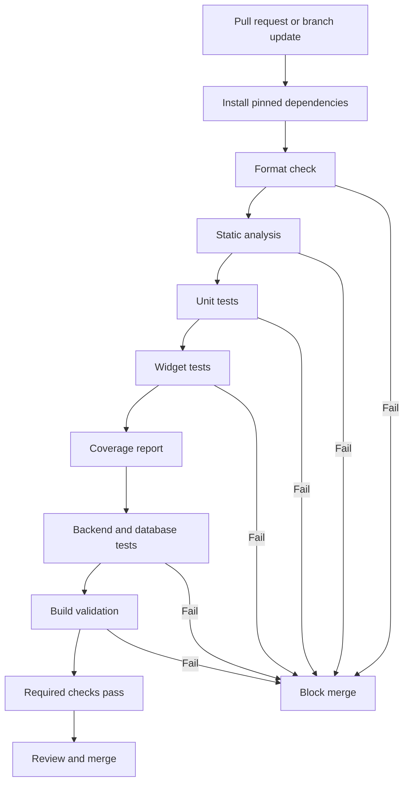

# TESTING.md

# Schedular Testing Strategy and Quality Assurance Standards

**Project:** Schedular  
**Document:** Testing Strategy and Quality Assurance Standards  
**Status:** Baseline specification  
**Primary platform:** Flutter  
**Target platforms:** Android and iOS  
**Audience:** Flutter developers, backend developers, QA engineers, reviewers, and AI coding agents

---

## 1. Purpose

This document defines how Schedular must be tested throughout development, integration, and release.

The goal is to verify that the application is functionally correct, reliable, secure, accessible, maintainable, and consistent with approved product requirements.

Testing must cover:

- Business logic and domain rules.
- Flutter widgets and screen behavior.
- Navigation and user journeys.
- Local and remote data persistence.
- Authentication and authorization.
- Schedule creation, editing, deletion, and completion.
- Recurrence, date handling, and time-zone behavior.
- Reminder scheduling and notification permissions.
- Offline behavior and network failures.
- Backend APIs and database constraints.
- Security and privacy.
- Accessibility and visual consistency.
- Performance and application stability.
- Android and iOS platform differences.
- CI/CD validation and release readiness.

A screen that renders successfully is not considered complete unless its supported interactions, data behavior, failure states, and acceptance criteria have also been tested.

---

## 2. Core Testing Principles

### 2.1 Test observable behavior

Tests must verify meaningful behavior rather than relying on implementation details that can change without affecting functionality.

Prefer assertions such as:

- A valid schedule item is persisted.
- An invalid time range is rejected.
- A failed save preserves user input.
- A notification opens the correct item.
- An unauthorized request is rejected.

Avoid tests that only verify private method calls or internal widget structure without confirming an important behavior.

### 2.2 Test at the appropriate layer

- Test pure calculations and business rules with unit tests.
- Test UI rendering and interactions with widget tests.
- Test complete journeys with integration tests.
- Test API behavior with backend integration and contract tests.
- Test persistence, constraints, and migrations against a real test database.
- Test operating-system integrations on actual or representative Android and iOS environments.

Do not use one test layer as a substitute for all others.

### 2.3 Make tests deterministic

Tests must not depend unnecessarily on:

- The current wall-clock time.
- Random identifiers.
- Uncontrolled network services.
- Production data.
- A developer's personal device configuration.
- Test execution order.
- An external service that can change without notice.

Use injected clocks, deterministic fixtures, controlled dependencies, and isolated test environments.

### 2.4 Fail safely

A test failure must be visible. Tests must not silently skip important assertions, swallow exceptions, or convert unexpected failures into passing results.

### 2.5 Avoid false confidence

- A passing mock-based test does not prove that a backend integration works.
- A widget test does not prove that operating-system notifications are delivered.
- A successful debug build does not prove that a release build works.
- Code coverage does not prove behavioral correctness.
- A successful database migration does not prove that authorization policies are correct.

Use the right evidence for each quality claim.

### 2.6 Do not fabricate test evidence

Never fabricate:

- Test results.
- Code coverage percentages.
- Benchmark measurements.
- Device test results.
- Security audit findings.
- CI status.
- Release approvals.

Report only results produced by actual test execution or verifiable tooling.

---

## 3. Testing Scope

### 3.1 In scope

The following areas are in scope whenever the corresponding feature is implemented:

1. Flutter application behavior.
2. Domain and scheduling logic.
3. Input validation.
4. Navigation and route handling.
5. Authentication and session management.
6. Local persistence.
7. Remote persistence and synchronization.
8. Database migrations and access policies.
9. Recurrence and time-zone calculations.
10. Reminder configuration and notification scheduling.
11. Network failures and retry behavior.
12. Accessibility.
13. Performance and stability.
14. Android and iOS compatibility.
15. CI/CD quality gates.
16. Release verification.

### 3.2 Conditional scope

These areas are required only if included in the approved product scope:

- Guest mode.
- Offline writes.
- Cross-device synchronization.
- Categories.
- Search and filtering.
- Account deletion.
- Subscription and payment flows.
- Collaboration and shared schedules.
- Push notifications.
- Analytics integrations.

Do not create tests for a feature as if it exists merely because it appears in a future proposal.

### 3.3 Out of scope unless approved

Do not introduce unapproved features or test requirements for:

- AI-generated schedules.
- Social feeds.
- Reviews and ratings.
- Fake user statistics.
- Unapproved analytics dashboards.
- Unapproved external messaging services.
- Team collaboration.
- Payment functionality.

The approved TRD defines product scope.

---

## 4. Testing Pyramid

Schedular must prioritize fast, focused tests while retaining sufficient integration and platform coverage.

<CodeBlock language="mermaid" editable={true}>flowchart TD
    A["Release and Device Validation"] --> B["End-to-End Integration Tests"]
    B --> C["Backend and Database Integration Tests"]
    C --> D["Flutter Widget Tests"]
    D --> E["Domain and Unit Tests"]
    E --> F["Static Analysis and Formatting"]

    style A fill:#e7e7e7,stroke:#777,color:#111
    style B fill:#e7e7e7,stroke:#777,color:#111
    style C fill:#e7e7e7,stroke:#777,color:#111
    style D fill:#e7e7e7,stroke:#777,color:#111
    style E fill:#e7e7e7,stroke:#777,color:#111
    style F fill:#e7e7e7,stroke:#777,color:#111</CodeBlock>

The diagram represents the validation layers, not a mandatory execution order. Fast checks should generally run first in CI.

### Layer 1: Static analysis

Detect formatting issues, type errors, lint violations, and other statically detectable problems.

### Layer 2: Unit tests

Validate deterministic business logic without requiring a running application or external service.

### Layer 3: Widget tests

Validate rendering, user interaction, validation messages, loading states, and accessible control behavior.

### Layer 4: Backend and database integration tests

Validate API contracts, persistence, authorization, transactions, and migrations.

### Layer 5: End-to-end integration tests

Validate important user journeys across the actual application layers.

### Layer 6: Device and release tests

Validate operating-system integrations, production-like builds, lifecycle behavior, and release artifacts.

---

## 5. Required Tooling

Use the tooling approved by the project architecture. The following is the baseline for a Flutter project.

| Area | Preferred tooling |
|---|---|
| Language and application | Flutter and Dart |
| Formatting | `dart format` |
| Static analysis | `flutter analyze` |
| Unit tests | Dart and Flutter test framework |
| Widget tests | `flutter_test` |
| Flutter integration tests | `integration_test` |
| Mocking | An approved Dart mocking library or handwritten fakes |
| API testing | The backend's approved test framework |
| Database tests | Isolated test database and migration tooling |
| UI automation | Flutter integration tooling or approved platform tooling |
| Performance | Flutter DevTools and platform profilers |
| Accessibility | Flutter accessibility checks and platform verification |
| CI | Provider selected in `CI_CD.md` |
| Test reporting | Machine-readable output and CI artifacts |

Do not add dependencies solely because they are listed here. Verify that each dependency is compatible with the selected Flutter SDK and the project's dependency policy.

The final dependency list must match the approved architecture and lockfile.

---

## 6. Repository and Test Organization

Use a consistent structure that fits the approved application architecture.

A possible baseline is:

```text
lib/
  core/
  features/
    schedule/
    calendar/
    reminders/
    settings/
    authentication/

test/
  unit/
    core/
    schedule/
    calendar/
    reminders/
    authentication/
  widget/
    schedule/
    calendar/
    reminders/
    settings/
    authentication/
  integration/
    authentication/
    schedule/
    reminders/
  fixtures/
  helpers/
  fakes/
```

Backend tests should reside in the backend's established test directory.

Database migration tests should reside alongside or within the backend/database testing structure.

### Organization rules

- Group tests by feature or responsibility.
- Keep fixtures reusable but explicit.
- Keep fake implementations separate from production implementations.
- Avoid oversized test files covering unrelated behavior.
- Keep test names descriptive.
- Do not put production logic inside test helpers.
- Do not store production credentials in test configuration.
- Do not mix real production data with test fixtures.

The exact directory layout may differ if `coding-standards.md` establishes another convention.

---

## 7. Naming and Test Structure

Test names must explain the behavior being verified.

Preferred examples:

```dart
test('rejects an event whose end time precedes its start time', () {
  // Arrange, act, assert.
});
```

```dart
testWidgets('shows a retry action when schedule loading fails',
    (tester) async {
  // Arrange, act, assert.
});
```

Use the Arrange, Act, Assert structure:

1. **Arrange:** Prepare the fixture and controlled dependencies.
2. **Act:** Execute the behavior under test.
3. **Assert:** Verify the externally observable result.

Each test should primarily verify one behavior. Multiple assertions are appropriate when they collectively establish the same behavior.

Avoid names such as:

- `test1`
- `works`
- `should pass`
- `test schedule`

Test names should remain useful when displayed in CI reports.

---

## 8. Static Analysis and Formatting

Static checks must run before merging changes.

### Required commands

```bash
dart format --output=none --set-exit-if-changed .
flutter analyze
flutter test
```

Run formatting normally when changes are required:

```bash
dart format .
```

If the repository contains unrelated Dart code, narrow the formatting scope according to the repository's standards.

### Requirements

- Resolve analysis errors before merging.
- Treat warnings according to the project's agreed lint policy.
- Do not disable lint rules solely to hide poor code.
- Avoid broad analysis suppressions.
- Document justified exceptions.
- Do not modify generated files manually unless the relevant tooling requires it.
- Regenerate generated artifacts using the approved generation process.
- Keep CI and local validation commands aligned.

Static analysis is necessary but does not replace testing.

---

## 9. Unit Testing

### 9.1 What to unit test

Unit tests must cover pure functions and isolated domain logic, including:

- Input normalization.
- Schedule item validation.
- Date and time calculations.
- Recurrence calculations.
- Reminder offset calculations.
- Sorting and filtering.
- Completion-state transitions.
- Permission-state mapping.
- Error-to-domain-state mapping.
- Repository coordination logic where appropriate.
- Conflict-resolution rules.
- Serialization and deserialization.
- Identifier and value-object validation.

### 9.2 Unit test requirements

- Keep tests fast and deterministic.
- Inject time-dependent behavior.
- Avoid live network requests.
- Avoid depending on a real operating-system notification service.
- Use fakes for simple deterministic dependencies.
- Use mocks only when interaction verification is meaningful.
- Test invalid input as well as valid input.
- Verify boundary conditions.

### 9.3 Example: event validation

```dart
import 'package:flutter_test/flutter_test.dart';

DateTime makeTime(int hour, int minute) {
  return DateTime(2026, 10, 25, hour, minute);
}

bool hasValidTimeRange({
  required DateTime start,
  required DateTime end,
}) {
  return end.isAfter(start);
}

void main() {
  group('hasValidTimeRange', () {
    test('accepts an end time after the start time', () {
      expect(
        hasValidTimeRange(
          start: makeTime(9, 0),
          end: makeTime(10, 0),
        ),
        isTrue,
      );
    });

    test('rejects an end time before the start time', () {
      expect(
        hasValidTimeRange(
          start: makeTime(10, 0),
          end: makeTime(9, 0),
        ),
        isFalse,
      );
    });

    test('rejects an end time equal to the start time', () {
      expect(
        hasValidTimeRange(
          start: makeTime(9, 0),
          end: makeTime(9, 0),
        ),
        isFalse,
      );
    });
  });
}
```

This example illustrates a simple rule. Production validation must also account for all-day events, supported overnight events, time-zone semantics, and the approved event model.

Do not copy sample logic into production without checking the domain requirements.

---

## 10. Widget Testing

### 10.1 Objectives

Widget tests verify the behavior of individual Flutter screens and components without requiring a full production backend.

### 10.2 Required coverage

Test applicable screens for:

- Initial rendering.
- Correct labels and values.
- Primary and secondary actions.
- Form validation.
- Keyboard and focus behavior where testable.
- Loading states.
- Empty states.
- Error states.
- Retry actions.
- Disabled controls.
- Duplicate submission protection.
- Unsaved-changes handling.
- Theme behavior.
- Accessibility semantics.
- Long text and layout constraints.

### 10.3 Schedule screen

Verify that:

- The selected date is displayed correctly.
- Schedule items are rendered in the expected order.
- An empty schedule displays the approved empty state.
- A loading failure displays a recoverable error.
- Retry requests a new load.
- Selecting an item opens its details.
- The create action opens the correct form.
- Completed items use the approved visual treatment.

### 10.4 Schedule item form

Verify that:

- Required fields are identified.
- Invalid input produces actionable errors.
- A valid form can be submitted.
- Save is guarded while a request is in progress.
- Failed saves preserve user input.
- The correct selected date is used.
- All-day events do not require irrelevant time values.
- Recurrence controls appear only when supported.
- Reminder controls accurately represent the current configuration.

### 10.5 Test isolation

- Use controlled fake repositories or test doubles.
- Do not make live production requests.
- Avoid arbitrary delays.
- Use deterministic completion of asynchronous operations.
- Ensure pending timers and streams are cleaned up.
- Avoid dependence on widget tree details that are not part of the expected behavior.

---

## 11. Integration Testing

### 11.1 Objectives

Integration tests verify that multiple application components work together.

Examples include:

- Flutter UI connected to application state.
- Application state connected to repositories.
- Repositories connected to a test backend.
- Authentication connected to protected routes.
- Persistence connected to schedule refresh.
- Reminder configuration connected to notification scheduling.

### 11.2 Required journeys

At minimum, test these journeys where applicable:

1. Launch and enter the schedule.
2. Create a schedule item.
3. View the created item.
4. Edit the item.
5. Delete the item.
6. Complete and reopen an item.
7. Create and edit a recurring item.
8. Configure a reminder.
9. Handle notification permission denial.
10. Open a notification.
11. Recover from a failed request.
12. Sign out and verify protected navigation.
13. Restore a session.
14. Change a supported preference.

### 11.3 Integration environment

- Use a dedicated test backend.
- Use isolated test accounts.
- Use deterministic seed data.
- Reset or clean up test data.
- Avoid shared mutable fixtures between concurrently running tests.
- Do not use production credentials.
- Keep external services isolated or stubbed unless their real integration is being tested deliberately.

### 11.4 Failure behavior

Integration tests must include failure paths, not just successful journeys.

For example, creating an item should be tested with:

- Valid input.
- Invalid input.
- Authentication expiry.
- Network failure.
- Backend validation failure.
- A response timeout with an uncertain write outcome.
- Repeated submission.

---

## 12. User-Flow Acceptance Testing

`USER_FLOWS.md` is the source of truth for expected navigation and interaction behavior.

Every implemented flow must have traceable tests.

### Required flow coverage

| Flow | Minimum verification |
|---|---|
| First launch | Correct entry screen and initialization recovery |
| Onboarding | Completion and optional skip behavior |
| Registration | Validation and successful account creation |
| Sign in | Successful and failed authentication |
| Password recovery | Request submission and safe error handling |
| Schedule overview | Populated, empty, loading, and error states |
| Create item | Validation and exactly one confirmed creation |
| Item details | Correct item and current data |
| Edit item | Intended changes persist |
| Delete item | Confirmation and correct deletion scope |
| Completion | Correct state transition |
| Recurrence | Supported pattern and edit scope |
| Reminders | Configuration persistence and scheduling reconciliation |
| Permissions | Granted, denied, and restricted states |
| Notifications | Correct routing and missing-item fallback |
| Calendar | Correct selected date and schedule |
| Settings | Preference persistence |
| Sign out | Session cleanup and protected-route behavior |
| Deep links | Valid, invalid, and unauthorized destinations |
| Offline behavior | Correct behavior for the supported offline model |
| Synchronization | Consistency and conflict handling, if supported |

### Traceability requirement

For each flow:

1. Identify the applicable section in `USER_FLOWS.md`.
2. Identify its acceptance criteria.
3. Create corresponding automated tests where practical.
4. Document manual tests for behaviors that cannot be adequately automated.
5. Record any unimplemented or intentionally deferred requirements.

A flow must not be marked complete merely because its screen exists.

---

## 13. Scheduling Domain Tests

Scheduling logic requires special attention because small errors can affect event timing and reminders.

### 13.1 Date and time validation

Test:

- Valid start and end times.
- End before start.
- Equal start and end.
- Midnight boundaries.
- End-of-day boundaries.
- All-day events.
- Supported overnight events.
- Missing optional values.
- Invalid date values.
- Events in the past.
- Events scheduled for the current minute.
- Events near month and year boundaries.
- Leap-day dates.
- Month lengths of 28, 29, 30, and 31 days.

### 13.2 Time-zone behavior

Test:

- Conversion between stored instants and local display values.
- Date-only events across time zones.
- Events viewed after a device time-zone change.
- Recurring events around daylight-saving transitions.
- Ambiguous local times.
- Nonexistent local times.
- UTC-to-local conversion around midnight.
- Server and client consistency.

Do not rely only on the test machine's default time zone.

Use explicit time-zone fixtures and the project's approved date/time libraries.

### 13.3 Recurrence behavior

For each supported recurrence pattern, test:

- Initial occurrence.
- Next occurrence.
- End date.
- Occurrence limit, if supported.
- Month and year transitions.
- Leap years.
- Weekday selection.
- Editing one occurrence.
- Editing the remaining series.
- Editing the whole series.
- Skipping an occurrence.
- Deleting an occurrence.
- Preventing duplicate occurrence generation.
- Recalculation after a series change.

Unsupported recurrence patterns must be rejected or omitted from the UI. They must not be approximated silently.

### 13.4 Completion behavior

Test:

- Marking an item complete.
- Reopening a completed item.
- Repeated completion requests.
- Completion persistence.
- Synchronization of completion status, if supported.
- Behavior for deleted items.
- Completion behavior for recurring occurrences according to the approved data model.

---

## 14. Reminder and Notification Testing

Reminder behavior must be tested at both the application logic layer and the platform integration layer.

### 14.1 Unit tests

Test:

- Reminder offset calculations.
- Invalid reminder configurations.
- Reminder times in the past.
- Time-zone conversion.
- Recurring reminder calculations.
- Reconciliation after event edits.
- Cancellation after deletion.
- Duplicate scheduling prevention.
- Permission-state mapping.
- Notification payload parsing.

### 14.2 Integration tests

Verify:

- A saved reminder reaches the notification scheduling layer.
- Editing an event updates the appropriate scheduled notifications.
- Deleting an event cancels relevant notifications.
- Recurrence changes update the relevant reminders.
- Permission denial does not break schedule management.
- Invalid notification payloads lead to safe fallback behavior.
- Notification taps route to the correct destination.
- Repeated notification taps do not create duplicate navigation stacks.

### 14.3 Platform tests

Verify actual notification behavior on supported Android and iOS environments.

Consider:

- Permission granted.
- Permission denied.
- Permission changed in system settings.
- App foregrounded.
- App backgrounded.
- App terminated.
- Device restart, where supported.
- Notification scheduling limits.
- Battery and operating-system restrictions.
- App upgrade behavior.
- Time-zone change.
- Notification rescheduling after a reminder edit.

A test must not assume identical notification behavior across Android and iOS.

### 14.4 Delivery guarantees

A successful local scheduling API call does not prove that a notification was delivered to the user.

Report separate results for:

- Reminder configuration persistence.
- Notification scheduling request.
- Operating-system acceptance, where observable.
- Actual notification presentation, when explicitly verified.

Do not claim guaranteed delivery without supporting platform and backend evidence.

---

## 15. Authentication and Authorization Tests

### 15.1 Authentication

Test:

- Successful registration.
- Invalid registration.
- Duplicate account registration.
- Successful sign-in.
- Incorrect credentials.
- Expired session.
- Session refresh failure.
- Sign-out.
- Password recovery.
- Verification requirements.
- Authentication provider failure.
- Repeated submissions.
- Application resume after session expiry.

### 15.2 Authorization

Verify that:

- An unauthenticated user cannot access protected resources.
- A user cannot read another user's private schedule.
- A user cannot modify another user's items.
- A user cannot delete another user's items.
- Changing an item identifier does not bypass authorization.
- Deep links do not bypass access controls.
- Database policies enforce access independently of the Flutter UI.
- Backend operations validate ownership and permissions.

### 15.3 Security test rules

- Use dedicated test accounts.
- Use synthetic test data.
- Do not log credentials, tokens, or recovery secrets.
- Do not run destructive authorization tests against production data.
- Test both permitted and forbidden operations.
- Verify authorization at the actual enforcement layer.

A hidden button is not a security boundary.

---

## 16. Backend API Testing

If Schedular uses a backend API, the API must be tested independently of the Flutter client.

### 16.1 Request validation

Test:

- Missing required fields.
- Invalid field types.
- Malformed identifiers.
- Invalid date and time values.
- Unsupported recurrence values.
- Unsupported reminder values.
- Excessively long strings.
- Unexpected fields where strict validation is required.
- Invalid enum values.
- Duplicate requests.
- Invalid authentication tokens.

### 16.2 Response behavior

Verify:

- Correct success status and response structure.
- Consistent error format.
- Validation error details that are safe to expose.
- Authorization failure behavior.
- Resource-not-found behavior.
- Conflict handling.
- Rate-limit handling.
- Timeout behavior.
- Pagination and sorting, if implemented.

### 16.3 Contract consistency

The client, backend, and database must agree on:

- Required fields.
- Nullability.
- Identifier formats.
- Date and time representations.
- Recurrence definitions.
- Reminder configuration.
- Completion status.
- Deletion behavior.
- Error codes.
- Authorization rules.

If the API contract changes, update the corresponding tests and documentation in the same change.

---

## 17. Database Testing

Database tests must use an isolated test database or approved disposable database environment.

### 17.1 Schema and migration tests

Verify:

- A clean database can be created from the approved migrations.
- Migrations run in the correct order.
- Required tables and columns exist.
- Primary keys and foreign keys are valid.
- Unique constraints behave correctly.
- Check constraints reject invalid values.
- Nullability matches the data model.
- Indexes required by the product exist.
- Rollback or recovery procedures work where supported.
- Existing supported data can migrate safely.

### 17.2 Data integrity

Test:

- Creating valid schedule items.
- Rejecting invalid records.
- Updating only permitted fields.
- Deleting or deactivating records according to policy.
- Recurrence and exception relationships.
- Reminder references.
- Device token ownership, if used.
- User preference persistence.
- Concurrent updates.
- Transaction rollback after failure.

### 17.3 Row-level security and access policies

If PostgreSQL row-level security or an equivalent access policy is used, verify it directly.

Test:

- Owner can read their permitted records.
- Owner can create valid records.
- Owner can update their permitted records.
- Owner can delete their permitted records.
- Another user cannot read the owner's records.
- Another user cannot update the owner's records.
- Another user cannot delete the owner's records.
- Unauthenticated requests are denied where required.
- Administrative access follows the documented service-role policy.

Never assume that application-level authorization makes database access policies unnecessary.

### 17.4 Migration safety

- Never run destructive migration tests against production.
- Back up important data before production migrations.
- Verify migration order and prerequisites.
- Test realistic data volumes where schema changes may affect performance.
- Document non-reversible migrations.
- Verify application compatibility with the deployment sequence.
- Follow the approved release and rollback strategy in `CI_CD.md`.

---

## 18. Local Persistence and Offline Tests

These tests are required if local persistence or offline functionality is implemented.

### Local persistence

Verify:

- Data survives application restart.
- Corrupt or incomplete stored data is handled safely.
- Schema upgrades preserve supported data.
- Cache invalidation works.
- Sensitive values use appropriate storage.
- Deleted records do not reappear unexpectedly.
- Stored data is associated with the correct user where applicable.

### Offline reads

Verify:

- Cached data is available when supported.
- The interface distinguishes stale cached data from confirmed current data where necessary.
- Missing cache produces a useful state.
- Returning online refreshes data correctly.

### Offline writes

Verify:

- Supported operations are queued correctly.
- Pending changes are identifiable.
- Reconnection triggers synchronization.
- Failed synchronization can be retried.
- Repeated retries do not create duplicates.
- Conflicting changes follow the approved resolution policy.
- Sign-out does not expose one user's pending operations to another user.
- Unconfirmed operations are not represented as confirmed server data.

If offline writes are not supported, test that the app preserves form input and accurately communicates the failure instead of claiming that the operation was queued.

---

## 19. Network Failure and Resilience Tests

Test realistic failure modes rather than only successful responses.

### Required scenarios

- No network connection.
- High latency.
- Request timeout.
- Server error.
- Invalid response.
- Empty response where not expected.
- Malformed JSON or incompatible response format.
- Authentication expiry during a request.
- Rate limiting.
- Temporary service unavailability.
- Connection interruption during a write.
- Request succeeds remotely but the response is lost.
- Retry after an uncertain result.
- Partial synchronization failure.

### Assertions

- The application does not crash.
- Loading indicators terminate.
- User-entered data is preserved where possible.
- Errors are actionable.
- Retry behavior is safe.
- Duplicate writes are prevented where supported.
- The UI does not claim success before confirmation.
- Sensitive error details are not exposed.

---

## 20. UI and Design-System Testing

All user-facing flows must comply with `design.md`.

### 20.1 Visual requirements

Verify that:

- Typography follows the approved system.
- Spacing is consistent.
- Buttons follow the approved shape and size.
- Colors follow the approved palette.
- Text and controls have sufficient contrast.
- Icons use the approved icon system.
- Empty states have meaningful content.
- Loading states do not create disruptive layout changes.
- Dialogs fit supported screen sizes.
- Long text does not cause unintended overflow.
- Error and destructive states are visually distinguishable.

### 20.2 Project-specific prohibitions

Visual reviews must explicitly verify that the application does not introduce:

- Purple or blue gradients.
- Pill-shaped buttons.
- Fake reviews or testimonials.
- Fake metrics or fabricated social proof.
- Vague hero headings.
- Emoji used as interface icons.
- Excessive scroll-triggered animations.
- A "Made with AI" tag.
- Decorative animation that interferes with task completion.

These rules apply to new screens, refactored screens, dialogs, onboarding, and empty states.

### 20.3 Golden tests

Use screenshot or golden tests for stable, high-value UI components where visual regression is likely.

Good candidates include:

- Schedule item cards.
- Empty states.
- Create/edit forms.
- Confirmation dialogs.
- Error states.
- Light and dark theme variants, if supported.

Requirements:

- Use stable test fonts and fixtures.
- Fix the viewport size and relevant theme settings.
- Avoid dependence on live network data.
- Review golden updates intentionally.
- Do not blindly regenerate snapshots to make a failing test pass.
- Account for platform rendering differences.

Golden tests supplement, rather than replace, functional tests.

---

## 21. Accessibility Testing

Accessibility must be tested throughout development.

### Required checks

- Interactive controls have meaningful accessible labels.
- Controls expose state and role where appropriate.
- Text remains readable at supported system font scales.
- Color contrast meets applicable standards.
- Focus order is logical.
- Keyboard navigation works where applicable.
- Validation messages are discoverable.
- Screen readers can identify essential actions.
- Touch targets are usable.
- Status is not conveyed through color alone.
- Animations respect reduced-motion settings where supported.
- Date and time controls are accessible.

### Flutter testing

Use Flutter's accessibility guideline checks where appropriate and supplement them with manual verification.

### Manual verification

Perform representative VoiceOver testing on iOS and TalkBack testing on Android.

Automated checks do not guarantee full accessibility compliance.

---

## 22. Device and Platform Compatibility

Test on supported Android and iOS versions defined by the project.

### Device coverage

Include representative:

- Small-screen devices.
- Large-screen devices.
- Current supported OS versions.
- Older supported OS versions.
- Different display densities.
- Different locale and date-format configurations.
- Different font-scale settings.
- Devices with different notification permission states.

### Platform-specific behavior

Verify:

- Android back behavior.
- iOS navigation behavior.
- App background and resume.
- Process termination and restart.
- Permission prompts.
- Notification taps.
- Keyboard interactions.
- System bars and safe areas.
- Deep-link routing.
- Secure storage behavior.
- Platform-specific lifecycle handling.

### Release build verification

Test the actual release configuration, not only debug builds.

Verify:

- The app starts.
- Required configuration is available.
- API endpoints are correct for the environment.
- Signing and entitlements are correct.
- Deep links work.
- Notification integrations are configured.
- Obfuscation or shrinking does not break required behavior.
- Crash reporting and privacy settings are correct where configured.

---

## 23. Performance Testing

Performance tests must focus on actual user-visible behavior.

### 23.1 Startup

Measure:

- Time to first rendered frame.
- Time to the first useful screen.
- Time to the initial schedule content where measurable.
- Startup behavior with cached and uncached data.

### 23.2 UI responsiveness

Test:

- Scrolling large schedules.
- Opening and closing item forms.
- Changing calendar dates.
- Switching screens.
- Rendering long titles and descriptions.
- Rebuilding after data updates.
- Handling repeated state changes.

### 23.3 Backend performance

Where a backend exists, evaluate:

- Schedule retrieval latency.
- Item creation and update latency.
- Database query efficiency.
- Index effectiveness.
- Pagination behavior.
- Concurrent user operations.
- Reminder-processing workloads, if implemented.

### 23.4 Baseline policy

The project must establish measurable performance budgets before treating performance as a release gate.

Do not invent benchmark results.

Record:

- Test environment.
- Device or runtime.
- Dataset size.
- Number of iterations.
- Measurement method.
- Observed results.
- Regression threshold.

Use Flutter DevTools and appropriate platform profilers to investigate performance regressions.

---

## 24. Security and Privacy Testing

Security testing must be proportionate to the application's data and integrations.

### Required areas

- Authentication enforcement.
- Authorization enforcement.
- Session expiration.
- Secure storage.
- API transport security.
- Input validation.
- Database access policies.
- Deep-link validation.
- Sensitive logging.
- Dependency vulnerabilities.
- Secret detection.
- Account deletion, if supported.
- Data isolation between accounts.

### Test requirements

- Use synthetic data.
- Use nonproduction credentials.
- Verify access restrictions directly.
- Run dependency and secret scans in CI where supported.
- Investigate security findings before release.
- Document accepted risks through the approved review process.
- Never suppress a security failure without authorization and a recorded justification.

### Prohibited practices

- Embedding production secrets in source code.
- Committing credentials to test fixtures.
- Disabling authorization to simplify tests.
- Running destructive security tests against production.
- Logging access tokens or passwords.
- Treating client-side validation as sufficient security.

---

## 25. Test Data and Fixtures

### 25.1 Test data requirements

Test fixtures must be:

- Synthetic.
- Deterministic.
- Minimal.
- Explicit.
- Isolated by test.
- Representative of valid and invalid cases.

### 25.2 Scheduling fixtures

Include representative cases such as:

- An item scheduled in the morning.
- An item scheduled in the evening.
- An all-day item, if supported.
- A recurring item.
- An item with a reminder.
- A completed item.
- An item with a long title.
- An item near midnight.
- An item near a month boundary.
- An item near a daylight-saving transition.
- An item in an unsupported or invalid state for negative testing.

### 25.3 Fixture isolation

- Tests must not depend on another test creating data.
- Concurrent tests must not share mutable records unintentionally.
- Remote records must be cleaned up or created in isolated namespaces.
- Test accounts must not use production identities.
- Fixtures must not contain real personal information.

### 25.4 Time control

Inject a clock or use a controlled time source for logic that depends on the current date or time.

Avoid tests that pass or fail based on the actual time the test happens to execute.

---

## 26. Mocking, Fakes, and Test Doubles

Use the simplest test double that provides reliable verification.

### Fakes

Prefer fakes when a small in-memory implementation can accurately represent the dependency contract.

Examples:

- In-memory schedule repository.
- Controlled clock.
- Fake notification scheduler.
- Fake authentication service.

### Mocks

Use mocks when verifying a specific interaction is essential.

Examples:

- Verifying that a failed validation never submits a request.
- Verifying that a successful deletion triggers reminder reconciliation.
- Verifying that a repository is called with the intended identifier.

### Integration boundary

Do not use mocks to claim that a real backend, database, operating-system API, or notification integration works.

Test those integrations independently in a controlled environment.

---

## 27. Property-Based and Boundary Testing

Use property-based testing when it adds meaningful value to deterministic domain logic.

Potential targets include:

- Date-range validation.
- Recurrence expansion.
- Sorting.
- Serialization round trips.
- Identifier parsing.
- Reminder offset calculations.

### Example properties

- Every ordinary timed event has a valid start and end.
- Sorted schedule items remain in chronological order.
- Serialization followed by deserialization preserves supported fields.
- A recurrence rule does not generate duplicate occurrence identifiers.
- An item outside a requested date range is not included in the result.
- Invalid values do not become valid through silent truncation.

Property-based tooling is optional unless the architecture or project rules require it. Ordinary boundary tests remain mandatory.

---

## 28. Flaky Test Prevention

A flaky test produces inconsistent results without a meaningful change in the code under test.

### Prevention rules

- Avoid arbitrary sleeps.
- Await asynchronous operations explicitly.
- Use controlled clocks.
- Avoid shared mutable test state.
- Reset test data.
- Use stable fixture identifiers where appropriate.
- Isolate external dependencies.
- Avoid test-order dependencies.
- Keep widget pumps bounded and intentional.
- Ensure timers, streams, and subscriptions are cleaned up.
- Stabilize screenshot-test environments.

### Handling flaky tests

When a test becomes flaky:

1. Identify the source of nondeterminism.
2. Reproduce the failure.
3. Correct the underlying cause.
4. Add or improve diagnostics.
5. Re-run the affected test repeatedly.
6. Restore it to the required CI gate.

Do not permanently ignore a flaky test without an approved, documented exception and an owner responsible for resolution.

---

## 29. Test Coverage Policy

Coverage is a diagnostic tool, not the sole measure of quality.

### Baseline targets

Use the following as initial project targets, subject to approval by the project owner.

| Area | Initial target |
|---|---:|
| Critical domain logic | At least 90% line coverage |
| Scheduling and recurrence logic | At least 90% line coverage |
| Overall unit-testable Dart code | At least 80% line coverage |
| Critical authentication and authorization behavior | All defined security scenarios covered |
| Core user journeys | All release-critical journeys covered |
| Database authorization policies | All required allow/deny cases covered |
| Critical notification lifecycle behavior | All defined lifecycle scenarios covered |

These are proposed thresholds, not claims about current coverage.

### Coverage requirements

- Measure coverage using an approved, reproducible command.
- Define the denominator and exclusions.
- Exclude generated code only according to documented policy.
- Do not exclude code simply to improve the reported percentage.
- Review uncovered critical branches.
- Ensure tests verify outcomes, not merely execute lines.
- Do not interpret a high coverage percentage as proof of correctness.

### Coverage enforcement

If a threshold is adopted as a CI gate, CI must enforce it using a verified coverage-reporting process.

Until that gate exists, report the measured value accurately without claiming enforcement.

---

## 30. Continuous Integration Testing

CI must run on relevant pull requests and changes to protected branches according to `CI_CD.md`.

### Recommended pipeline



This is a conceptual pipeline. Exact job boundaries depend on the chosen CI provider and backend technology.

### Required CI checks

At minimum, run the applicable checks:

1. Dependency resolution.
2. Dart formatting validation.
3. Flutter static analysis.
4. Unit tests.
5. Widget tests.
6. Backend tests.
7. Database migration validation.
8. Security and secret scanning.
9. Relevant build validation.
10. Test result publication.

Integration tests may run in a separate job when they require emulators, a test backend, or additional infrastructure.

### CI requirements

- Pin or constrain tool versions according to the project's dependency policy.
- Use isolated test environments.
- Do not expose production secrets to untrusted pull requests.
- Fail the job when required tests fail.
- Publish useful test reports.
- Preserve logs and artifacts without exposing secrets.
- Avoid reporting skipped tests as passing tests.
- Make mandatory status checks explicit in repository settings.
- Keep local and CI commands consistent.

---

## 31. Pull Request Testing Requirements

Every pull request must include an appropriate level of validation.

### Author checklist

- [ ] Requirements and acceptance criteria are understood.
- [ ] Relevant unit tests are added or updated.
- [ ] Relevant widget tests are added or updated.
- [ ] Integration tests are updated where appropriate.
- [ ] Backend or database tests are updated where applicable.
- [ ] Formatting passes.
- [ ] Static analysis passes.
- [ ] Required automated tests pass.
- [ ] No production secrets are committed.
- [ ] Error and loading states are handled.
- [ ] Accessibility has been considered.
- [ ] `design.md` requirements are followed.
- [ ] Documentation is updated if behavior or scope changes.
- [ ] Unimplemented or deferred requirements are documented.

### Reviewer checklist

- [ ] Tests verify meaningful behavior.
- [ ] Negative and boundary cases are covered.
- [ ] Retry behavior is safe.
- [ ] Authorization is enforced at the correct layer.
- [ ] Time-zone and recurrence behavior is correct where applicable.
- [ ] The change does not introduce unsupported scope.
- [ ] CI results are verified.
- [ ] Risky changes have appropriate migration or rollback plans.

A checklist does not replace technical review.

---

## 32. Regression Testing

Regression testing verifies that new changes do not break existing functionality.

### Required regression areas

After changes to scheduling logic, recheck:

- Item creation.
- Item editing.
- Item deletion.
- Completion.
- Recurrence.
- Reminder calculations.
- Calendar navigation.
- Date and time formatting.

After changes to authentication or routing, recheck:

- Session restoration.
- Sign-in.
- Sign-out.
- Protected routes.
- Deep links.
- Notification routing.

After changes to persistence or the backend, recheck:

- Data validation.
- Authorization.
- Migrations.
- API contracts.
- Synchronization.
- Conflict handling.

After changes to UI components, recheck:

- Loading, empty, and error states.
- Form validation.
- Responsive layout.
- Accessibility.
- Light and dark themes where supported.
- Compliance with the design system.

The regression suite should grow as confirmed defects are discovered.

---

## 33. Bug Reporting and Defect Management

Every actionable defect must have enough information to reproduce and investigate it.

### Required bug report fields

- Title.
- Environment.
- Application version or commit.
- Device and OS version where relevant.
- Preconditions.
- Reproduction steps.
- Expected behavior.
- Actual behavior.
- Reproduction frequency.
- Severity.
- Relevant logs or screenshots with sensitive information removed.
- Related user flow or requirement.

### Severity guidance

| Severity | Definition | Examples |
|---|---|---|
| Critical | Core functionality is unavailable or there is a severe security or data-integrity failure | Cross-account data exposure, widespread data corruption |
| High | Important functionality is broken with no reasonable workaround | Schedule items cannot be saved |
| Medium | A meaningful feature is impaired but a workaround exists | A preference fails to persist |
| Low | Minor defect with limited impact | Nonessential visual inconsistency |

Severity must reflect actual impact, not the amount of code changed.

### Defect resolution

- Reproduce the issue.
- Identify the root cause where feasible.
- Add a regression test when practical.
- Verify the fix in the affected environment.
- Re-run relevant regression tests.
- Update documentation when behavior changes.

---

## 34. Release Acceptance Criteria

A release candidate must satisfy the approved release gates.

### Functional

- Core scheduling journeys pass.
- Critical recurrence and reminder behavior is verified.
- Authentication and authorization tests pass.
- Required backend and database tests pass.
- No unresolved release-blocking defects remain.

### Reliability

- No known critical data-loss defect remains.
- Duplicate writes are prevented where required.
- Error and retry behavior is verified.
- Lifecycle and session handling work as expected.

### Security

- Required security checks pass.
- No unresolved critical security issue remains.
- Secrets are not exposed.
- Access-control behavior is verified.

### Accessibility and design

- Core journeys meet the agreed accessibility requirements.
- The design system is followed.
- Prohibited design patterns are absent.
- Critical layout regressions are resolved.

### Platform

- Supported Android release builds are verified.
- Supported iOS release builds are verified.
- Required permissions and platform integrations are configured.
- Relevant deep-link and notification behavior is verified.

### Operations

- Version and build metadata are correct.
- Environment configuration is correct.
- Database migration requirements are satisfied.
- Required release artifacts are available.
- Rollback or recovery procedures are documented where applicable.

A release must not be declared ready based only on successful compilation.

---

## 35. Test Execution Commands

The following commands are the baseline for Flutter validation. Adapt paths and options to the approved repository layout.

### Install dependencies

```bash
flutter pub get
```

### Validate formatting

```bash
dart format --output=none --set-exit-if-changed .
```

### Run static analysis

```bash
flutter analyze
```

### Run the full Flutter test suite

```bash
flutter test
```

### Run a specific test directory

```bash
flutter test test/unit
```

```bash
flutter test test/widget
```

Use only paths that exist in the repository.

### Generate coverage

```bash
flutter test --coverage
```

The command normally generates an LCOV coverage report in the repository's coverage output directory. Verify the exact output for the selected Flutter SDK and test configuration.

### Run integration tests

```bash
flutter test integration_test
```

This command is a baseline example. Device selection, emulator startup, platform configuration, and the integration-test runner may require additional setup.

### Validate Android build

```bash
flutter build apk --release
```

### Validate iOS build

```bash
flutter build ios --release
```

iOS builds require a supported macOS and Xcode environment. Signing and distribution configuration may require additional steps.

These commands must not be represented as having passed until they have actually been executed successfully.

---

## 36. Environment and Secret Management

Testing environments must be clearly separated.

### Environments

The project should distinguish, where applicable:

- Local development.
- Automated test.
- Staging.
- Production.

### Requirements

- Automated tests must not write to production.
- Use test-specific backend endpoints and databases.
- Use dedicated test credentials.
- Keep secrets in approved secret-management systems.
- Do not commit environment secrets.
- Do not print sensitive values in CI logs.
- Restrict production credentials to trusted workflows.
- Do not expose secrets to untrusted forked pull requests.
- Verify environment configuration before running destructive tests.

Tests must fail safely if a required environment is misconfigured.

---

## 37. Database Migration and Deployment Testing

Database changes require more than a successful application test.

### Before deployment

- Validate the migration against a clean test database.
- Validate the migration against representative existing data.
- Confirm constraints and indexes.
- Verify access policies.
- Check application compatibility with the migration.
- Evaluate lock and query-performance risks where applicable.
- Document backup and recovery requirements.

### During deployment

Follow the approved `CI_CD.md` process.

Do not allow a routine client release process to bypass required database deployment checks.

### After deployment

- Verify schema version.
- Run safe health checks.
- Confirm critical database operations work.
- Monitor relevant errors.
- Follow the documented recovery plan if validation fails.

Destructive or irreversible changes require explicit approval and an appropriate data recovery plan.

---

## 38. Observability and Production Verification

Production monitoring complements pre-release testing.

Where observability tooling is configured, monitor:

- Application crashes.
- Unhandled exceptions.
- API error rates.
- Authentication failures.
- Schedule persistence failures.
- Synchronization failures.
- Reminder scheduling failures.
- Unexpected performance regressions.

### Privacy requirements

- Avoid logging event descriptions or other sensitive content unnecessarily.
- Exclude passwords, tokens, and recovery secrets.
- Minimize personally identifiable information.
- Apply retention and access controls to diagnostics.

### Production verification

After a release:

1. Verify the application can start.
2. Verify authentication where applicable.
3. Verify a safe, representative schedule operation.
4. Verify critical backend health.
5. Verify required notification integrations where practical.
6. Check crash and error reporting.
7. Confirm that the release uses the correct environment.

Use controlled test accounts and safe test data. Never perform destructive production tests without explicit authorization.

---

## 39. Test Documentation and Reporting

Each significant test run should produce an accurate record of what was executed.

### Recommended report fields

- Commit or release identifier.
- Flutter and Dart versions.
- Test environment.
- Platform and device where relevant.
- Commands executed.
- Passed, failed, and skipped counts.
- Coverage measurement where available.
- Failed test names.
- Known limitations.
- Relevant artifacts.
- Follow-up actions.

### Reporting rules

- Distinguish not run, skipped, failed, and passed.
- Do not treat a missing report as a successful run.
- Do not fabricate coverage values.
- Do not hide failures by excluding tests without justification.
- Preserve enough information to reproduce failures.
- Avoid including secrets or sensitive production data.

---

## 40. Testing Rules for AI Coding Agents

Any AI agent modifying the Schedular codebase must follow these rules.

1. Read the relevant project documentation before changing behavior.
2. Identify the applicable user flow and acceptance criteria.
3. Inspect existing tests before adding or changing implementation.
4. Add or update tests for behavior changes.
5. Preserve the approved architecture and dependencies.
6. Do not invent product requirements.
7. Do not replace a real integration with a mock and then claim the integration was verified.
8. Do not delete or weaken tests simply to make CI pass.
9. Do not suppress analysis issues without justification.
10. Do not fabricate test execution results.
11. Do not claim that a command passed unless it was executed successfully.
12. Do not modify production data to validate tests.
13. Do not introduce fake data into real user-facing flows.
14. Do not introduce prohibited design patterns.
15. Do not bypass authentication, authorization, or database policies.
16. Preserve unrelated code and behavior.
17. Document untested behavior and environmental limitations.
18. Report the exact commands run and their actual outcomes.
19. Ask for clarification when a requirement conflicts with approved documentation.
20. Keep changes focused on the requested task.

### Required completion report

After implementing a change, report:

- What changed.
- Which tests were added or updated.
- Which validation commands were executed.
- Which checks passed.
- Which checks failed.
- Which checks were not run and why.
- Any remaining risks or unresolved issues.

Never report a complete implementation if required functionality or validation remains outstanding.

---

## 41. Definition of Done

A change is considered complete only when all applicable criteria are satisfied.

### Code quality

- [ ] Formatting passes.
- [ ] Static analysis passes.
- [ ] Architecture and coding standards are followed.
- [ ] No unauthorized dependency was introduced.

### Testing

- [ ] Relevant unit tests pass.
- [ ] Relevant widget tests pass.
- [ ] Relevant integration tests pass.
- [ ] Backend and database tests pass where applicable.
- [ ] Negative and boundary cases are covered.
- [ ] Regression tests are added for important defects.
- [ ] Required coverage gates pass where configured.

### Reliability and security

- [ ] Loading, error, and retry behavior is verified.
- [ ] Duplicate operations are handled.
- [ ] Authorization is verified at the enforcement layer.
- [ ] Sensitive data is protected.
- [ ] Time-zone and recurrence behavior is verified where applicable.

### User experience

- [ ] User-flow acceptance criteria are met.
- [ ] Accessibility has been reviewed.
- [ ] Design-system requirements are followed.
- [ ] Unsupported controls are not presented as functional.

### Documentation and release

- [ ] Relevant documentation is updated.
- [ ] CI results are verified.
- [ ] Environment and migration impacts are understood.
- [ ] Remaining risks are documented.
- [ ] Completion reporting is accurate.

Not every test category applies to every change. Inapplicable checks must be identified explicitly rather than silently marked as passed.

---

## 42. Unresolved Testing Decisions

The following decisions must be confirmed before the testing setup is considered finalized.

1. Which Flutter and Dart versions are supported?
2. What are the minimum supported Android and iOS versions?
3. Which state-management and navigation libraries are approved?
4. Which backend and authentication provider are selected?
5. Which database and migration tooling are used?
6. Is local persistence required?
7. Is offline write support required?
8. Which recurrence patterns are supported in the first release?
9. Which notification integrations are required?
10. Which CI provider is approved?
11. Which coverage thresholds are mandatory merge gates?
12. Which devices or emulators are available for automated integration tests?
13. Which security and dependency scanning tools are approved?
14. What performance budgets must be met?
15. Which accessibility standard and release criteria are adopted?
16. Which test reporting and artifact retention policies apply?

Until these decisions are approved, treat the relevant tooling and numeric targets in this document as baseline proposals rather than finalized infrastructure.

---

## 43. Related Project Documents

Keep this document consistent with:

- `TRD.md`: Product requirements and release scope.
- `USER_FLOWS.md`: User journeys and acceptance criteria.
- `design.md`: Visual and interaction rules.
- `coding-standards.md`: Code quality and implementation conventions.
- `master_rules.md`: Project-wide engineering governance.
- `database-schema.md`: Data integrity, relationships, and access policies.
- `CI_CD.md`: Automated validation, build, and deployment requirements.
- `ARCHITECTURE.md`: Application and backend boundaries, if maintained.
- `API_CONTRACTS.md`: API behavior, if maintained.
- `NOTIFICATIONS.md`: Reminder and notification behavior, if maintained.

When requirements conflict, identify the conflict and resolve it through the project's approved decision process.

---

## 44. Final Rule

**No feature is complete until its behavior has been verified at the appropriate testing layers.**

Test normal usage, invalid input, boundary conditions, failure recovery, permissions, and security. Protect scheduling correctness, user data, and notification behavior. Keep tests deterministic and meaningful. Report only verified results.

The purpose of testing is not merely to make CI green. It is to establish evidence that Schedular behaves correctly under the conditions users will actually encounter.
