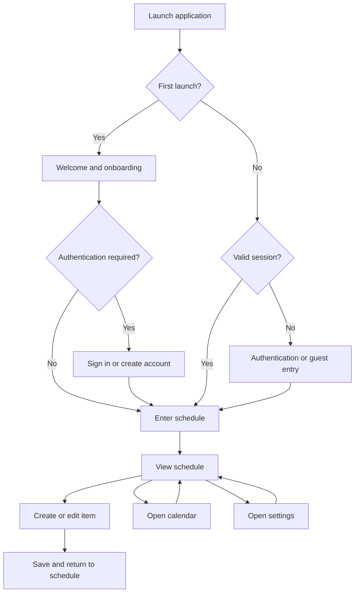

# USER_FLOWS.md

# Schedular User Flows and Interaction Specification

**Project:** Schedular  
**Document:** User Flows and Interaction Specification  
**Status:** Baseline specification  
**Platform:** Flutter mobile application  
**Primary targets:** Android and iOS  
**Audience:** Product, design, Flutter engineering, backend engineering, QA, and AI coding agents

---

## 1. Purpose

This document defines how users navigate and interact with Schedular, from first launch through daily scheduling and ongoing account management.

It establishes:

- Primary user journeys and navigation behavior.
- Screen responsibilities and transitions.
- Authentication and onboarding behavior.
- Schedule creation, editing, completion, deletion, and recurrence.
- Reminder permissions and notification handling.
- Loading, empty, validation, error, and recovery states.
- Accessibility and interaction requirements.
- Acceptance criteria for testing and implementation.

This document describes expected product behavior. It does not replace the technical architecture, database schema, API contracts, coding standards, design system, or release requirements.

When implementation details conflict with this document, do not silently invent a resolution. Identify the conflict and request clarification where necessary.

---

## 2. Product Principles

### 2.1 Core product objective

Schedular helps users organize their time by creating, viewing, updating, and completing scheduled activities with dependable reminders.

The application must prioritize:

1. Fast access to today's schedule.
2. Predictable event creation and editing.
3. Clear date and time handling.
4. Reliable recurrence and reminder behavior.
5. Safe handling of destructive actions.
6. Consistent behavior across Android and iOS.
7. Useful feedback when something fails.

### 2.2 Interaction principles

- Each screen must have a clear primary purpose.
- Primary actions must be visually distinguishable from secondary actions.
- Users must not lose entered data because of avoidable navigation or transient failures.
- Destructive actions must have appropriate confirmation or recovery behavior.
- Loading, empty, success, and error states must be designed explicitly.
- Never report that an event or reminder was saved unless the relevant operation has succeeded.
- Avoid unnecessary steps, redundant confirmations, and forced onboarding.
- Request operating-system permissions only when the associated feature is relevant.
- Explain permission requirements in plain language.
- Preserve user intent when network connectivity or backend services are unavailable.
- Do not display fabricated metrics, reviews, activity counts, or social proof.

### 2.3 Visual interaction constraints

All flows must follow `design.md`.

- Do not use purple or blue gradients.
- Do not use pill-shaped buttons.
- Do not use emoji as interface icons.
- Do not use vague headings or generic hero copy.
- Do not use excessive scroll-triggered animations.
- Do not display a "Made with AI" label.
- Do not use fake testimonials, fake ratings, or fabricated statistics.
- Use consistent spacing, typography, borders, surface colors, and component states.
- Use restrained transitions that preserve usability and performance.
- Ensure important actions remain understandable without color alone.
- Avoid em dashes in user-facing interface copy.

These rules apply to onboarding, empty states, dialogs, notifications, settings, and all other user-facing screens.

---

## 3. User Roles and Access

### 3.1 Guest user

A guest is a person who has opened the application but has not authenticated.

The guest experience depends on the product's approved authentication and persistence model.

Until that model is finalized:

- Do not assume that guest-created schedules automatically synchronize.
- Do not silently discard guest data when the user signs in.
- Do not promise cloud backup or cross-device synchronization.
- Clearly explain any account requirement before a restricted operation.
- Preserve guest data during authentication whenever supported by the approved architecture.

### 3.2 Authenticated user

An authenticated user can access the features permitted by the account and product configuration.

Expected capabilities include:

- View the schedule.
- Create and manage schedule items.
- Configure recurrence and reminders.
- Mark supported items as complete.
- Manage preferences.
- Manage account details.
- Sign out.

Cloud synchronization, sharing, collaboration, subscriptions, and other advanced capabilities are not assumed to be part of the initial release.

### 3.3 Returning user

A returning user should reach the primary schedule experience with minimal friction.

The application should restore valid navigation state where appropriate without restoring expired authentication, invalid routes, or stale transient dialogs.

---

## 4. Application Navigation

### 4.1 Primary navigation

The application must provide a consistent way to reach the main scheduling areas.

The initial navigation model is:

1. **Schedule:** Daily agenda and schedule overview.
2. **Calendar:** Date-oriented schedule navigation.
3. **Settings:** Preferences, reminders, and account options.

The exact navigation component, labels, and placement must follow the approved UI design. Do not add destinations simply to fill a navigation bar.

If the initial release does not implement a dedicated calendar screen, calendar navigation may be integrated into the Schedule screen. Do not ship a nonfunctional navigation destination.

### 4.2 Global actions

Depending on the active screen and implementation, global actions may include:

- Create a schedule item.
- Navigate to today.
- Search or filter schedule items, if supported.
- Open settings.
- Return to the previous screen.

The primary create action must remain discoverable and must not obscure schedule content or essential accessibility controls.

### 4.3 Navigation behavior

- Android system back must behave predictably.
- iOS navigation must respect native back-navigation expectations.
- A form with unsaved changes must not silently discard them.
- Repeated taps must not create duplicate events or submit duplicate requests.
- A notification deep link must resolve to the appropriate screen or a safe fallback.
- Expired or deleted schedule items must not cause navigation crashes.
- Unknown routes must lead to a valid fallback screen.

---

## 5. High-Level User Journey

This diagram represents the intended journey. Authentication requirements and guest access must follow the final product decision.

---

## 6. Flow 01: First Launch

### Objective

Help a new user understand the application and reach a useful scheduling screen.

### Entry point

The application is opened for the first time.

### Main flow

1. The application initializes its configuration and local dependencies.
2. It checks whether an authenticated session can be restored.
3. It loads the minimum information required for the initial screen.
4. If onboarding is required, it displays the approved onboarding experience.
5. The user proceeds through onboarding or skips optional introductory content.
6. The application presents authentication only when required or requested.
7. The user enters the primary schedule screen.

### Requirements

- Onboarding must explain real product capabilities.
- Do not force users through multiple informational slides if they can proceed directly.
- Do not request notification permission immediately without context.
- Do not request unrelated permissions.
- Avoid blocking the entire interface while nonessential content loads.
- Do not treat a temporary network failure as proof that the user's session is invalid.

### Alternative flows

**Returning user:** Restore a valid session and navigate to the main schedule.

**Network unavailable:** Display a recoverable state and offer retry or an approved offline experience.

**Initialization failure:** Display a useful error and provide retry where safe.

**Invalid stored session:** Clear or refresh the session according to the authentication contract, then show the appropriate entry screen.

### Exit condition

The user reaches the schedule or an actionable authentication or recovery screen.

---

## 7. Flow 02: Onboarding

### Objective

Introduce the product without delaying access to its primary functionality.

### Main flow

1. Display the welcome screen.
2. Explain the primary scheduling benefit.
3. Present any additional onboarding information only if it materially improves understanding.
4. Allow the user to continue or skip optional content.
5. Proceed to authentication or the schedule, according to the access model.

### Interaction requirements

- Onboarding progress must be clear if multiple steps exist.
- Back navigation must not unexpectedly restart the entire onboarding sequence.
- Reopening the app must not repeatedly show completed onboarding without a defined reason.
- Onboarding completion must be stored using an appropriate persistence mechanism.
- Do not collect unnecessary personal information during onboarding.

### Acceptance criteria

- A user can complete onboarding.
- A user can skip optional introductory steps.
- Completed onboarding is not unnecessarily repeated.
- A failed persistence operation does not create an unrecoverable navigation state.

---

## 8. Flow 03: Create an Account

### Objective

Allow a new user to register using the authentication methods approved for the product.

### Entry points

- Registration action on the welcome or sign-in screen.
- An account-required action.
- An account creation option in an approved account flow.

### Main flow

1. The user opens the registration screen.
2. The application displays the supported registration fields.
3. The user enters the required information.
4. The application validates input locally.
5. The user submits the form.
6. The backend or authentication provider processes the registration.
7. If verification is required, the application explains the next step.
8. On successful registration, the application establishes the appropriate session.
9. The user proceeds to the schedule or the next required setup step.

### Validation

Validation must cover the fields actually required by the selected authentication provider.

Examples include:

- Required fields cannot be empty.
- Email addresses must have an acceptable format if email authentication is used.
- Password requirements must match the configured provider.
- Password confirmation must match if that field exists.
- Input must be normalized safely where appropriate.
- Server-side validation errors must be displayed in understandable language.

### Error cases

- Account already exists.
- Invalid credentials or input.
- Weak password.
- Verification required.
- Rate limit reached.
- Network unavailable.
- Authentication provider unavailable.
- Unexpected server error.

The interface must not expose internal stack traces, database details, tokens, or sensitive provider responses.

### Acceptance criteria

- Valid registration reaches the correct success state.
- Invalid input receives actionable feedback.
- Repeated submissions do not create duplicate requests unnecessarily.
- Failed registration preserves valid form input where safe.
- Authentication state is refreshed after successful registration.

---

## 9. Flow 04: Sign In

### Objective

Allow an existing user to access their account.

### Main flow

1. The user opens the sign-in screen.
2. The user enters the required credentials or selects a supported authentication provider.
3. The application validates required fields.
4. The user submits the request.
5. The authentication provider verifies the credentials.
6. The application stores session information using the approved secure storage strategy.
7. The application loads the user's schedule and preferences.
8. The user enters the main schedule screen.

### Alternative flows

**Incorrect credentials:** Display a general authentication error without unnecessarily revealing account existence.

**Verification required:** Explain how to complete verification.

**Forgot password:** Navigate to the password recovery flow.

**Network unavailable:** Preserve entered data where safe and allow retry.

**Session restoration fails:** Return to the appropriate authentication state.

### Acceptance criteria

- A successful sign-in restores the correct account.
- Failed sign-in does not expose secrets.
- The submit control prevents accidental repeated submissions.
- A loading indicator is displayed while authentication is processing.
- The application does not navigate to authenticated screens before authentication succeeds.

---

## 10. Flow 05: Password Recovery

### Objective

Allow users to regain access without exposing sensitive account information.

### Main flow

1. The user selects "Forgot password?"
2. The application displays the recovery form.
3. The user enters the required account identifier.
4. The application validates the input.
5. The user submits the request.
6. The authentication provider processes the recovery request.
7. The application displays a safe confirmation message.
8. The user follows the provider's recovery instructions.
9. The user sets a new password if supported by the provider.
10. The user returns to sign-in or continues through the provider-approved recovery process.

### Requirements

- Use the recovery behavior supported by the configured authentication provider.
- Do not claim that an email or message was delivered unless delivery is confirmed.
- Avoid revealing whether a specific account exists.
- Explain expired or invalid recovery links with a route back to recovery.
- Do not log passwords, recovery tokens, or sensitive URLs.

### Acceptance criteria

- Valid recovery requests reach the provider.
- Invalid input is identified before submission where possible.
- Provider errors are handled safely.
- The user can restart recovery after an expired link.

---

## 11. Flow 06: First Entry to the Schedule

### Objective

Present the user's schedule in a clear, immediately useful format.

### Main flow

1. The application opens the Schedule screen.
2. It determines the relevant local date and time zone.
3. It loads schedule items for the requested period.
4. It displays the selected date and its associated items.
5. It shows a clear action to create an item.
6. The user can navigate dates, inspect an item, or create a new one.

### Required screen states

**Loading:** Show an appropriate progress indicator or lightweight placeholder.

**Populated:** Display schedule items in chronological order unless the product explicitly supports another ordering.

**Empty:** Explain that no items are scheduled for the selected period and provide a direct create action.

**Error:** Explain that schedule data could not be loaded and provide retry.

**Offline:** Clearly distinguish cached data from data that could not be refreshed, if offline support is implemented.

### Requirements

- Date labels must be unambiguous.
- Time formatting must respect the user's settings or device locale.
- All-day items must be visually distinguishable from timed items.
- Completed items must be represented consistently.
- Long titles must not break the layout.
- The screen must not display fabricated schedule items to make the interface look populated.
- Changing the selected date must not accidentally create or edit an item.

### Acceptance criteria

- The user can identify the selected date.
- Items appear in the expected order.
- Empty and error states are distinguishable.
- The create action is discoverable.
- Date navigation does not duplicate or corrupt loaded items.

---

## 12. Flow 07: Create a Schedule Item

### Objective

Allow users to create a scheduled activity with the minimum required information and optional configuration.

### Entry points

- Create action on the Schedule screen.
- Create action on the Calendar screen.
- An explicitly supported shortcut or deep link.

### Required and optional fields

The exact required fields must be consistent with the domain model and database schema.

A reasonable baseline is:

| Field | Requirement |
|---|---|
| Title | Required |
| Date | Required |
| Start time | Required for timed items |
| End time or duration | Optional unless required by the approved product model |
| All-day status | Supported if included in the product scope |
| Description | Optional |
| Reminder | Optional, subject to supported reminder behavior |
| Recurrence | Optional |
| Category | Optional unless categories are mandatory in the approved schema |

Do not add fields that are not supported by the product requirements.

### Main flow

1. The user selects Create.
2. The application opens the item form.
3. The form initializes with sensible defaults.
4. The user enters the title.
5. The user chooses the date.
6. The user configures the time or all-day status.
7. The user optionally adds a description, category, recurrence, or reminder.
8. The application validates the form.
9. The user selects Save.
10. The application submits the request.
11. The backend or local persistence layer confirms the operation.
12. The application closes the form or displays the saved item according to the intended navigation design.
13. The schedule refreshes to include the new item.

### Default values

- Use a documented and consistent default date.
- A create action initiated from a selected calendar date should use that date.
- A create action initiated from a specific time slot may prefill that time.
- Do not silently choose a misleading or unexpected time.
- Defaults must respect the device's local time zone and the approved scheduling model.

### Validation rules

- A title cannot be blank after trimming whitespace.
- Date and time values must be valid.
- End time must be after start time for ordinary timed items unless the domain model explicitly supports overnight events.
- All-day items must not require meaningless time values.
- Recurrence configuration must be valid.
- Reminder values must conform to supported limits.
- Character limits must match backend validation.
- Invalid values must not be silently rewritten into different values.

### Duplicate submission protection

- Disable or guard repeated submission while a save request is in progress.
- Use idempotency protection where supported by the backend.
- Do not create multiple items because the user tapped Save repeatedly.
- Do not treat a client timeout as definitive proof that the server did not save the item.
- If the outcome is uncertain, reconcile with the backend before retrying in a way that could duplicate the item.

### Error handling

If saving fails:

1. Keep the form open.
2. Preserve entered data where safe.
3. Display a useful error.
4. Offer retry.
5. Avoid displaying a success message.
6. Prevent duplicate creation during recovery.

### Acceptance criteria

- Valid input creates exactly one schedule item.
- Invalid input is rejected with actionable feedback.
- The schedule reflects a confirmed save.
- Failure does not silently discard the form.
- Defaults and date values are consistent with the entry point.

---

## 13. Flow 08: View Schedule Item Details

### Objective

Allow users to inspect a scheduled activity and access supported actions.

### Main flow

1. The user selects an item from the schedule or calendar.
2. The application loads or retrieves the item's current details.
3. It displays the title, date, time, and supported optional fields.
4. It provides access to Edit and any other approved actions.
5. The user returns to the originating screen or navigates to another supported action.

### Requirements

- Display date and time in a consistent format.
- Distinguish all-day events from timed events.
- Show recurrence information when relevant.
- Show reminder information when configured.
- Show completion status if the item supports completion.
- Handle items deleted or made unavailable by another device or session.
- Avoid showing stale details as if they were current when a refresh has failed.

### Acceptance criteria

- Selecting an item opens the correct details.
- All supported fields are displayed accurately.
- Deleted items produce a recoverable state.
- Back navigation returns to the expected location.

---

## 14. Flow 09: Edit a Schedule Item

### Objective

Allow users to modify an existing schedule item without unintentionally changing unrelated fields.

### Main flow

1. The user opens item details.
2. The user selects Edit.
3. The application loads the current editable values.
4. The user changes one or more fields.
5. The application validates the updated form.
6. The user selects Save.
7. The application submits the changes.
8. The persistence layer confirms the update.
9. The updated item is displayed and the schedule refreshes.

### Requirements

- Existing values must be prefilled correctly.
- Unchanged fields must remain unchanged.
- The form must track whether meaningful changes were made.
- Leaving a modified form must trigger the approved unsaved-changes behavior.
- Failed saves must preserve the user's edits.
- Concurrent edits must follow the backend's conflict-handling strategy.
- Updates to recurring items must use the recurrence-editing flow.

### Unsaved changes

If the user attempts to leave a modified form, provide an appropriate choice:

- Continue editing.
- Discard changes.
- Save changes, where supported and appropriate.

Do not show an unsaved-changes dialog when nothing has changed.

### Acceptance criteria

- The intended item is updated.
- Unmodified fields are preserved.
- Invalid edits are rejected.
- A failed update does not erase the user's changes.
- Recurring-item updates use the correct scope.

---

## 15. Flow 10: Delete a Schedule Item

### Objective

Allow users to remove an item without accidental deletion.

### Main flow

1. The user opens the item or its action menu.
2. The user selects Delete.
3. The application displays a confirmation when appropriate.
4. The confirmation identifies the item being deleted.
5. The user confirms the action.
6. The application submits the deletion.
7. The persistence layer confirms the result.
8. The item disappears from the active schedule.
9. Associated reminders are canceled or reconciled according to the reminder architecture.

### Requirements

- Destructive actions must be visually distinguishable.
- The cancel action must be easy to select.
- The application must not report deletion before confirmation.
- Failed deletion must leave the item visible or clearly indicate that its status is uncertain.
- The system must handle already-deleted items safely.
- If undo is implemented, the undo window and behavior must be clearly defined.
- Deletion of recurring items must follow the recurrence scope rules.

### Acceptance criteria

- Canceling leaves the item unchanged.
- Confirming deletes or deactivates the correct item according to the data model.
- Duplicate delete requests are handled safely.
- Reminder cleanup is triggered as required.
- The user receives clear feedback on failure.

---

## 16. Flow 11: Mark an Item Complete

### Objective

Allow users to record completion for supported schedule items.

### Main flow

1. The user selects the completion control.
2. The application updates the completion state.
3. The change is persisted.
4. The interface reflects the confirmed status.
5. The user may reverse the action if the product supports reopening completed items.

### Requirements

- Completion must be represented consistently.
- Completion status must not be inferred only from the item's end time.
- A completed item must not be deleted automatically unless that behavior is explicitly specified.
- The state must remain consistent across supported devices.
- If persistence fails, the interface must either revert the optimistic update or clearly indicate the pending state.

### Acceptance criteria

- The intended item changes state.
- Repeated interactions do not create inconsistent completion records.
- Reopening an item works where supported.
- Persistence errors are visible and recoverable.

---

## 17. Flow 12: Recurring Schedule Items

### Objective

Support recurring activities without unexpectedly changing past or future occurrences.

### Supported recurrence scope

The initial product scope must define which recurrence patterns are supported. Potential patterns include:

- Daily.
- Weekly.
- Selected weekdays.
- Monthly.
- A custom interval, if explicitly supported.
- An end date or occurrence limit, if supported.

Do not imply support for a recurrence pattern until it has been implemented and tested.

### Creating a recurring item

1. The user creates a schedule item.
2. The user opens recurrence settings.
3. The user selects a supported recurrence pattern.
4. The application displays relevant options.
5. The user configures an end condition if supported.
6. The application validates the recurrence.
7. The user saves the item.
8. The application persists the recurrence definition and its associated data.

### Editing a recurring item

When a recurring item is edited, the application must identify the scope of the change.

Potential choices:

- This occurrence only.
- This occurrence and future occurrences.
- The entire series.

Only display choices supported by the underlying recurrence model.

### Deleting a recurring item

Use the same explicit scope rules as recurrence editing.

The confirmation must communicate what will be removed. Never delete an entire series when the user intended to remove one occurrence.

### Recurrence exceptions

The data model must support exceptions when the product allows a single occurrence to be modified or removed independently.

Examples include:

- Skipping one occurrence.
- Moving one occurrence to another date.
- Changing one occurrence's time.
- Canceling one occurrence.

### Time-zone and daylight-saving behavior

- Recurring events must follow the approved time-zone semantics.
- A recurring event intended for 9:00 AM local time should not unexpectedly shift to another local hour after a daylight-saving transition.
- Invalid local times during daylight-saving transitions must follow a documented resolution policy.
- Ambiguous local times must follow a documented disambiguation policy.
- Server storage and recurrence expansion must use consistent time-zone rules.
- Past occurrences must not be silently rewritten by recurrence changes.

### Acceptance criteria

- Supported recurrence patterns generate the expected occurrences.
- Exceptions apply only to the intended occurrences.
- Editing and deletion respect the selected scope.
- Time-zone transitions are covered by tests.
- Recurrence changes do not create unintended duplicate occurrences.

---

## 18. Flow 13: Configure Reminders

### Objective

Allow users to choose whether and when they are reminded about a schedule item.

### Main flow

1. The user creates or edits a schedule item.
2. The user opens reminder settings.
3. The application displays supported reminder choices.
4. The user selects a reminder time or reminder rule.
5. The application validates the configuration.
6. The user saves the item.
7. The system persists the reminder configuration.
8. The reminder scheduling mechanism schedules or reconciles the notification.
9. The interface reflects the confirmed configuration.

### Reminder rules

- Only offer reminder intervals that are actually supported.
- Define how reminders behave for all-day items.
- Define how reminders behave for past events.
- Define whether multiple reminders are allowed.
- Define whether reminder settings apply to one occurrence or an entire series.
- Avoid scheduling duplicate notifications after repeated edits.
- Cancel or update obsolete reminders after a time or recurrence change.
- Handle operating-system scheduling limits and permissions.

### Important distinction

Saving a reminder preference is not necessarily the same as guaranteeing that the operating system will deliver a notification.

The application must distinguish between:

- Reminder configuration saved.
- Reminder scheduled by the application.
- Notification permission unavailable.
- Notification scheduling failed.
- Delivery not verifiable.

Do not promise guaranteed delivery where the platform cannot guarantee it.

### Acceptance criteria

- Supported reminder options can be selected.
- Invalid reminder configurations are rejected.
- Changes reconcile the correct notification schedules.
- Deleting an item cancels associated reminders when appropriate.
- Permission and scheduling failures produce understandable feedback.

---

## 19. Flow 14: Notification Permission

### Objective

Request permission at a moment when the user understands its value.

### Entry point

The user enables reminders or performs another action that genuinely requires notification access.

### Main flow

1. The user enables a reminder.
2. The application determines whether notification permission is required and available.
3. If the permission has not been requested, the application explains why notifications are useful.
4. The application requests the operating-system permission.
5. The operating system returns the result.
6. The application responds according to the permission state.

### Permission outcomes

**Granted:** Continue reminder setup.

**Denied:** Explain that notifications are unavailable and provide an alternative if one exists.

**Permanently denied or restricted:** Explain how the user can review notification settings where supported.

**Permission already granted:** Continue without another request.

**Permission not applicable:** Follow the platform-specific implementation.

### Requirements

- Do not repeatedly prompt after denial without a meaningful user action.
- Do not imply that the user must grant permission to use unrelated scheduling features.
- Keep reminder preferences understandable when notifications are disabled.
- Recheck permission state when the app resumes if required by platform behavior.
- Handle Android and iOS differences through the platform implementation, not inconsistent business rules.

### Acceptance criteria

- Permission is requested at a relevant point.
- Denial does not crash or block unrelated features.
- The user can continue using supported scheduling features.
- The UI accurately reflects the current permission state.

---

## 20. Flow 15: Receive and Open a Notification

### Objective

Help users navigate from a notification to the relevant schedule item.

### Main flow

1. The operating system presents a scheduled notification when supported and permitted.
2. The user taps the notification.
3. The application launches or resumes.
4. The application validates the notification payload.
5. The application restores or establishes the appropriate navigation state.
6. The application opens the relevant item or a safe fallback.
7. The user can inspect or modify the item according to their access permissions.

### Requirements

- Notification payloads must not contain unnecessary sensitive information.
- Item identifiers must be validated.
- Deleted or inaccessible items must lead to a safe fallback.
- Expired authentication must be handled before opening protected content.
- Repeated notification taps must not create duplicate navigation stacks.
- Notification actions must be validated on the application side.
- Notification routing must work from cold start and warm start.

### Acceptance criteria

- A valid notification opens the correct item.
- Invalid payloads do not crash the application.
- Missing items show a useful fallback.
- Navigation remains predictable after repeated taps.

---

## 21. Flow 16: Calendar Navigation

### Objective

Allow users to select a date and inspect the schedule for that date.

### Main flow

1. The user opens Calendar or the calendar interface within Schedule.
2. The application displays the selected period.
3. The user selects a date.
4. The application loads or filters schedule items for that date.
5. The user inspects an item or creates a new item for the selected date.
6. The user can return to the current date using the approved navigation control.

### Requirements

- The current date must be identifiable.
- The selected date must be distinguishable from the current date.
- Date navigation must support the approved calendar range.
- Month and year changes must be predictable.
- Date selection must respect locale conventions.
- Schedule items must use the same time-zone semantics as the Schedule screen.
- The application must not confuse the date selected in the calendar with the date of an existing event.

### Acceptance criteria

- Selecting a date loads the correct items.
- Returning to today works.
- Creating an item from a selected date uses the intended date.
- Empty dates remain navigable and actionable.

---

## 22. Flow 17: Search and Filtering

### Status

Optional feature. Implement only if included in the approved release scope.

### Objective

Help users locate schedule items quickly.

### Potential search fields

Depending on product scope:

- Title.
- Description.
- Category.

Do not claim that search includes fields that are not indexed or searchable.

### Main flow

1. The user opens search.
2. The user enters a query.
3. The application validates and normalizes the query where appropriate.
4. Matching items are displayed.
5. The user selects a result.
6. The application opens the corresponding item.

### Filtering

If filters are supported, the application may allow filtering by:

- Date range.
- Category.
- Completion status.
- Other approved attributes.

### Requirements

- Empty search results must be distinct from a search error.
- Clearing a query must restore the appropriate unfiltered state.
- Search must not reveal another user's data.
- Loading and cancellation must be handled safely.
- Search results must respect the same access controls as the primary schedule.

### Acceptance criteria

- Results match the implemented search semantics.
- Empty results are explained clearly.
- Selecting a result opens the correct item.
- Clearing the search restores the expected screen state.

---

## 23. Flow 18: Categories

### Status

Implement only if categories are included in the approved product scope.

### Objective

Allow users to organize schedule items using supported categories.

### Main flow

1. The user opens an item form.
2. The user selects a category.
3. The selected category is displayed in the form.
4. The user saves the item.
5. The saved item displays the category where appropriate.

### Requirements

- A category must be valid under the data model.
- Removing or archiving a category must follow an explicit policy for associated items.
- Category colors must remain readable in light and dark themes if both themes are supported.
- Color must not be the only category identifier.
- Do not show category management screens if categories cannot be managed or selected.

### Acceptance criteria

- Supported categories can be selected.
- Invalid category references are rejected.
- Category changes persist correctly.
- Archived or removed categories do not break existing items.

---

## 24. Flow 19: Settings

### Objective

Provide one predictable location for supported application preferences and account controls.

### Potential sections

Include only implemented features:

- Appearance.
- Date and time preferences.
- Week-start preference.
- Notification preferences.
- Account information.
- Privacy and security.
- Sign out.
- About and application version.

### Main flow

1. The user opens Settings.
2. The application displays current preferences.
3. The user selects a setting.
4. The user changes the setting.
5. The application validates and persists the change.
6. The application displays the updated value or an actionable error.

### Requirements

- Settings must reflect persisted values.
- Unsupported settings must not appear as if they work.
- A failed update must not silently show an unpersisted value as permanent.
- Preferences must use appropriate local or server-side persistence.
- Device-controlled settings must be distinguished from application-controlled settings.

### Acceptance criteria

- Settings show the correct current values.
- Supported changes persist.
- Errors provide a recovery path.
- Returning to Settings reflects the actual stored state.

---

## 25. Flow 20: Appearance and Theme

### Status

Implement only if theme switching is included in the product scope.

### Objective

Allow users to choose an available appearance mode.

### Potential options

- Light.
- Dark.
- Follow system.

### Main flow

1. The user opens appearance settings.
2. The user selects an available theme.
3. The application applies the theme.
4. The selection is persisted.
5. The application maintains the theme across navigation and subsequent launches.

### Requirements

- The theme must be applied consistently to all screens.
- Text and controls must remain readable.
- Status bars, dialogs, input fields, and system surfaces must be handled correctly.
- The selected theme must not unexpectedly reset after restart.
- Theme selection must not introduce prohibited gradients or other design violations.

---

## 26. Flow 21: Account Profile

### Status

Implement only the account fields supported by the authentication provider and data model.

### Objective

Allow users to inspect and update supported profile information.

### Main flow

1. The user opens account settings.
2. The application displays the current profile.
3. The user edits an allowed field.
4. The application validates the new value.
5. The user saves the changes.
6. The backend confirms the update.
7. The updated profile is displayed.

### Requirements

- Do not display sensitive account information unnecessarily.
- Changes to verified identifiers must follow the provider's verification flow.
- Failed updates must preserve the user's edits where safe.
- Profile data must not be confused with authentication-provider data.
- Access to account editing must be authenticated.

---

## 27. Flow 22: Sign Out

### Objective

End the current authenticated session safely.

### Main flow

1. The user opens account settings.
2. The user selects Sign out.
3. The application requests confirmation if required by the approved design.
4. The authentication provider invalidates or ends the session according to its contract.
5. Sensitive session material is cleared from secure storage as appropriate.
6. The application returns to the correct unauthenticated entry screen.

### Requirements

- Do not leave authenticated screens accessible after a confirmed sign-out.
- Do not delete user-owned schedule data when signing out.
- Do not clear unrelated application preferences unless explicitly required.
- Handle sign-out failures according to the authentication provider's security requirements.
- Ensure back navigation cannot expose protected cached screens after sign-out.

### Acceptance criteria

- A successful sign-out ends the application session.
- Protected routes require authentication where applicable.
- User data is not accidentally deleted.
- A subsequent sign-in loads the correct account.

---

## 28. Flow 23: Delete Account

### Status

Include only if account deletion is supported and approved for the release.

### Objective

Allow a user to request account deletion through a clear and secure process.

### Main flow

1. The user opens account settings.
2. The user selects Delete account.
3. The application explains the consequences and applicable data-retention policy.
4. The user completes any required reauthentication.
5. The application requests explicit confirmation.
6. The backend processes the account deletion request.
7. The application handles associated data according to the approved retention policy.
8. The application ends the session and displays the final state.

### Requirements

- Account deletion must not be implemented as a simple client-side record removal if server-side cleanup is required.
- The application must communicate the actual deletion behavior.
- The process must follow applicable platform, legal, and privacy requirements.
- Failed deletion must not falsely claim that the account has been deleted.
- Related scheduled jobs, notifications, and device registrations must be handled.
- Retained records, if any, must follow the documented retention policy.

---

## 29. Flow 24: Offline and Connectivity Failures

### Objective

Handle unavailable network connectivity without losing user intent or misrepresenting persisted data.

### Scope dependency

Offline editing is not assumed to be supported. The implementation must follow the approved architecture.

### When connectivity is lost

- Preserve visible data already loaded where possible.
- Clearly indicate when current data cannot be refreshed.
- Keep forms and entered values available.
- Avoid repeating network requests indefinitely.
- Provide retry where useful.
- Do not display fabricated data to make the screen appear populated.

### If offline reads are supported

1. Load valid cached data.
2. Clearly distinguish cached data from confirmed current server data when relevant.
3. Allow supported navigation.
4. Reconcile cached data when connectivity returns.

### If offline writes are supported

1. Record the user's intended operation in the approved local queue.
2. Identify the operation as pending synchronization.
3. Submit it when connectivity returns.
4. Handle conflicts and retries.
5. Mark it confirmed only after the relevant persistence layer confirms the operation.

### If offline writes are not supported

- Keep the form open.
- Explain that the operation could not be saved.
- Allow the user to retry.
- Do not claim that the operation is queued.

### Acceptance criteria

- Network failure does not crash the application.
- Unconfirmed changes are not presented as confirmed server state.
- Retry does not cause duplicate items.
- Offline behavior matches the documented architecture.

---

## 30. Flow 25: Application Resume and Session Restoration

### Objective

Restore a usable application state when the user returns from the background.

### Main flow

1. The application resumes.
2. It checks the current session and relevant platform permissions.
3. It refreshes data where appropriate.
4. It reconciles notification state if required.
5. It restores the current route when safe.
6. It presents any required authentication or error state.

### Requirements

- Do not restart onboarding on every resume.
- Do not reload all data unnecessarily.
- Handle expired authentication gracefully.
- Recheck notification permission when platform behavior requires it.
- Do not show stale loading indicators indefinitely.
- Handle system termination during a form or network request according to the persistence model.

---

## 31. Flow 26: Deep Links

### Objective

Open a specific supported application destination from a valid link.

### Potential destinations

Only implement destinations explicitly supported by the product:

- A schedule item.
- A particular date.
- A supported account or verification screen.

### Main flow

1. The operating system delivers a deep link.
2. The application validates the link structure.
3. It validates any identifiers or required parameters.
4. It checks authentication and authorization requirements.
5. It navigates to the target screen.
6. It displays a safe fallback if the target cannot be resolved.

### Requirements

- Treat all incoming parameters as untrusted input.
- Never rely on a deep link as proof of authorization.
- Do not expose secrets in URLs.
- Handle missing, malformed, expired, and unsupported links.
- Avoid duplicate navigation during cold start.
- Protect against opening resources belonging to another user.

---

## 32. Flow 27: Data Synchronization and Conflict Handling

### Scope dependency

This flow applies if the product uses a remote backend or multiple devices.

### Objective

Keep schedule data consistent between the client and its authoritative persistence layer.

### Main flow

1. The user performs an operation.
2. The application submits the change.
3. The backend validates permissions and data.
4. The backend persists the operation.
5. The client receives a confirmed result.
6. The client updates its state and refreshes affected views.
7. Other supported clients receive changes through the approved synchronization mechanism.

### Requirements

- The backend is authoritative for remote data.
- The client must not bypass server-side authorization.
- Concurrent modifications must follow an explicit conflict policy.
- Retries must not silently duplicate writes.
- Stale data must not overwrite newer confirmed data.
- Deletion must propagate to relevant clients and reminder systems.
- Synchronization errors must be observable and recoverable.
- Do not promise real-time synchronization unless the architecture supports it.

### Acceptance criteria

- Confirmed changes appear in the relevant views.
- Unauthorized changes are rejected.
- Conflicts follow the documented policy.
- Retries do not create duplicates.
- Stale data is not silently treated as authoritative.

---

## 33. Flow 28: Search, Loading, and Retry States

All network-backed screens must explicitly define these states.

### Loading

- Show a progress indicator or placeholder appropriate to the screen.
- Prevent conflicting submissions where necessary.
- Keep the layout stable when possible.
- Avoid unnecessary full-screen blocking for small operations.

### Empty

- Explain what is absent.
- Offer a relevant action when appropriate.
- Do not present empty states as errors.
- Do not populate empty states with fake examples presented as real user data.

### Error

- Explain the failed operation in plain language.
- Preserve user input when safe.
- Provide retry where retry is meaningful.
- Avoid exposing internal errors.
- Avoid automatic retries that cause duplicate writes.

### Success

- Confirm the actual result.
- Update the relevant screen.
- Avoid redundant success dialogs for routine operations.
- Do not display success before persistence is confirmed.

### Stale or uncertain state

When a request times out or a connection is interrupted after a write may have reached the server:

- Do not assume the write failed.
- Reconcile the operation with the authoritative data source when possible.
- Use idempotency keys or operation identifiers where supported.
- Clearly indicate uncertainty if it cannot immediately be resolved.

---

## 34. Flow 29: Form Validation and Unsaved Changes

### Objective

Protect user input and make correction straightforward.

### Validation behavior

- Validate required fields before submission.
- Display field-specific errors when possible.
- Explain how to fix each error.
- Keep valid input when another field is invalid.
- Match frontend validation to backend rules.
- Do not depend exclusively on frontend validation.

### Unsaved changes

When the user attempts to leave a modified form:

1. Determine whether meaningful changes exist.
2. If there are none, navigate normally.
3. If changes exist, present the approved unsaved-changes choice.
4. Preserve the draft while the user decides.
5. Discard only after the user confirms.

### Acceptance criteria

- Errors identify the affected fields.
- Valid input is preserved.
- Unmodified forms do not produce unnecessary warnings.
- Unsaved data is not silently discarded.

---

## 35. Flow 30: Accessibility

Accessibility is required for every supported flow, not an optional enhancement.

### Requirements

- Every interactive control has a meaningful accessible label.
- Controls expose their current state where applicable.
- Screen readers can distinguish primary actions, secondary actions, and destructive actions.
- Text contrast meets the applicable accessibility requirements.
- The application supports system font scaling within a usable layout.
- Touch targets meet platform accessibility guidance.
- Keyboard and switch-based navigation work where applicable.
- Focus order follows the visual and logical reading order.
- Errors are announced or made discoverable to assistive technologies.
- Color is not the only means of conveying status.
- Animations must respect reduced-motion preferences where applicable.
- Date and time controls must be usable with assistive technology.

### Acceptance criteria

- Core scheduling flows can be completed with supported assistive technologies.
- Buttons and fields have meaningful semantics.
- Validation errors are discoverable.
- Theme changes do not make controls inaccessible.

---

## 36. Flow 31: Privacy and Sensitive Data

### Requirements

- Store authentication secrets using the approved secure-storage mechanism.
- Never store plaintext passwords.
- Do not include credentials, tokens, or sensitive schedule descriptions in ordinary logs.
- Minimize personal information collected by the application.
- Request permissions only for genuine functionality.
- Enforce authorization on the backend.
- Do not assume that hiding a button secures the underlying operation.
- Clear sensitive session material when required by the authentication lifecycle.
- Use secure transport for remote communication.
- Follow the documented data retention and account deletion policies.
- Keep notification payloads free of unnecessary sensitive information.

### Acceptance criteria

- Sensitive data is not unnecessarily logged.
- Protected resources cannot be accessed through unauthorized client requests.
- Permission prompts accurately describe the feature.
- Session cleanup follows the authentication specification.

---

## 37. Flow 32: Performance and Responsiveness

### Requirements

- Display the initial useful interface without waiting for nonessential work.
- Avoid unnecessary rebuilds of large schedule lists.
- Paginate or constrain data retrieval where appropriate.
- Prevent duplicate network requests caused by repeated lifecycle events.
- Avoid blocking the UI thread with expensive processing.
- Keep animations restrained and purposeful.
- Handle long schedules without excessive memory usage.
- Avoid unnecessary polling.
- Use efficient local persistence if offline support is approved.

### Acceptance criteria

- Large schedules remain usable.
- Navigation does not repeatedly reload unchanged data without reason.
- Loading states remain responsive.
- Failed requests do not create infinite loading states.

---

## 38. Flow 33: Unexpected Errors and Recovery

### Objective

Ensure that unexpected failures leave the user with a safe, understandable next step.

### Main flow

1. An operation fails unexpectedly.
2. The application captures diagnostic information through approved observability tooling.
3. Sensitive values are excluded from diagnostics.
4. The application presents a user-safe error state.
5. The user can retry, return, or continue with another supported action.
6. The application recovers without corrupting local or remote state.

### Requirements

- No raw stack traces in user-facing screens.
- No blank screens caused by unhandled asynchronous failures.
- No false success states.
- No unbounded retry loops.
- No silent loss of user-entered data where recovery is possible.
- Error logging must follow privacy and security requirements.

---

## 39. Navigation State and Route Guards

### Requirements

- Protected screens require the appropriate authenticated state.
- Every route must define its required parameters.
- Missing or invalid parameters must lead to a safe fallback.
- A deleted item must not remain indefinitely accessible through stale navigation state.
- Signing out must invalidate protected navigation state.
- A notification or deep link must not bypass authorization.
- Modal and form routes must have clear back-navigation behavior.
- Multiple rapid navigation events must not create an invalid route stack.

### Acceptance criteria

- Unauthorized users cannot access protected content.
- Invalid routes do not crash the app.
- Back navigation returns to an appropriate destination.
- Stale item references are handled safely.

---

## 40. Flow 34: Date, Time, and Time-Zone Semantics

Scheduling correctness is a core product requirement.

### Requirements

- Use an explicit, consistent time-zone strategy.
- Distinguish calendar dates from instants in time.
- Store timed events according to the approved backend contract.
- Avoid interpreting date-only values as arbitrary UTC instants.
- Use the intended time zone when displaying and expanding recurring events.
- Validate start and end times according to event semantics.
- Define behavior for daylight-saving transitions.
- Define behavior when a user changes device time zone.
- Avoid silently changing the meaning of an existing event.
- Keep client and server recurrence rules consistent.

### Acceptance criteria

- Events display at the intended local time.
- Date-only events do not shift unexpectedly across time zones.
- Recurring events behave consistently through time-zone transitions.
- Device time-zone changes follow the documented product policy.

---

## 41. Out-of-Scope Features

Unless explicitly approved in the product requirements, do not implement these features merely because they are common in scheduling applications:

- Team collaboration.
- Shared calendars.
- Public event pages.
- Social feeds.
- User reviews or ratings.
- AI-generated schedules.
- AI assistants or chat interfaces.
- Payments or subscriptions.
- Location tracking.
- Contact importing.
- Email or SMS delivery.
- Complex project management.
- Unapproved analytics dashboards.
- Fake statistics, usage metrics, or testimonials.

An out-of-scope feature must not appear as an active, working UI control.

---

## 42. Flutter Implementation Requirements

This section defines user-flow implementation expectations without prescribing unconfirmed dependencies.

### 42.1 State management

Use the state-management solution approved in the technical architecture.

The implementation must distinguish:

- Initial state.
- Loading state.
- Success state.
- Empty state.
- Validation failure.
- Recoverable error.
- Authentication-required state.
- Pending or uncertain write state where relevant.

Avoid embedding business logic directly inside large widget build methods.

### 42.2 Navigation

Use the navigation approach approved by the project architecture.

The implementation must support:

- Typed or validated route parameters where feasible.
- Authentication-aware navigation.
- Deep-link handling where supported.
- Predictable back behavior.
- Safe handling of missing resources.
- Protection against duplicate navigation events.

### 42.3 Forms

Reusable form components should provide consistent:

- Labels.
- Validation.
- Error messaging.
- Focus handling.
- Loading and submission states.
- Keyboard behavior.
- Accessibility semantics.

### 42.4 Data layer

UI components must not directly own persistence rules.

The application should use the approved service or repository layer to coordinate:

- Local data.
- Remote requests.
- Validation.
- Persistence.
- Synchronization.
- Conflict handling.
- Error mapping.

### 42.5 Platform integration

Notification permissions, scheduled notifications, secure storage, and lifecycle behavior must be implemented through the approved Flutter-compatible integrations.

Do not assume that identical operating-system behavior exists on Android and iOS.

### 42.6 Testing

User-flow behavior must be covered by the appropriate combination of:

- Unit tests.
- Widget tests.
- Integration tests.
- Backend tests.
- Platform-specific notification tests where required.

Do not claim a flow is implemented merely because a screen exists.

---

## 43. Cross-Flow Acceptance Criteria

The application is not ready for release unless all applicable criteria are satisfied.

### Navigation

- Users can reach primary screens.
- Back navigation behaves predictably.
- Invalid routes recover safely.
- Protected routes enforce authentication.

### Schedule management

- Users can create valid items.
- Users can view and edit items.
- Users can delete items safely.
- Completion state behaves correctly where supported.
- Invalid and duplicate writes are handled.

### Recurrence

- Supported patterns work correctly.
- Series changes use the intended scope.
- Exceptions behave correctly.
- Time-zone transitions are tested.

### Reminders

- Reminder preferences persist.
- Permission denial is handled.
- Reminder updates reconcile existing schedules.
- Deleted items do not leave unintended notifications.

### Reliability

- Loading states terminate.
- Errors are understandable.
- Retry behavior is safe.
- User-entered data is preserved where possible.
- Uncertain writes are reconciled where supported.

### Accessibility

- Core controls have accessible labels.
- Validation is discoverable.
- Text remains readable.
- Core flows work with supported assistive technologies.

### Security

- Authentication and authorization are enforced.
- Sensitive data is protected.
- Logs exclude secrets.
- Deep links do not bypass access controls.

### Design consistency

- `design.md` is followed.
- No prohibited gradients or pill-shaped buttons are introduced.
- No fake metrics, reviews, or testimonials appear.
- No emoji icons are used as UI iconography.
- No excessive scroll animations are introduced.
- No "Made with AI" tag appears.

---

## 44. QA Test Scenarios

The following scenarios must be adapted into executable tests.

| ID | Scenario | Expected result |
|---|---|---|
| UF-001 | First application launch | User reaches onboarding or the approved entry screen |
| UF-002 | Returning authenticated user | Valid session is restored |
| UF-003 | Invalid registration input | Field errors are displayed |
| UF-004 | Failed sign-in | User remains unauthenticated |
| UF-005 | Password recovery request | Safe recovery confirmation is displayed |
| UF-006 | Empty schedule | Useful empty state and create action are shown |
| UF-007 | Create valid item | Exactly one item is persisted |
| UF-008 | Create item with blank title | Save is rejected |
| UF-009 | Save item during network failure | Input is preserved and no false success is shown |
| UF-010 | Rapid repeated Save taps | Duplicate items are prevented |
| UF-011 | Edit item | Intended changes are persisted |
| UF-012 | Leave modified form | Unsaved-changes behavior is shown |
| UF-013 | Cancel item deletion | Item remains unchanged |
| UF-014 | Confirm item deletion | Item is removed or deactivated correctly |
| UF-015 | Complete an item | Completion state is updated |
| UF-016 | Edit one recurring occurrence | Only the selected scope changes |
| UF-017 | Delete one recurring occurrence | Other occurrences remain intact |
| UF-018 | Change reminder configuration | Relevant reminders are reconciled |
| UF-019 | Deny notification permission | App remains usable |
| UF-020 | Open valid notification | Correct item or destination opens |
| UF-021 | Open notification for deleted item | Safe fallback is displayed |
| UF-022 | Navigate to another date | Correct date and items are shown |
| UF-023 | Change a supported preference | Preference persists |
| UF-024 | Sign out | Protected navigation is cleared |
| UF-025 | Resume after session expiry | User is routed to the correct authentication state |
| UF-026 | Receive malformed deep link | App does not crash or expose protected data |
| UF-027 | Concurrently edit an item | Documented conflict policy is applied |
| UF-028 | Change device time zone | Events follow documented time-zone rules |
| UF-029 | Use large accessibility text | Core screens remain usable |
| UF-030 | Trigger unexpected backend failure | Safe error and recovery state are shown |

### Required test environments

Test on supported Android and iOS versions, including:

- Small and large screens.
- Slow or unreliable connectivity.
- Permission granted and denied states.
- Light and dark themes if supported.
- Fresh installation and application upgrade.
- Expired authentication.
- Different locale and date formats.
- Time-zone changes and daylight-saving transitions where applicable.

---

## 45. Definition of Done for a User Flow

A user flow is complete only when all applicable conditions are satisfied:

1. The flow has a defined entry point and exit condition.
2. Every required screen and transition is implemented.
3. Loading, empty, error, success, and validation states are covered.
4. Data persistence matches the approved architecture.
5. Authentication and authorization are enforced.
6. Duplicate operations and retry behavior are handled.
7. Accessibility requirements are met.
8. UI behavior follows `design.md`.
9. Unit, widget, integration, and backend tests are added where appropriate.
10. Relevant platform-specific behavior is verified.
11. No unsupported feature is represented as working.
12. Documentation is updated when behavior or scope changes.

A visually complete screen does not count as a completed user flow if its underlying actions do not work.

---

## 46. Dependencies and Related Documents

This document must remain consistent with the following project documents:

- `TRD.md`: Product requirements, feature scope, and system behavior.
- `design.md`: Visual design and interaction rules.
- `coding-standards.md`: Code structure and implementation conventions.
- `master_rules.md`: Project-wide governance and development rules.
- `database-schema.md`: Data entities, relationships, constraints, and persistence rules.
- `CI_CD.md`: Validation, build, testing, and release processes.
- `ARCHITECTURE.md`: Application layers, dependencies, and integration boundaries, if maintained.
- `API_CONTRACTS.md`: Request, response, error, and authorization contracts, if maintained.
- `NOTIFICATIONS.md`: Reminder scheduling and notification delivery rules, if maintained.
- `TESTING.md`: Test strategy and test coverage requirements, if maintained.

If a referenced file does not exist, treat it as a proposed supporting document rather than assuming it has already been approved.

---

## 47. Unresolved Product Decisions

The following decisions must be confirmed before the affected flows are treated as final implementation requirements.

1. **Authentication:** Is an account required, or is guest use supported?
2. **Persistence:** Is the initial schedule stored locally, remotely, or both?
3. **Backend:** Which backend and authentication provider are approved?
4. **Offline mode:** Can users create and edit items without connectivity?
5. **Event model:** Are all-day events supported?
6. **Recurrence:** Which recurrence patterns and edit scopes are in the first release?
7. **Reminders:** Are reminders local notifications, server-triggered notifications, or both?
8. **Completion:** Can all schedule items be marked complete?
9. **Calendar:** Is a separate calendar screen required?
10. **Categories:** Are categories part of the first release?
11. **Search:** Is schedule search required for the first release?
12. **Synchronization:** Is cross-device synchronization required?
13. **Account deletion:** Must users be able to delete their accounts in the first release?
14. **Appearance:** Are light, dark, and system themes supported?
15. **Conflict resolution:** How are simultaneous changes from multiple clients resolved?
16. **Time zones:** Should events retain their original time zone or follow the device's current time zone?
17. **Data retention:** What happens to associated data after account deletion?
18. **Supported platforms:** Which minimum Android and iOS versions must be supported?

Until these decisions are confirmed, implementation agents must not invent product commitments or expand scope silently.

---

## 48. Final Rule

**Implement the smallest complete, reliable user journey that satisfies the approved requirements.**

Every visible action must have a defined outcome. Every persistence operation must handle success and failure. Every destructive operation must protect user intent. Every reminder must follow the approved scheduling model. Every screen must follow the design system.

When requirements are unclear, document the ambiguity and ask for a decision instead of creating behavior that has not been approved.
